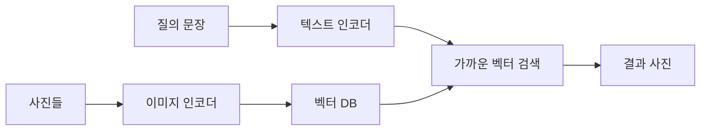

# 이미지-텍스트 검색

> 이미지-텍스트 검색은 CLIP 같은 모델로 사진과 문장을 같은 벡터 공간에 넣고, 가까운 것끼리 찾아 "문장으로 사진 찾기"(또는 반대)를 하는 응용이다.

## 쉽게 말하면
도서관에서 사진과 설명 카드를 같은 지도 위에 꽂아 두는 것과 같다. "해변의 강아지"라고 물으면 지도에서 그 문장 위치 근처에 꽂힌 사진들을 가져온다. 사진 하나하나에 태그를 달 필요가 없다.

## 자세히
- 바탕: CLIP(arXiv 2103.00020, 2021). 인터넷에서 모은 4억 개의 (이미지, 텍스트) 쌍으로 "어떤 캡션이 어떤 이미지와 짝인지"를 맞히도록 학습했다. 이미지 인코더와 텍스트 인코더가 같은 차원의 벡터를 내고, 내적이 유사도가 된다(HF transformers 문서 v5.22.2).
- 검색 절차: ① 사진 전체를 미리 임베딩해 벡터 DB에 저장 ② 질의 문장을 임베딩 ③ 가장 가까운 벡터 k개를 반환. 사진→사진, 사진→문장 검색도 같은 방식이다.
- 장점: 별도 라벨 없이 자연어로 새 개념을 질의할 수 있다(zero-shot). 한계: 세밀한 수량·위치 관계, 글자 인식에는 약할 수 있다(*일반적 평가, 이번 출처에서 직접 확인하지 않음*).
- 실무에서는 [임베딩](#embedding-clip)과 벡터 DB, [RAG](#rag) 파이프라인에 이미지를 끼우는 형태로 쓴다.

## 그림으로 보기



## 예시
```python
from transformers import pipeline
clip = pipeline("zero-shot-image-classification", model="openai/clip-vit-base-patch32")
clip(image_url, candidate_labels=["a photo of a cat","a photo of a dog","a photo of a car"])
```
(HF 문서의 예시.) 사내 사진·상품 이미지에서 "빨간 가죽 가방" 같은 문장으로 후보를 뽑는 데 쓴다.

## 헷갈리는 것과 비교
| 개념 | 차이 |
|---|---|
| 이미지-텍스트 검색 | 두 모달리티를 임베딩으로 비교해 찾기 |
| [Zero-shot CLIP 분류](#zero-shot-clip) | 후보 라벨 중 고르기(분류) |
| 캡셔닝 | 사진에서 문장을 생성 |
| 키워드 검색 | 태그·글자 일치 기반 |

## 더 읽을거리
- [CLIP 논문 (arXiv 2103.00020)](https://arxiv.org/abs/2103.00020) — 초록.
- [HF transformers CLIP](https://huggingface.co/docs/transformers/model_doc/clip) — 사용법과 예제.
