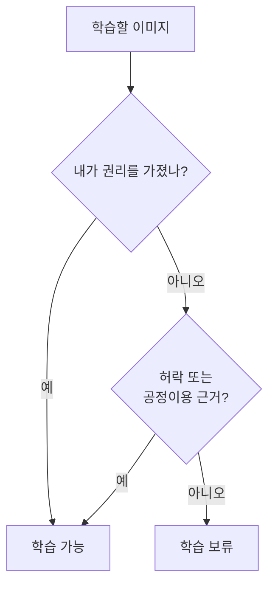
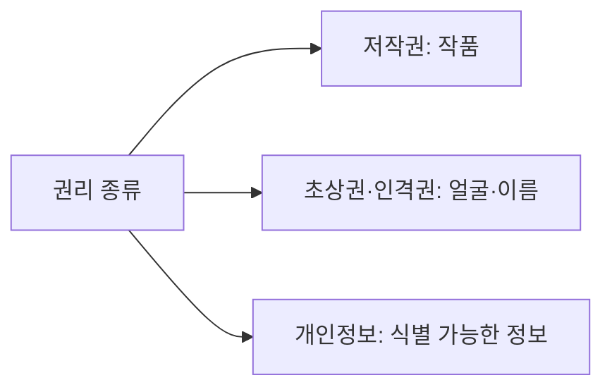

# 학습 데이터 저작권·초상권

> LoRA·DreamBooth 같은 미세조정에 쓰는 사진·그림에는 저작권과 초상권(인격권)·개인정보 문제가 따라붙으므로, 학습 전에 권리를 확인해야 한다.

## 쉽게 말하면
남의 그림을 보고 따라 그리는 연습은 괜찮아도, 그 그림을 복제해 상품으로 팔거나 남의 얼굴로 가짜 사진을 만들면 문제가 된다. AI 학습도 "무엇을 어디에 쓰느냐"가 핵심이다.

## 자세히
이번 웹 검색 결과 기준(법률 자문 아님, 최신 확인 필요):
- 한국 문화체육관광부·한국저작권위원회가 생성형 AI 학습의 공정이용(fair use) 가이드를 냈다. 데이터 수집·전처리·학습 과정에서 저작물이 복제될 수 있어 **권리자 허락이 기본이고 공정이용 같은 예외가 있을 때만 예외**라는 취지이며, 판단 요소는 이용 목적·저작물 종류·이용 분량·시장 영향 4가지다.
- 기존 문체부 안내는 AI 사업자가 정당한 이용 권한을 확보하고 기존 저작물과 동일·유사한 출력을 피하라고 권고했고, 권리자의 학습 거부(opt-out)를 장려했다. 한국의 법적 입장은 아직 정리 중(주장: 사전 허락 의무 조항 논의, 표준계약 배포 계획).
- **초상권·LoRA**는 이번 검색에서 직접적인 한국 지침을 찾지 못했다. 개인정보보호법과 민법상 인격권 판례를 별도로 확인해야 한다(미확인).
- 실무 체크리스트(일반 관행): ① 직접 촬영·권리를 가진 이미지만 쓰기 ② 타인 얼굴은 서면 동의 ③ 특정 작가 화풍·캐릭터 모사 금지 ④ 학습 데이터 출처 기록 ⑤ 결과물의 상업 이용 전 약관·라이선스 확인.

## 그림으로 보기

## 예시
자사 제품 사진 20장으로 [DreamBooth](#dreambooth) 학습은 직접 촬영본이라 비교적 안전하다. 반면 유명인 사진으로 LoRA를 만들어 광고에 쓰는 것은 초상권 문제 위험이 크다(일반적 판단, 법률 검토 필요).

## 헷갈리는 것과 비교
| 개념 | 차이 |
|---|---|
| 저작권 | 창작물(작품)에 대한 권리 |
| 초상권 | 얼굴·모습 이용에 대한 권리 |
| 공정이용 | 허락 없이 쓸 수 있는 예외(4요소로 판단) |
| [AI 안전·윤리](#ai-safety) | 더 넓은 책임 있는 AI 틀 |

## 더 읽을거리
- 한국 생성형 AI 학습 공정이용 가이드(문화체육관광부·한국저작권위원회) — 웹 검색 결과로만 확인했고 원문은 열어 보지 못했다. 공식 사이트에서 최신본을 확인할 것.
