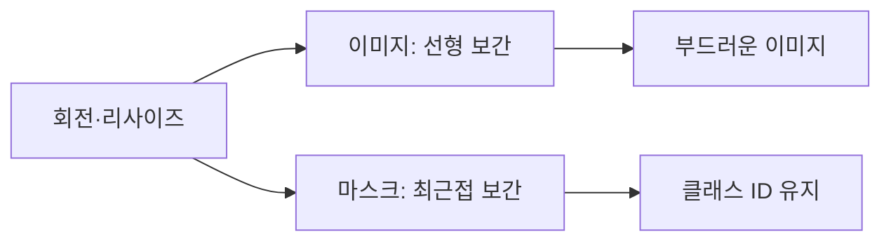
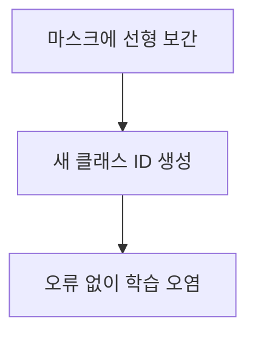

# 이미지·마스크 보간 분리

> 회전·리사이즈처럼 픽셀을 다시 계산하는 증강에서, **이미지에는 부드러운 보간(선형 등)을, 마스크(클래스 ID 이미지)에는 최근접 보간을** 따로 지정해야 한다. 마스크에 부드러운 보간을 쓰면 존재하지 않는 클래스 ID가 생긴다.

## 쉽게 말하면
색 사진은 이웃 색을 섞어도 자연스럽지만, "1번=고양이, 5번=개" 같은 번호표를 섞으면 3번(없는 동물)이 나온다. 번호표는 가장 가까운 칸의 번호를 그대로 베껴 와야 한다.

## 자세히
- Albumentations 2.0.8은 변환마다 `interpolation`(이미지)과 `mask_interpolation`(마스크)을 따로 받는다(예: `RandomSizedBBoxSafeCrop`의 기본값은 이미지 1=선형, 마스크 0=최근접).
- 직접 실험(64×64 마스크, 클래스 ID 0·1·5·9, `Rotate(30°)` + `Resize(100,100)`):
  | mask_interpolation | 증강 후 마스크의 고유 값 개수 | 값 |
  |---|---|---|
  | NEAREST(0) | 4 | 0, 1, 5, 9 (원래와 같음) |
  | LINEAR(1) | 10 | 0~9 사이 여러 값 — **2·3·4·6·7·8이 새로 생김** |
  | CUBIC(2) | 12 | 0~11 — 원래 최대값 9보다 큰 값까지 생김 |
- 해석: 경계 픽셀에서 이웃 클래스 ID를 평균·보간하면 존재하지 않는 값이 생긴다(1과 5 사이 3 등). 3차 보간(CUBIC)은 오버슈트로 원래 범위를 넘는 값(10, 11)까지 만든다. 결과 dtype은 uint8로 유지되어 **오류 없이** 지나간다([조용한 데이터 버그](#silent-data-bugs)).
- 규칙: 마스크는 클래스 ID이므로 `mask_interpolation=cv2.INTER_NEAREST`(=0) 유지. 이미지에만 선형·3차·면적 보간을 선택한다. 확률 마스크(소프트 라벨)라면 예외적으로 부드러운 보간이 가능하다(제안).
- 구버전은 마스크 보간이 변환에 고정돼 있거나 `mask_interpolation` 인자가 없을 수 있어 설치 버전을 확인한다(추정, 버전 차이 점검 필요).

## 그림으로 보기



## 예시
```python
A.Compose([A.Rotate(limit=30, interpolation=cv2.INTER_LINEAR,
                    mask_interpolation=cv2.INTER_NEAREST)])
```
- 교육: 세그멘테이션 라벨이 "그림"이 아니라 "번호표"라는 점을 가르치는 사례.

## 헷갈리는 것과 비교
| 개념 | 차이 |
|---|---|
| 이미지 보간 | 색 값을 섞어도 됨 |
| 마스크 보간 | 클래스 ID는 섞으면 안 됨 |
| [마스크 값 집합 테스트](#mask-unique-unit-test) | 보간 오류를 `np.unique`로 검출 |

## 더 읽을거리
- [Albumentations 문서](https://albumentations.ai/docs/) — `interpolation`·`mask_interpolation` 인자 확인.
- 직접 실행: Albumentations 2.0.8 마스크 보간 3종 비교.
