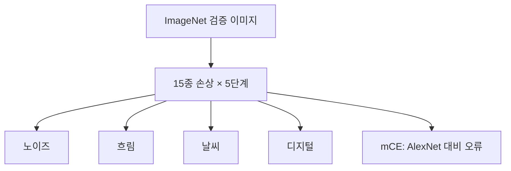

# ImageNet-C·ImageNet-P

> ImageNet-C는 ImageNet 검증 이미지에 흔한 손상(노이즈·흐림·날씨·디지털 변형) 15종을 5단계 강도로 입힌 **견고성 벤치마크**이고, ImageNet-P는 손상이 조금씩 변하는 영상 시퀀스에서 **예측이 얼마나 자주 뒤집히는지** 재는 벤치마크다(Hendrycks & Dietterich, ICLR 2019).

## 쉽게 말하면
시력 검사표를 또렷하게만 읽던 사람에게 안개·빗방울·흐린 렌즈 낀 표를 보여 주는 시험이다. 정상 조건 점수와 별개로 "조금만 환경이 나빠져도 무너지는가"를 본다. P는 같은 장면을 조금씩 흔들었을 때 답이 오락가락하는지 본다.

## 자세히
- **ImageNet-C(논문 ar5iv 직접 확인)**: 15개 손상 유형이 noise·blur·weather·digital 4범주. 유형마다 **5단계 강도**, 총 75종. 과적합을 막기 위해 범주마다 검증용 손상 1종(speckle noise, Gaussian blur, spatter, saturate)을 따로 둔다.
- **mCE(mean Corruption Error)**: 손상별로 5단계 오류를 합산해 AlexNet의 같은 값으로 나눈 비율의 15종 평균. 즉 AlexNet 대비 상대 오류.
- **ImageNet-P와 mFR**: 영상 시퀀스에서 연속 프레임 간 예측이 바뀌는 확률(Flip Probability)을 AlexNet 대비로 표준화한 Flip Rate의 평균이 mFR.
- **핵심 발견(논문 초록, arXiv 1903.12261)**: AlexNet 시대에서 ResNet 시대까지 **상대적 손상 견고성은 거의 개선되지 않았다**("negligible changes"). 또 적대적 방어를 우회한 방법이 일반 섭동 견고성을 크게 높여 준다고 보고한다. 이 벤치마크는 최악 사례를 겨냥한 적대적 공격이 아니라 **흔한** 손상을 다룬다.
- **저장소(GitHub hendrycks/robustness, 직접 확인)**: Apache-2.0(데이터셋 별도 라이선스는 페이지에서 확인 못 함). 리더보드 값: ImageNet-C ResNet-50 mCE 76.7%, DeepAugment+AugMix 53.6%. ImageNet-P mFR ResNet-50 58.0%, AugMix 37.4%. Tiny ImageNet-C(200클래스 64×64), CIFAR-10/100-C·P도 제공. 결정론적 결과를 위해 제공된 JPEG로 평가하길 권한다. (리더보드 수치는 확인 시점의 것이다.)
- **한계(해석)**: 정해진 합성 손상이라 실제 현장 변화(새 장비·지역)는 [WILDS 벤치마크](#wilds-benchmark)가 더 가깝다.

## 그림으로 보기

## 예시
- 공장 불량 검출 모델을 배포하기 전, 노이즈·흐림 손상 5단계에서 성능이 어떻게 떨어지는지 곡선으로 확인.
- 교육 소재: 같은 사진에 손상 강도를 올리며 모델 예측이 바뀌는 지점을 보여 주는 데모.

## 헷갈리는 것과 비교
| 개념 | 차이 |
|---|---|
| ImageNet-C | 정지 이미지 손상 |
| ImageNet-P | 연속 섭동에서 예측 안정성 |
| [적대적 사례](#adversarial-examples) | 일부러 만든 최악 입력 |
| [WILDS 벤치마크](#wilds-benchmark) | 실제 분포 변화 |
| [변형 강도 단계](#perturbation-severity-levels) | 약함→강함 곡선 |

## 더 읽을거리
- [Benchmarking Neural Network Robustness (arXiv 1903.12261)](https://arxiv.org/abs/1903.12261) — 논문 초록과 ar5iv 본문(직접 확인).
- [hendrycks/robustness (GitHub)](https://github.com/hendrycks/robustness) — 다운로드·리더보드(직접 확인).
