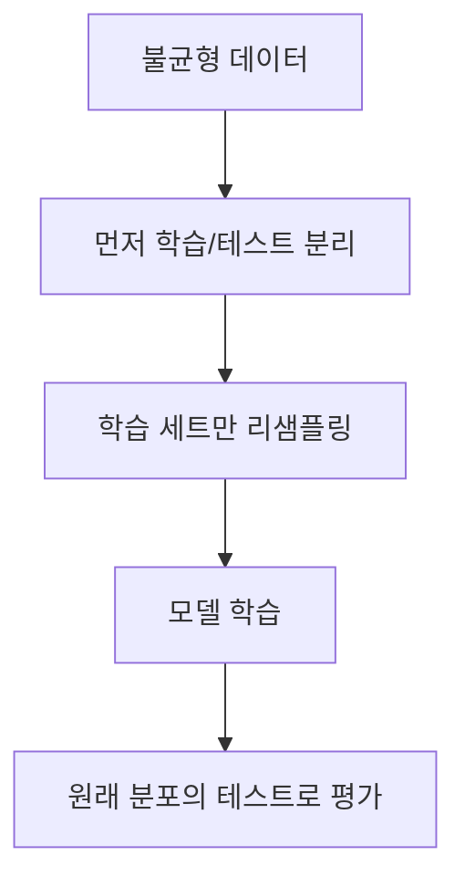

# 불균형 데이터 (Imbalanced Data)

> 불균형 데이터는 한쪽 클래스(예: 사기 거래)가 다른 쪽보다 훨씬 적은 데이터로, 정확도가 높아도 소수 클래스를 못 찾는 모델이 나오기 쉽다.

## 쉽게 말하면
1000명 중 10명만 걸리는 병이 있을 때 "모두 건강"이라고 답하면 정확도 99%지만 환자는 한 명도 못 찾는다. 이런 착시가 불균형 데이터의 문제다.

## 자세히
- 평가: scikit-learn 문서는 정확도가 다수 클래스만 찍어도 높게 나온다고 경고하며, balanced accuracy(클래스별 재현율의 macro 평균)·소수 클래스의 recall·[F1](#f1-score), `classification_report`를 쓰라고 한다. 예: 정확도 0.833인 모델의 balanced accuracy는 0.75.
- 대응법(imbalanced-learn 사용자 가이드 목차 기준): 소수 클래스를 늘리는 **오버샘플링**(무작위, SMOTE, ADASYN), 다수 클래스를 줄이는 **언더샘플링**(무작위, Tomek links, ENN 등), 둘을 합친 **조합**, 균형을 내장한 **앙상블**. (클래스 가중치는 이번에 열어 본 페이지에 없음 — 일반적으로 쓰는 또 다른 방법.)
- **가장 큰 함정은 데이터 누수**: 전체를 리샘플링한 뒤 분할하면 테스트 세트가 비현실적으로 균형 잡히고 정보가 새어 성능이 부풀려진다. 해당 가이드 예시에서 전체 리샘플링 후 교차검증 0.724 vs 홀드아웃 0.698. imblearn `Pipeline`으로 **학습 폴드에만** 리샘플링하면 0.732 vs 0.727로 일치.
- 어떤 오류가 더 비싼지(놓침 vs 오탐)에 따라 임계값 조정도 함께 고려한다.

## 그림으로 보기



## 예시
```python
from imblearn.pipeline import make_pipeline
from imblearn.under_sampling import RandomUnderSampler
from sklearn.ensemble import HistGradientBoostingClassifier
from sklearn.model_selection import cross_validate
model = make_pipeline(RandomUnderSampler(random_state=0), HistGradientBoostingClassifier(random_state=0))
cross_validate(model, X, y, scoring="balanced_accuracy")
```
이상 거래·불량품 탐지·민원 긴급도 분류처럼 소수가 중요한 업무에서 필수 점검 항목이다.

## 헷갈리는 것과 비교
| 개념 | 차이 |
|---|---|
| 오버샘플링 | 소수 클래스를 늘려 균형 |
| 언더샘플링 | 다수 클래스를 줄임(정보 손실) |
| [혼동 행렬](#confusion-matrix) | 오류 유형을 보는 도구 |
| [이상 탐지](#anomaly-detection) | 극소수를 정상과 구분하는 문제 설정 |

## 더 읽을거리
- [imbalanced-learn: Common pitfalls](https://imbalanced-learn.org/stable/common_pitfalls.html) — 리샘플링의 데이터 누수와 Pipeline 해법.
- [imbalanced-learn User Guide](https://imbalanced-learn.org/stable/user_guide.html) — 오버·언더샘플링 기법 목록.
- [sklearn Model evaluation](https://scikit-learn.org/stable/modules/model_evaluation.html) — balanced accuracy와 불균형 주의.
