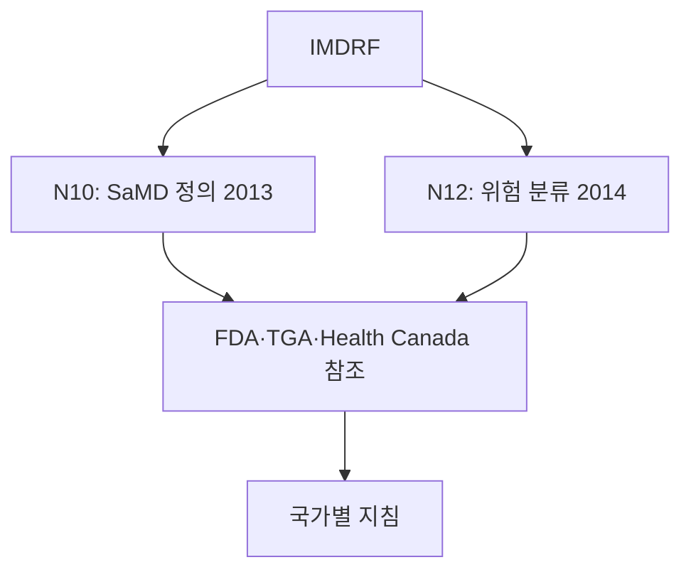

# IMDRF

> 국제의료기기규제당국자포럼(International Medical Device Regulators Forum). 각국 의료기기 규제기관이 규제를 조화시키려는 모임으로, SaMD 용어(N10, 2013)와 위험 분류 틀(N12, 2014)을 만들었다.

## 쉽게 말하면
나라마다 다른 교통법규를 맞추려는 국제 회의체다. "소프트웨어 의료기기"를 모두 같은 단어로 부르기로 정한 곳이 여기다.

## 자세히
출처: 검색 결과 요약(IMDRF 원 사이트는 503으로 열리지 않음).
- **SaMD 정의 문서**: N10(2013). 의료 목적을 가진, 하드웨어 의료기기의 일부가 아닌 소프트웨어. 하드웨어 기기를 구동하는 목적이거나 그 기기의 의도 의료 목적에 필수인 소프트웨어는 SaMD가 아니다. FDA·캐나다·호주 TGA 등이 사용한다고 한다. FDA가 문구를 그대로 채택했는지는 자료가 엇갈려 확인하지 못했다.
- **위험 분류 틀**: N12(2014) — [SaMD 위험 분류](#samd-risk-categorization).
- **품질관리 문서**: SaMD QMS(2015, 문서 번호 N23으로 알려짐, 이 글에서 직접 확인 안 함).
- **성격**: IMDRF 문서는 권고이며, 각국 법이 되는 것은 아니다. 각 나라가 참조해 자체 지침을 낸다(예: 싱가포르 HSA).
- AI·ML 의료기기 관련 제안·용어 문서도 IMDRF 활동에 포함되지만 이번에 확인하지 않았다.

## 그림으로 보기

## 예시
- 한국 업체가 AI 소프트웨어를 미국·EU에 동시에 내놓을 때 IMDRF의 공통 용어·범주로 분류 논리를 설명하면 각국 규제 문서 작성이 쉬워진다.

## 헷갈리는 것과 비교
| 개념 | 차이 |
|---|---|
| IMDRF | 국제 포럼, 권고 문서 |
| FDA | 미국 규제 기관, 법적 권한 |
| [SaMD](#samd) | IMDRF가 정의한 개념 |

## 더 읽을거리
- [IMDRF/SaMD WG/N12](https://imdrf.org/sites/default/files/docs/imdrf/final/technical/imdrf-tech-140918-samd-framework-risk-categorization-141013.pdf) — 위험 분류 문서
- [SaMD vs SiMD (PURE Global)](https://www.pureglobal.com/blog-posts/samd-software-as-a-medical-device-fda-eu-mdr-guide) — 정의 비교(검색 결과로만 확인)
