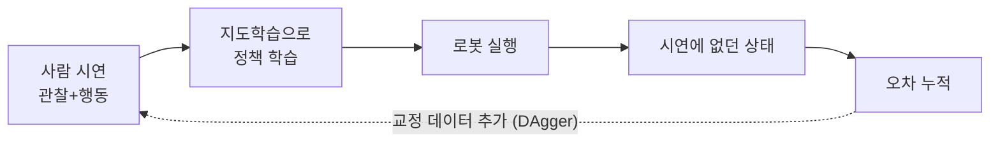
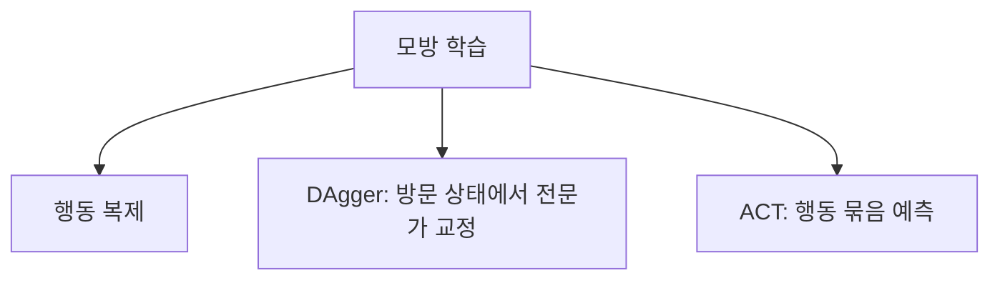

# 모방 학습

> 보상 함수를 설계하는 대신 **사람이 보여 준 시연(관찰 → 행동 쌍)을 따라 하도록** 정책을 학습하는 방식. 로봇 조작·자율주행에서 가장 기본이 되는 학습 방법이다.

## 쉽게 말하면
요리를 배울 때 레시피 이론 대신 숙련자 옆에서 손동작을 보고 따라 하는 것과 같다. 빨리 배우지만, 숙련자가 한 번도 안 보여 준 상황(국이 넘치기 직전)에선 어찌할 바를 모른다.

## 자세히
- 가장 단순한 형태는 **행동 복제(behavior cloning)**: 시연 데이터 (관찰, 행동)을 정답 라벨로 보고 지도학습으로 정책을 맞춘다. 강화학습처럼 보상 설계·무수한 시행착오가 필요 없다.
- 핵심 약점은 **분포 이동과 오차 누적**. 정책이 조금 틀리면 시연에 없던 상태로 가고, 거기서 더 틀려 오차가 시간에 따라 커진다. Ross·Gordon·Bagnell(2011, arXiv 1011.0686)은 이를 순차 예측이 i.i.d. 가정을 깬다는 문제로 보고, 정책이 실제로 방문하는 상태에서 전문가 교정을 받는 반복 알고리즘(DAgger)을 제안했다.
- **ALOHA/ACT**(Zhao 외, 2023, arXiv 2304.13705): 저가 양팔 원격조종 장치로 시연을 모으고, 행동을 한 번에 여러 스텝 묶음(chunk)으로 예측하는 ACT로 학습. 논문 초록 기준 정밀 조작 6개 과제에서 약 10분 분량 시연으로 성공률 80~90%. 오차 누적이 핵심 난제라고 명시한다(구체적 완화 원리는 본문 확인 필요 — 나는 초록만 읽음).
- 요즘 VLA 모델의 사전학습도 대부분 사람 원격조종 시연에 기대므로 [시연 데이터 품질](#demonstration-quality)이 성능을 좌우한다.
- 한계: 시연자 수준이 상한선, 시연 수집 비용, 시연 밖 상황에 취약.

## 그림으로 보기

## 예시
- 사람이 원격조종 장치로 컵 열기를 50번 시연 → 카메라 이미지·관절 값을 입력, 다음 행동을 출력하도록 학습.
- 교육: "강화학습 vs 모방 학습"을 사람 학습(시행착오 vs 도제식)에 빗대 설명.

## 헷갈리는 것과 비교
| 개념 | 차이 |
|---|---|
| 모방 학습 | 시연을 따라 함, 보상 불필요 |
| 강화학습 | 보상을 최대화하며 시행착오 |
| [ALOHA와 ACT](#aloha-act) | 모방 학습의 대표 하드웨어·알고리즘 |

## 더 읽을거리
- [ALOHA/ACT 논문](https://arxiv.org/abs/2304.13705) — 저가 양팔 시스템과 ACT(초록 읽음).
- [DAgger 논문](https://arxiv.org/abs/1011.0686) — 순차 문제의 i.i.d. 위반(초록 읽음).
