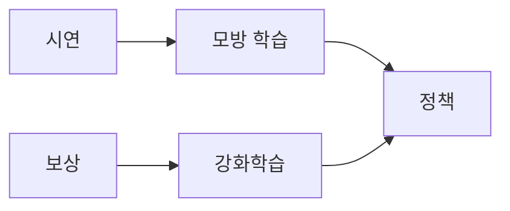
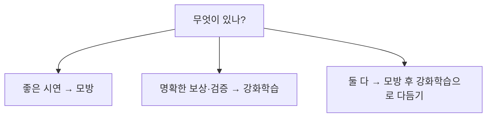

# 모방 학습 vs 강화학습

> **모방 학습**은 사람의 시연을 따라 하며 배우고, **강화학습**은 보상 신호를 최대화하며 시행착오로 배운다. 필요한 것(시연 vs 보상 설계·탐색)과 한계가 서로 다르다.

## 쉽게 말하면
요리를 배울 때 숙련자 옆에서 보고 따라 하는 것(모방)과, 맛 점수만 받고 스스로 이것저것 해 보는 것(강화)의 차이다. 따라 하기는 빠르지만 스승을 넘기 어렵고, 시행착오는 느리지만 스스로 방법을 찾을 수 있다.

## 자세히
- 모방: 시연 데이터가 필요하고 보상이 필요 없다. 약점은 [오차 누적](#compounding-error)(T²ε)과 시연자 수준이 상한이라는 점. ACT는 약 10분 분량(과제당 시연 50개)으로 정밀 조작 6과제에서 80~90% 성공을 보고했다([ALOHA와 ACT](#aloha-act), 저자 보고).
- 강화학습: 보상을 정의해야 하고 탐색이 필요하다. 자동 채점이 되는 문제에서는 사람 예시 없이 강화학습만으로 추론 능력을 개발했다는 DeepSeek-R1 초록의 주장이 있다([검증 가능한 보상 RL](#rl-verifiable-rewards)).
- 둘의 접점: 사람 시연 데이터에서 **오프라인 강화학습**을 쓰면 robomimic 연구(검색 요약)에서 배치 오프라인 RL이 **최적이 아닌 사람 데이터에 약했다**([시연 데이터 품질](#demonstration-quality)). 즉 데이터 품질이 낮을 때 모방이 더 안정적일 수 있고, 반대로 정답을 자동 검증할 수 있으면 강화학습이 유리하다(해석).
- 선택 기준(내 정리): 좋은 시연을 모을 수 있다 → 모방. 보상·검증이 명확하고 시뮬레이션이 값싸다 → 강화학습. 둘을 섞어 모방으로 시작해 강화학습으로 다듬는 방식도 널리 쓰인다(일반 설명, 이번 출처로 확인하지 않음).
- 한계: 이 글은 서로 다른 분야(로봇·LLM) 사례를 묶었으므로 직접 성능 비교가 아니다.

## 그림으로 보기

## 예시
- 로봇 팔 정밀 조작: 사람 시연 수집(모방). 수학 풀이 모델: 자동 정답 채점(강화).
- 교육: "스승 따라 하기 vs 시행착오"를 사내 신입 교육 방식에 빗대어 토론.

## 헷갈리는 것과 비교
| 개념 | 차이 |
|---|---|
| 모방 학습 | 시연이 정답 |
| 강화학습 | 보상이 정답 |
| [행동 복제](#behavior-cloning) | 모방 학습의 가장 단순한 형태 |

## 더 읽을거리
- [DeepSeek-R1](https://arxiv.org/abs/2501.12948) — RL만으로 추론(초록 읽음).
- [robomimic 연구](https://robomimic.github.io/study) — 오프라인 RL과 사람 데이터(검색 결과 확인).
