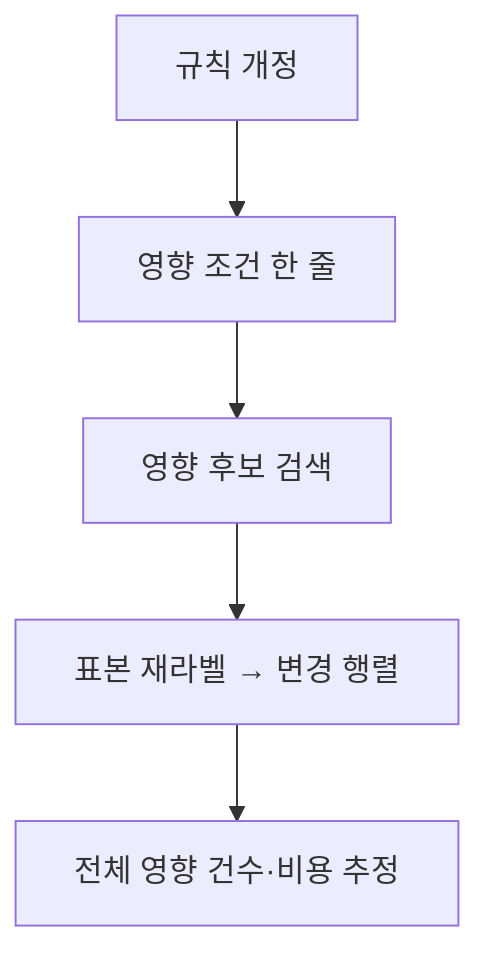
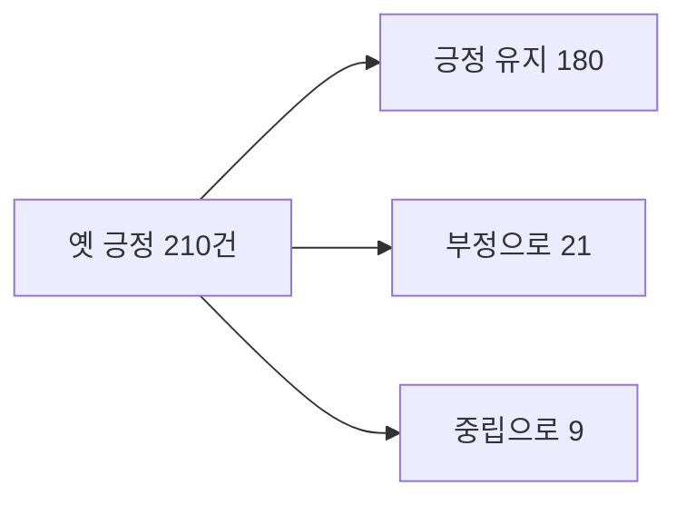

# 규칙 변경 영향 분석

> 규칙 변경 영향 분석은 규칙서 개정이 기존 라벨 중 어떤 클래스·경계·하위 유형에 영향을 주는지, 얼마나 되는지를 재라벨 전에 정의하고 추정하는 일이다. 재라벨 범위와 우선순위를 정하는 근거가 된다.

## 쉽게 말하면
법을 고쳤을 때 "어느 조항·어떤 유형의 사건이 달라지는가"를 먼저 정리해야, 모든 옛 사건을 뒤질 필요 없이 필요한 부분만 다시 본다.

## 자세히
- **분석 단계(해석)**: ① 개정 내용을 한 줄 조건으로 표현("반어 표현이 있는 긍정 라벨 → 부정 가능") ② 영향받는 클래스와 경계 쌍 정의(긍정↔부정, 긍정↔중립) ③ 영향 후보 찾기([재검토 검색식](#relabel-query)) ④ 후보에서 표본을 재라벨해 변경 행렬 추정([재라벨 표본 시험](#relabel-sample-test)) ⑤ 전체 영향 건수 추정과 비용 계산([라벨링 비용 모델](#annotation-cost-model)).
- **변경 행렬(직접 계산 예, 가상 300건 표본 재라벨 결과: 행=옛 라벨, 열=새 라벨)**:

| 옛 \ 새 | 긍정 | 부정 | 중립 | 행 합 |
| --- | --- | --- | --- | --- |
| 긍정 | 180 | 21 | 9 | 210 |
| 부정 | 0 | 24 | 0 | 24 |
| 중립 | 0 | 6 | 60 | 66 |

  변경된 라벨은 36건으로 12%다. 옛 "긍정" 중 14.3%(30/210)가 바뀌었고 옛 "부정"은 하나도 안 바뀌었다. 가장 큰 흐름은 긍정→부정(21건)과 중립→부정(6건)이어서 개정은 "부정 쪽으로 이동"시킨다. 이 숫자는 가상 표본이며 구조(변경 행렬)가 중요하다. 혼동 행렬 읽는 법은 [라벨러 간 혼동 행렬](#annotator-confusion-matrix)과 같다.
- **영향 범위 추정(해석)**: 옛 클래스별 변경률 × 클래스별 전체 건수로 전체 변경 건수를 추정한다. 예를 들어 전체 긍정 라벨이 8,000건이고 변경률 14%라면 약 1,120건이 바뀔 것으로 본다(계산 예).
- **주의(해석)**: 영향 후보를 찾는 검색식이 놓치는 것(미탐)도 있다. 범위 밖 표본으로 확인한다. 변경이 없는 클래스(위 표의 부정)는 재라벨 대상에서 제외해 비용을 줄인다.
- **연결**: 어느 샘플부터 고칠지는 [재라벨 우선순위](#relabel-prioritization), 결과는 새 데이터셋 버전으로 저장한다([재라벨 후 데이터셋 버전](#dataset-version-after-relabel)).

## 그림으로 보기

## 예시
- 위 변경 행렬로 "부정 라벨은 영향 없음"을 확인하고 긍정·중립 라벨만 재라벨 대상으로 한다.
- 교육 활용: 규칙 개정안을 하나 정해 표본 30건을 재라벨하고 변경 행렬을 직접 만든다.

## 헷갈리는 것과 비교
| 개념 | 차이 |
| --- | --- |
| 영향 분석 | 어디가 얼마나 바뀌는지 정의·추정 |
| [재라벨 표본 시험](#relabel-sample-test) | 변경률로 재라벨 여부 결정 |
| [재검토 검색식](#relabel-query) | 후보를 찾는 쿼리 |
| [재라벨 우선순위](#relabel-prioritization) | 어떤 순서로 고칠지 |

## 더 읽을거리
- [scikit-learn 모델 평가: confusion matrix](https://scikit-learn.org/stable/modules/model_evaluation.html#confusion-matrix) — 행·열 의미(변경 행렬 읽기에 같은 방식)
- [Sample size determination (Wikipedia)](https://en.wikipedia.org/wiki/Sample_size_determination) — 표본 크기
