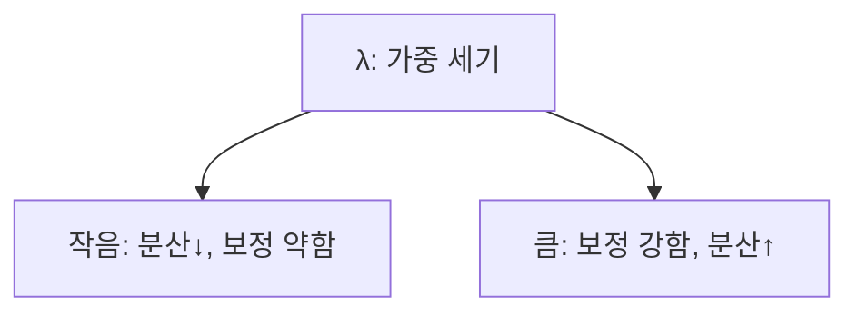

# 중요도 가중

> 공변량 이동에서 **학습 표본의 손실에 `w(x) = p_test(x) / p_train(x)` 비율을 곱해**, 학습 손실의 기댓값이 시험(배포) 분포의 기댓값과 같아지게 하는 보정법. Shimodaira(2000)가 표준 참고 문헌이다.

## 쉽게 말하면
설문조사에서 20대가 너무 많이 응답했다면, 20대 응답의 비중을 낮추고 부족한 연령대의 비중을 높여 전체 인구에 맞추는 것과 같다.

## 자세히
(검색 요약 기준. 2000년 원 논문은 직접 열람하지 못했다.)
- 가정: 입력 분포는 다르고(`p_tr(x) ≠ p_te(x)`) 조건부 관계는 같다(`p_tr(y|x) = p_te(y|x)`). 곧 [공변량 이동](#covariate-shift).
- 방법: 로그우도 항을 중요도 `w(x) = p_te(x)/p_tr(x)`로 가중. 이렇게 하면 학습 데이터의 기대 손실이 시험 데이터의 기대 손실과 같아진다.
- 이유: 공변량 이동 아래서 표준 최대우도는 일관적이지 않지만, 입력 밀도 비율로 가중한 방식은 **일관적**이며 가중 최대우도 추정량은 목표 위험의 최소화점으로 확률 수렴한다고 요약된다.
- 실제 문제: 밀도 비율을 모르므로 추정해야 한다. 원 접근은 두 밀도를 따로 추정(커널 밀도 추정 등), 이후 방법은 비율을 직접 추정한다(커널 평균 매칭, KLIEP).
- **완화(tempering)**: 비율을 λ∈[0,1] 제곱한다. λ가 작으면 값이 1에 가까워져 **가중으로 인한 분산 비용이 줄고**, 크면 보정이 강해진다. λ는 AIC 유형 기준으로 고르는 것이 일반적.
- 주의: Cortes 외(2010)의 일반화 한계는 표본 중요도 가중치의 **2차 모멘트가 유계일 때만** 성립한다. 가중치가 극단적으로 크면 불안정하다.
- 활용(내 정리): 라벨 없는 운영 입력으로 w를 추정해 학습·평가 표본을 재가중할 수 있다.

## 그림으로 보기

## 예시
- 학습 데이터에 실내 사진이 90%, 운영에는 야외 사진이 많다면 야외 표본의 손실에 큰 가중치를 곱한다.
- 교육: 설문 가중치 보정 사례로 개념을 설명.

## 헷갈리는 것과 비교
| 개념 | 차이 |
|---|---|
| 중요도 가중 | 표본 가중으로 분포 차이 보정 |
| 재학습 | 새 데이터를 모아 다시 학습 |
| [공변량 이동](#covariate-shift) | 이 보정이 겨냥하는 이동 |

## 더 읽을거리
- [A Short Survey on Importance Weighting](https://ar5iv.labs.arxiv.org/html/2403.10175) — 중요도 가중 개요(검색 결과 확인).
- [When is Importance Weighting Correction Needed?](https://arxiv.org/pdf/2303.04020) — 필요 조건(검색 결과 확인).
