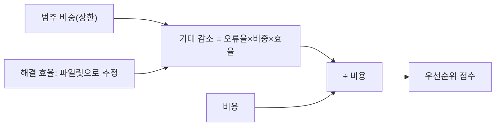
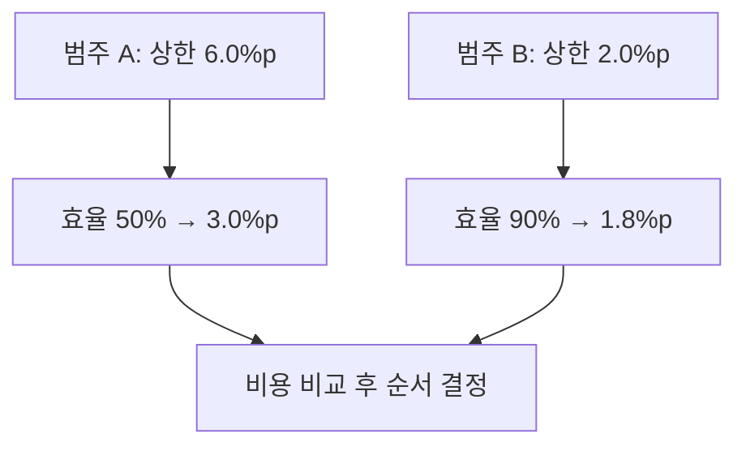

# 상한 vs 실제 효율

> 범주별 개선 **상한(ceiling)** 은 "그 범주를 100% 고칠 때"의 최댓값이다. 실제 기대 효과는 **상한 × 해결 효율(그 범주 오류를 실제로 줄이는 비율)** 이고, 여기에 비용을 나눠야 우선순위가 나온다.

## 쉽게 말하면
식당 불만의 60%가 "대기 시간"이라도, 대기 시간을 절반만 줄일 수 있다면 불만은 30%만 준다. 반면 "메뉴판 오타"가 10%이고 오타는 하루에 다 고칠 수 있다면 값싸게 10%를 없앤다. 큰 상한과 높은 효율, 낮은 비용의 곱을 본다.

## 자세히
- **오류 분석의 기본 절차(Stanford 계열 강의 노트 요약, 열어 확인)**: ① 틀린 개발 세트 예시를 무작위로 약 100개 뽑고 ② 범주를 사람이 분류하고 ③ 범주별 영향받는 비율을 센다. 규칙: 오류의 약 5%에 영향을 주는 문제는 중요도가 낮고 약 50%면 중요하다. 예: 흐림 20%·뒤집힘 50%·라벨 오류 30% → 뒤집힌 이미지 수정이 최우선. 분석에 최소 약 50~100개 오류가 필요하고 오류율 ε이면 개발 세트 약 100/ε(5%면 약 2,000개)를 권한다.
- **기대 효과 공식**: 기대 감소 = 오류율 × 범주 비중 × 해결 효율. 예(가정): 전체 오류율 10%, 범주 A 비중 60%·효율 50% → 10% × 0.6 × 0.5 = 3.0%p 감소(상한 6.0%p의 절반). 범주 B 비중 20%·효율 90% → 1.8%p.
- **효율(해결 가능성)을 어떻게 추정하나**: 소규모 파일럿(해당 범주 예시 20개에 수정을 적용해 몇 개가 해결되는지), 사람의 해결 가능성(사람도 못 맞히는 예시는 효율 낮음), 이전 유사 개선의 경험치.
- **비용까지 넣은 점수**: 우선순위 = (상한 × 효율) / 비용(인일·데이터 라벨링·지연). 상한이 큰데 효율이 낮고 비싼 범주(예: 근본적 모호성)는 뒤로 미룬다.
- **주의**
  - 한 예시가 여러 범주에 속하면 비중 합이 100%를 넘고 효과가 겹치므로 단순 합산 금지([중복 오류 범주](#overlapping-error-categories)).
  - 한 범주를 고치면 다른 범주 오류가 늘 수 있다(트레이드오프).
  - 비중 자체가 표본 추정치이므로 [구간](#category-share-confidence-interval)을 함께 본다.

## 그림으로 보기

## 예시
| 범주 | 비중 | 효율 | 비용(인일) | 기대 감소(%p, 오류율 10%) | 점수 |
|---|---|---|---|---|---|
| 흐림 | 60% | 30% | 20 | 1.8 | 0.09 |
| 라벨 오류 | 30% | 90% | 3 | 2.7 | 0.90 |
| 형식 위반 | 10% | 95% | 1 | 0.95 | 0.95 |
(가정 수치) 점수로 보면 라벨 오류와 형식 위반이 먼저고 큰 상한의 흐림은 뒤로 간다.

## 헷갈리는 것과 비교
| 개념 | 정의 |
|---|---|
| [상한(ceiling)](#error-category-ceiling) | 범주를 완전히 고칠 때의 최대 감소 |
| 효율 | 실제로 줄이는 비율 |
| 기대 효과 | 상한 × 효율 |
| 우선순위 점수 | 기대 효과 ÷ 비용 |

## 더 읽을거리
- [Kuleshov: Lecture 21 Model Iteration and Improvement](https://kuleshov-group.github.io/aml-resources/notes_html/lecture21-model-iteration.html) — 오류 분석 절차·우선순위 규칙·예(앞부분 열어 확인; 이 글에 '상한 분석'은 없음).
- Ng, Machine Learning Yearning — 오류 분석 장(검색에서 초안 목록만 확인, 본문 미열람).
