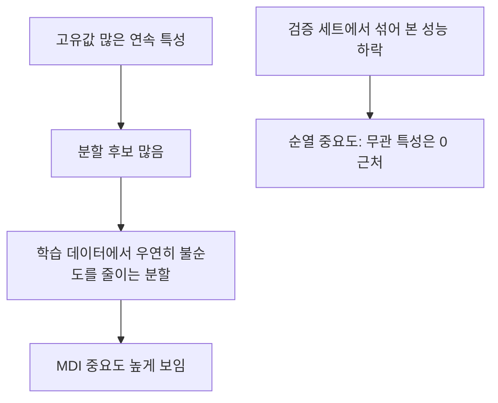

# 불순도 중요도의 편향

> 랜덤 포레스트 같은 트리 모델의 기본 특성 중요도(MDI, 불순도 감소 기반)는 **값의 종류가 많은(고유값이 많은) 수치형 특성에 치우쳐** 무관한 특성도 중요해 보이게 만들 수 있다. 순열 중요도는 이 편향을 피한다고 scikit-learn 문서가 설명한다.

## 쉽게 말하면
시험 문제를 나누는 질문이 많을수록 우연히 정답과 맞는 질문이 하나쯤 생긴다. 값의 종류가 많은 특성은 나눌 방법이 많아 학습 데이터에서 우연히 잘 맞는 분할을 찾기 쉽고, 트리는 그 분할을 "중요하다"고 기록한다.

## 자세히
출처: scikit-learn 순열 중요도 가이드(열어서 읽음: MDI가 높은 카디널리티 수치형 특성에 강하게 편향되며 순열 중요도는 이 편향을 피한다고 서술) + 이 세션의 직접 실험.
- **현상(문서)**: 트리 모델의 불순도 기반 중요도(MDI)는 높은 카디널리티 수치형 특성에 강하게 편향된다. 순열 중요도는 이 편향이 없다.
- **직접 실험(합성, 이 세션)**: 이진 신호 특성(라벨과 약 80% 일치), 무관한 연속 특성, 무관한 이진 특성으로 랜덤 포레스트 분류기(200그루, 기본 설정)를 학습했다.
  - **MDI**: 신호 0.349, 무관 연속 **0.649**, 무관 이진 0.002. 무관한 연속 특성이 신호보다 높게 나왔다.
  - **순열 중요도(검증 세트)**: 신호 0.161, 무관 연속 −0.006, 무관 이진 −0.011. 신호만 양의 값.
  - 학습 정확도 1.0, 검증 정확도 0.653: 과적합된 상태에서 MDI는 학습 데이터의 우연한 분할을 반영했다.
  - 한 가지 합성 설정의 결과이며 일반적 크기를 뜻하지 않는다.
- **원인(일반 설명)**: 연속 특성은 가능한 분할 지점이 많아 학습 데이터에서 불순도를 우연히 줄이는 분할을 찾을 기회가 많다. MDI는 학습 데이터 기준이라 과적합된 분할도 중요도로 센다. 이 설명은 문서가 직접 서술한 것이 아니라 현상의 일반적 이유다.
- **대응**: 검증 세트에서 순열 중요도를 계산하거나, 무관한 난수 특성을 일부러 넣어 기준선으로 삼아 비교한다. 상관 특성이 있으면 순열 중요도도 과소평가될 수 있다는 점에 유의([순열 중요도](#permutation-importance)).

## 그림으로 보기

## 예시
- 신용 모델 감사: 고유값이 많은 연속형 변수(예: 정밀한 거래 금액)가 MDI 상위인데 순열 중요도는 낮다면 과적합이나 편향을 의심한다.
- 점검: 난수 열 하나를 추가해 그 중요도보다 낮은 특성은 해석에서 제외.

## 헷갈리는 것과 비교
| 개념 | 차이 |
|---|---|
| MDI(불순도 중요도) | 학습 중 불순도 감소량, 고카디널리티 편향 |
| [순열 중요도](#permutation-importance) | 섞었을 때 성능 하락량, 편향 회피 |
| SHAP 중요도 | 평균 절댓값 기여, 별도 방법 |
| [상관 특성과 순열 중요도](#permutation-importance-correlated) | 순열 중요도의 반대 약점 |

## 더 읽을거리
- [Permutation feature importance (scikit-learn)](https://scikit-learn.org/stable/modules/permutation_importance.html) — MDI 편향 서술(열어서 확인)
