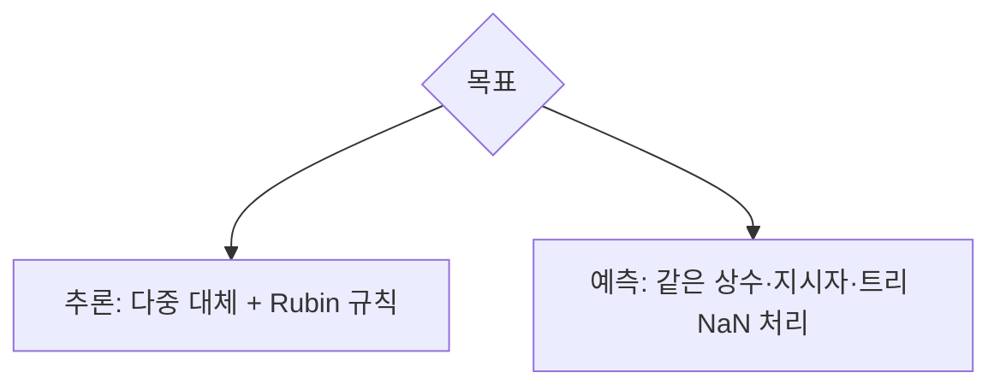

# 예측 목적의 결측 처리

> 모델이 새 데이터를 예측하는 것이 목표일 때의 결측 처리는 모수 추정이 목표일 때와 다르다. 이론적으로는 학습·테스트에 같은 상수로 채우는 방법이나 테스트 시 다중 대체가 일관된 예측을 줄 수 있다.

## 쉽게 말하면
"평균 소득이 얼마인가"를 알려는 연구와 "이 사람이 연체할까"를 맞히는 모델은 빈칸을 다루는 기준이 다르다. 예측에서는 정확한 값 복원보다 예측 성능이 중요하다.

## 자세히
(Josse 외 arXiv 1902.06931 v5(2024.3)와 scikit-learn 문서를 하위 에이전트가 원문으로 읽은 노트 기준. FIMD 2.6 "Imputation is not prediction"은 읽지 못함.)
- **정리 2**: **테스트 시 다중 대체**는 일관성(consistent)이 있다.
- **정리 3**: 비정보성(MAR) 결측에서는 **학습과 테스트에 같은 상수로 채운 뒤 만능(universal) 학습기를 쓰면 일관**이다. 평균 대체만으로는 일반적으로 일관성이 없고 결측이 정보적이면 **결측 마스크**가 필요하다.
- **트리 모델**: MIA(결측 기반 분기) 권장.
- **scikit-learn**: `add_indicator`의 기본은 False, `IterativeImputer`는 `sample_posterior=True`와 다른 seed를 쓰지 않으면 단일 대체, 예측에서 단일 vs 다중 대체는 "아직 열린 문제"라고 문서가 밝힌다. HistGradientBoosting·RandomForest·DecisionTree는 NaN을 직접 처리([NaN 지원 모델 목록](#nan-support-model-list)).
- **실무(제안)**: 대체 방식은 교차검증 안에서 학습 폴드로만 fit하고 서빙 시 같은 변환을 적용한다.

## 그림으로 보기

## 예시
- 연체 예측에 결측 지시자 + 중앙값 대체 파이프라인, HistGradientBoosting NaN 처리와 비교.
- 교육 활용: 추론과 예측의 결측 처리 차이를 표로 정리.

## 헷갈리는 것과 비교
| 목적 | 결측 처리 중점 |
|---|---|
| 추론(모수 추정) | 불확실성 반영(다중 대체) |
| 예측 | 일관된 예측·서빙 호환 |
| [단일 대체 문제](#single-imputation-underestimates) | 추론에서의 표준오차 과소 |

## 더 읽을거리
- [On the consistency of supervised learning with missing values (arXiv 1902.06931)](https://arxiv.org/abs/1902.06931) — 정리 2·3.
- [Imputation of missing values (sklearn)](https://scikit-learn.org/stable/modules/impute.html) — 지시자·다중 대체 언급.
