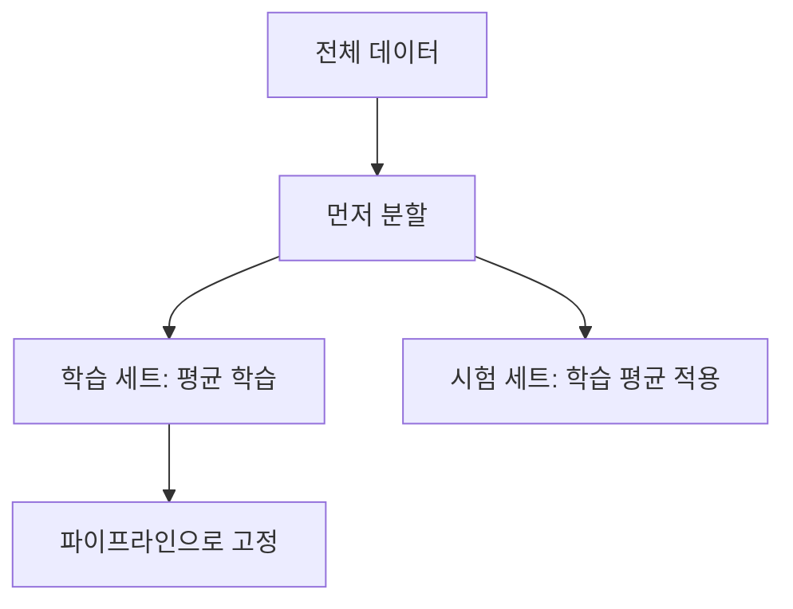

# 결측 대치 누수

> 결측 대치 누수는 빈 칸을 평균·중앙값·최빈값 등으로 채울 때, 그 값을 시험 데이터까지 포함한 전체에서 계산해 시험 정보가 학습 데이터로 새는 실수다. 올바른 방법은 분할 후 학습 데이터로만 대치 값을 학습하고 시험 데이터에는 그 값을 적용하는 것이다.

## 쉽게 말하면
출석부에 빈 칸이 있어 "반 평균 키"로 채우는데, 그 평균을 계산할 때 아직 만나지 않은 다음 학기 학생의 키까지 넣는 것과 같다. 채운 값에 미래 정보가 섞여 있다.

## 자세히
- **기본 도구(scikit-learn 결측값 대치 문서, 열람)**: `SimpleImputer`는 각 특성의 자기 값만으로 `mean`·`median`·`most_frequent`·`constant` 중 하나로 채운다. `IterativeImputer`(실험적)와 `KNNImputer`는 다른 특성을 이용해 추정한다. 기본 인자 `fit`으로 대치 값을 학습하고 `transform`으로 채운다. 이 순서에서 전체 데이터에 `fit`을 하면 시험 정보가 샌다.
- **Pipeline 예(같은 문서)**: `make_pipeline(SimpleImputer(strategy="mean"), DecisionTreeClassifier())`를 `fit(X_train, y_train)`하면 대치 통계는 학습 데이터에서만 배우고, `predict(X_test)`에는 학습 통계를 적용한다. 문서는 전체 데이터 fit이 누수라고 명시하지 않고 예제의 순서로 보여 준다.
- **다중 대치와 KNN**: `IterativeImputer`에서 `sample_posterior=True`와 다른 시드로 반복하면 다중 대치를 만들 수 있다. `KNNImputer`는 가장 가까운 `n_neighbors`개 표본의 값으로 채운다. 이웃을 시험 데이터에서 찾으면 마찬가지로 누수다(해석).
- **결측 표식을 함께 쓰기(같은 문서)**: `add_indicator=True`나 `MissingIndicator`로 "원래 비어 있었는가" 열을 붙이면 결측 자체가 정보인 경우를 살릴 수 있다. 대치만 하면 그 정보가 사라진다고 문서가 설명한다. 이 표식은 결측 패턴이 정답과 관련될 때 유용하지만, 운영 중 결측 패턴이 바뀌면 오히려 약점이 될 수 있다(해석).
- **NaN을 직접 처리하는 모델(같은 문서)**: `HistGradientBoosting`, 결정 트리, 랜덤 포레스트 등은 NaN을 그대로 받으므로 대치 단계를 생략할 수 있다.
- **직접 해 본 작은 예(순수 파이썬)**: 학습 값 [10, 12, 결측, 11, 13, 결측, 12, 10], 시험 값 [40, 42, 41, 39]를 가정한다. 학습 데이터 평균은 11.33이어서 결측이 11.33으로 채워지지만, 전체 평균(시험 포함)은 23이라서 결측이 23으로 채워진다. 시험 값이 큰 쪽으로 이동했다는 미래 정보가 학습 데이터의 빈 칸에 스며든다. 극단적으로 만든 예시이며 실제 영향은 데이터에 달렸다.
- **시계열(해석)**: 시간순 분할 후 과거 데이터의 통계만 쓰고, 미래 값으로 채우는 보간(interpolation)은 피한다.

## 그림으로 보기

## 예시
- 고객 설문 결측: 소득 항목의 결측을 학습 기간 중앙값으로 채우고, 시험 기간 결측에도 같은 중앙값을 쓴다. `add_indicator=True`로 "무응답 여부" 열을 추가해 무응답 자체의 신호를 모델이 쓰게 한다.
- 교육 활용: 두 방식의 대치 값 차이를 손으로 계산해 보고 왜 순서가 중요한지 설명하는 실습.

## 헷갈리는 것과 비교
| 개념 | 차이 |
| --- | --- |
| [스케일러 누수](#scaler-leakage) | 같은 원리를 표준화에 적용. 대치는 빈 칸을 채우는 값에서 발생 |
| [전처리 누수 파이프라인](#preprocessing-leakage-pipeline) | 상위 주제 |
| 결측 표식 | 결측 여부를 열로 보존. 대치와 병행 |

## 더 읽을거리
- [scikit-learn: Imputation of missing values](https://scikit-learn.org/stable/modules/impute.html) — SimpleImputer·IterativeImputer·KNNImputer, 표식, Pipeline
