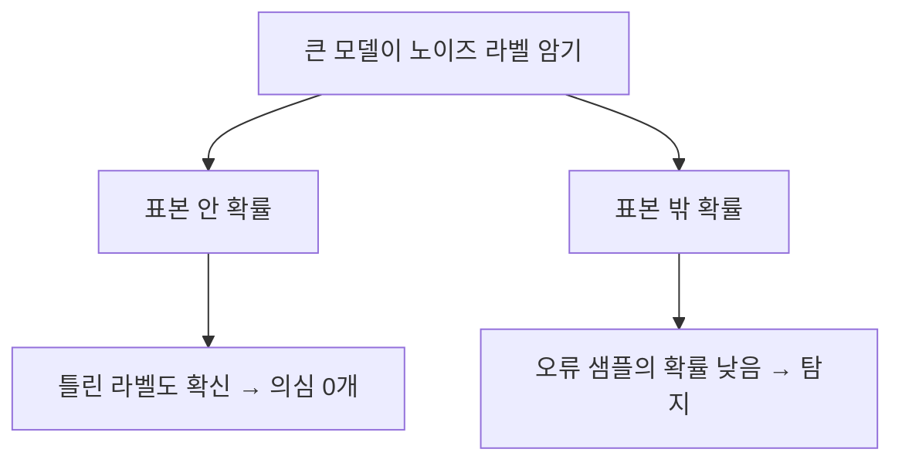
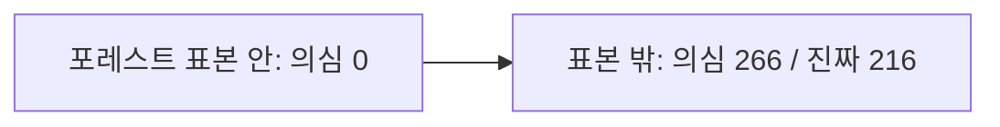

# 표본 안 예측 과신

> 모델을 학습시킨 **바로 그 샘플**에 대해 낸 예측 확률은 틀린 라벨까지 외워서 자신 있게 "라벨이 맞다"고 답한다. 이 확률로 라벨 오류를 찾으면 오류를 하나도 못 찾을 수 있어서, 반드시 폴드 밖(out-of-sample) 예측을 써야 한다.

## 쉽게 말하면
시험 문제와 오답 정답지를 통째로 외운 학생에게 같은 문제를 다시 내면 틀린 정답지대로 자신 있게 답한다. 그 답으로는 정답지에 오류가 있는지 알 수 없다. 처음 보는 학생의 답과 비교해야 정답지 오류가 드러난다.

## 자세히
- **원리**: 용량이 큰 모델은 학습 데이터의 틀린 라벨도 맞히도록 맞춰진다([노이즈 라벨 암기](#memorization-of-noisy-labels)). 그러면 틀린 라벨에 대해서도 주어진 라벨의 확률이 높아져 [라벨 품질 점수](#cleanlab-label-quality-score)가 높게(정상처럼) 나온다. cleanlab 문서도 정확한 점수를 위해 **교차검증 같은 표본 외 확률**을 권장한다.
- **직접 실험(cleanlab 2.9.0, 3클래스 합성 2,000개, 라벨 12% 오염 → 오류 247개)**
  | 모델 | 확률 종류 | 주어진 라벨 정확도 | 의심 샘플 수 | 진짜 오류 발견 | 점수 하위 100개의 오류 비율 |
  |---|---|---|---|---|---|
  | 로지스틱 회귀 | 표본 안 | 0.777 | 304 | 204/247 | 0.97 |
  | 로지스틱 회귀 | 표본 밖(5-폴드) | 0.774 | 312 | 205/247 | 0.97 |
  | 랜덤 포레스트 | 표본 안 | **1.000** | **0** | **0/247** | 0.91 |
  | 랜덤 포레스트 | 표본 밖(5-폴드) | 0.820 | 266 | 216/247 | 0.96 |
  - 포레스트는 표본 안에서 라벨 정확도 1.000(전부 외움)이라 `find_label_issues`가 **0개**를 의심했다. 표본 밖으로 바꾸면 216개를 찾는다.
  - 로지스틱 회귀(용량이 작음)는 표본 안·밖이 거의 같았다. 모델 용량이 클수록 표본 안 예측이 위험하다.
  - 포레스트 표본 안에서도 점수 하위 100개의 오류 비율이 0.91로 높아 순위는 어느 정도 유지되지만, 필터(이진 판정)는 완전히 무력해졌다.
- **방지책**: `cross_val_predict(..., method="predict_proba")`([cross_val_predict](#cross-val-predict))로 폴드 밖 확률을 얻는다. 같은 모델을 전체에 다시 학습해 쓰지 않는다. 그룹이 있으면 그룹 분할기를 쓴다.
- **예측 과신의 다른 사례**: 학습 데이터에서 재측정한 정확도·보정(calibration)도 과대평가된다. 평가는 늘 학습에 안 쓴 데이터로 한다.
- 합성 데이터 한 번의 결과이며 포레스트 설정(트리 200개, 가지치기 없음)에 의존한다.

## 그림으로 보기



## 예시
```python
# 잘못: 학습한 모델로 같은 데이터 예측
bad = model.fit(X, labels).predict_proba(X)
# 올바름: 폴드 밖 예측
good = cross_val_predict(model, X, labels, cv=5, method="predict_proba")
```
- 사내 라벨 점검에서 학습 완료 모델에 전체를 다시 넣었더니 의심 샘플이 0개 → 표본 밖으로 바꿔 해결.

## 헷갈리는 것과 비교
| 개념 | 차이 |
|---|---|
| 표본 안 예측 | 학습에 쓴 샘플 예측(과신) |
| 표본 밖 예측 | 그 샘플이 빠진 모델의 예측 |
| [노이즈 라벨 암기](#memorization-of-noisy-labels) | 과신의 원인 |
| 홀드아웃 예측 | 일부만 표본 밖(전체 샘플 커버 안 됨) |

## 더 읽을거리
- [cleanlab.rank 문서](https://docs.cleanlab.ai/stable/cleanlab/rank.html) — 표본 외 확률을 권장하는 이유.
- [cross_val_predict API](https://scikit-learn.org/stable/modules/generated/sklearn.model_selection.cross_val_predict.html) — 표본 외 예측을 얻는 방법.
