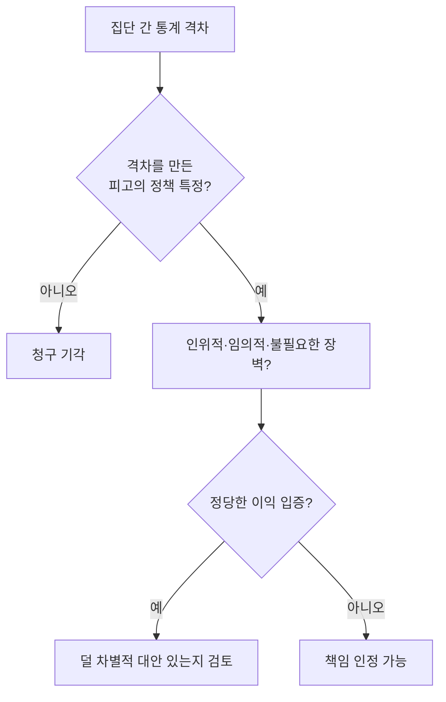

# Inclusive Communities 사건 (2015)

> 미국 연방대법원이 2015년 *Texas Department of Housing and Community Affairs v. Inclusive Communities Project*에서 **공정주택법(FHA)상 차별 영향(disparate impact) 청구가 가능하다**고 5대4로 판단한 사건. 동시에 청구를 남용하지 못하도록 "견고한 인과관계" 요건을 못 박았다. (법률 자문 아님)

## 쉽게 말하면
"차별할 의도가 없었어도 결과가 한쪽에 불리하면 책임을 물을 수 있다"는 길을 열되, 아무 통계 차이나 들이대면 안 되고 **그 차이를 만든 구체적 정책**을 짚어야 한다는 문턱을 함께 둔 판결이다.

## 자세히
출처: Cornell LII에 실린 판결문 요약(앞 100,000자 확인, 2026-11-18). 사건번호 13-1371. 이후 HUD 규정 변화는 [HUD 차별 영향 규정](#hud-disparate-impact-rule)에서 다룬다.
- **판단**: FHA는 차별 영향 청구를 인정한다. 원심(제5순회) 확인 후 환송.
- **표결**: 5대4. 케네디 대법관이 다수의견(긴즈버그·브라이어·소토마요르·케이건 동참). 알리토 대법관 반대(로버츠·스칼리아·토머스 동참), 토머스 별도 반대.
- **근거**: Griggs(Title VII), Smith(ADEA)처럼 "효과"에 주목하는 문구 해석. 1988년 FHA 개정을 당시 항소법원들의 일치된 해석을 추인한 것으로 읽었다(개정이 추가한 예외 조항이 그렇지 않으면 불필요해진다는 논리).
- **견고한 인과관계**: 통계적 격차만으로는 부족하고, 원고가 그 격차를 일으키는 **피고의 정책**을 가리키지 못하면 청구는 기각되어야 한다. 일회성 사적 부지 선정은 정책이 아닐 수 있다고 봤다.
- **남용 방지 장치**: 책임은 "인위적이고 임의적이며 불필요한 장벽"에 한정. 모든 주택 결정에 인종을 끌어들이는 방식으로 확장 해석하지 말 것. 법원은 초기 입증을 신중히 보고 신속히 정리해야 한다.
- **방어**: 피고는 정책이 정당한 이익에 부합함을 보일 수 있다(Title VII 사업 필요성과 유사). 주택 당국·개발자에게 이를 설명할 여지를 줘야 한다.
- **구제**: 인종 중립적 구제를 선호하고, 인종 쿼터는 헌법 문제를 낳을 수 있다.
- **AI 맥락(해석)**: 알고리즘 대출·보험·광고 심사에서 "어떤 모델·변수가 격차를 낳는가"를 특정해야 한다는 요구와 이어진다. 이 연결은 판결문이 직접 다룬 것이 아니다.

## 그림으로 보기

## 예시
- 대출 모델이 특정 우편번호 지역을 낮게 평가해 소수 집단 승인율이 낮다 → 격차를 낳는 정책(변수·임계값)을 특정하고, 정당한 사업 이익 대비 대안([LDA](#less-discriminatory-alternative))이 있는지가 쟁점.
- 교육 활용: "의도가 없었다"가 방어가 되지 않는 이유를 판례로 설명.

## 헷갈리는 것과 비교
| 개념 | 차이 |
|---|---|
| 차별 영향 | 결과의 격차에 책임(의도 불요) |
| 차별 의도(disparate treatment) | 의도적 차별 |
| [공정주택법 FHA](#fair-housing-act) | 이 판결이 해석한 법 |
| [HUD 차별 영향 규정](#hud-disparate-impact-rule) | 판결 후 입증 틀을 정한 행정 규정 |

## 더 읽을거리
- [Cornell LII: 판결문 13-1371](https://www.law.cornell.edu/supremecourt/text/13-1371) — 다수의견·반대의견 전문
