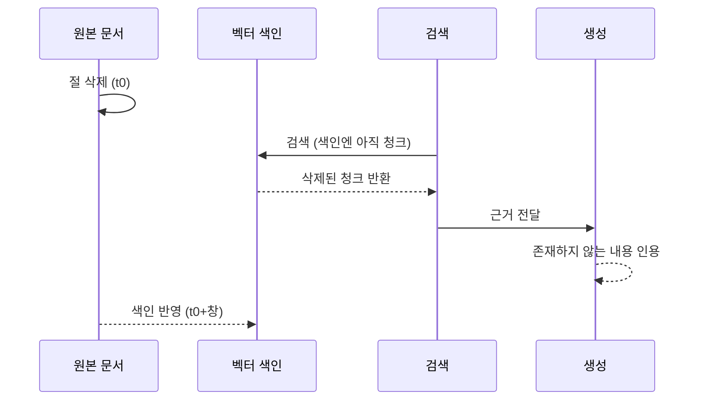
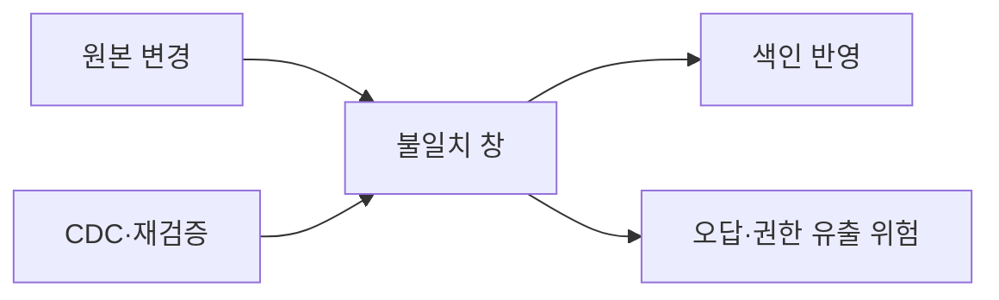

# 불일치 창

> **불일치 창(inconsistency window)**은 원본 문서가 바뀌거나 삭제된 순간부터 RAG 색인이 그 변화를 반영해 **검색 결과가 맞아지는 시점까지의 시간 간격**이다. 이 사이에는 챗봇이 이미 지워졌거나 바뀐 내용을 근거로 답할 수 있다.

## 쉽게 말하면
공지사항을 고쳤는데 안내 데스크의 인쇄물은 아직 옛 내용이라 직원이 옛 규정을 안내하는 시간이다. 고친 뒤 인쇄물이 교체되기까지가 불일치 창이다. 창이 짧을수록 안전하고, 길수록 잘못된 안내가 늘어난다.

## 자세히
(tianpan.co 블로그 「The RAG Read-After-Write Race」(2026-04-27)를 WebFetch로 직접 확인. 개인 블로그 글이며 수치는 글의 예시다. 글은 수집 큐·청킹·임베딩·색인 갱신 각 단계가 창에 기여하는 정도를 구분해 설명하지 않는다.)
- **두 종류의 경쟁(해석)**: ① **색인 반영 지연**(원본 변경→색인 반영) ② **검색-생성 사이 변경**(검색한 스냅샷으로 답하는 동안 원본이 바뀜). 글은 주로 ②를 레이스로 다룬다. 예: 검색 후 답변까지 약 **4초** 사이 관리자가 인용된 절을 삭제.
- **실패 유형(글)**
  - **삭제된 청크 인용**: 삭제가 지연·배치라 색인이 이미 지워진 청크를 계속 반환.
  - **편집된 청크의 뒤집힘**: 검색 후 편집되어 답변이 옛 사실(예: 환불 정책)을 말함.
  - **오래된 권한 유출**: 철회된 접근 권한이 다음 동기화까지 메타데이터에 남음. 외부 권한 API는 웹훅이 없는 경우가 많아 **폴링 간격이 노출 창**이 된다(글의 예: 15분).
- **보장이 없는 일관성(글)**: RAG는 암묵적으로 read-your-writes, 단조 읽기, 검색-생성 간 스냅샷 격리를 기대하지만 **어느 것도 강제되지 않는다**. 글은 벡터 색인을 **일관성 프로토콜이 필요한 캐시**로 본다.
- **완화 패턴(글)**: **스냅샷 격리**(청크에 버전을 두고 모델이 본 리비전을 인용), **인용 전 재검증**(청크 존재·해시 일치·사용자 권한을 확인, 권한 유출을 막는 유일한 방법이라고 글이 말함), **트랜잭션 검색**(중간에 변경되면 요청 실패, 고위험 영역), **스트리밍 재색인**(CDC로 임베딩 지연을 분 단위에서 초 단위로 — 해결이 아니라 "더 최종적으로 일관"하게 만드는 것). → [CDC 동기화](#change-data-capture-sync)
- **측정(글)**: 얼려 둔 코퍼스로 하는 표준 RAG 평가는 이 버그를 놓친다. **요청 중 변경 테스트**를 하고 **오래된 인용 비율·뒤집힌 인용 비율·권한 유출 비율·임베딩 지연(SLO·경보)**을 추적하라고 권한다. → [RAG 신선도 SLA](#rag-freshness-sla)

## 그림으로 보기

## 예시
- 환불 정책 문서가 수정됐는데 색인 반영이 야간 배치라 하루 동안 챗봇이 옛 정책을 안내.
- 교육 활동: 변경 시각 t0와 색인 반영 시각을 기록해 창 길이를 직접 재 보기.

## 헷갈리는 것과 비교
| 개념 | 차이 |
|---|---|
| 불일치 창 | 원본 변경~색인 반영 사이 시간 |
| [좀비 문서](#zombie-documents) | 삭제가 끝내 반영되지 않은 문서 |
| [RAG 신선도 SLA](#rag-freshness-sla) | 허용 창의 목표 설정 |
| [RAG 일관성 수준](#rag-consistency-models) | 어떤 보장 수준을 택할지 |

## 더 읽을거리
- [The RAG Read-After-Write Race (tianpan.co)](https://tianpan.co/blog/2026/04/27/rag-read-after-write-race) — 실패 유형, 완화 패턴, 지표(직접 확인, 개인 블로그).
