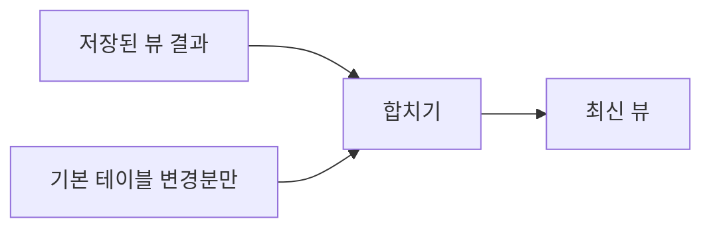
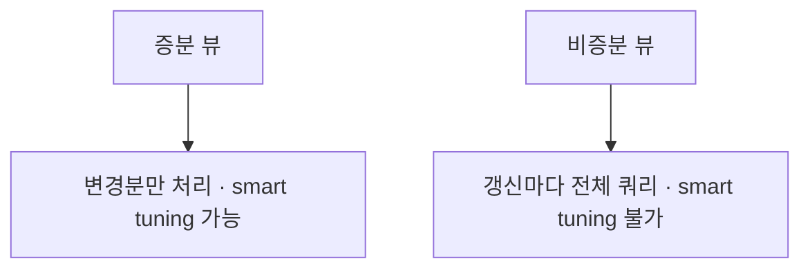

# 증분 갱신

> 구체화 뷰를 **전체를 다시 계산하지 않고 바뀐 부분만 반영해** 갱신하는 방식이다. 기본 테이블이 커도 갱신 비용이 변경량에 비례해 작게 든다.

## 쉽게 말하면
가계부 합계를 매달 1월부터 다시 더하는 대신, 지난달 합계에 이번 달 지출만 더하는 것이다. 장부가 아무리 길어도 새로 쓴 몇 줄만 계산하면 된다.

## 자세히
(BigQuery 공식 문서 "Introduction to materialized views"를 직접 읽었다. BigQuery 기준이며 다른 DB(Snowflake 등)의 증분 방식은 다를 수 있다.)
- **증분 뷰의 동작(문서)**: 증분 구체화 뷰는 **미리 계산된 데이터에 기본 테이블의 최근 변경분을 합쳐** 수동 파이프라인 없이도 결과를 최신으로 유지한다. 변경이 뷰를 무효화할 수 있으면 BigQuery가 기본 테이블을 직접 읽고, 그렇지 않으면 **뷰와 기본 테이블의 변경된 행만** 읽는다.
- **증분 vs 비증분(문서)**
  - **증분 뷰**: 지원하는 SQL 기능이 제한적이지만 smart tuning을 쓸 수 있고 결과가 항상 최신이다.
  - **비증분 뷰**: 대부분의 쿼리를 지원하지만 **갱신마다 전체 쿼리를 실행**하고 smart tuning은 지원되지 않는다.
  - 기본적으로는 증분 뷰만 만들 수 있다. 비증분 뷰를 만들려면 `allow_non_incremental_definition = true`를 설정해야 한다.
- **제약(문서)**: GoogleSQL 방언만, 제한된 문법과 집계 함수만 지원. 다른 구체화 뷰 위에 중첩 불가, 외부 테이블(BigLake 제외)·와일드카드 테이블·스냅샷 위에 만들 수 없음. 생성 후 뷰의 쿼리를 바꿀 수 없고 기본 테이블을 지우면 뷰가 깨진다. `UNPIVOT` 같은 CPU 집약 연산자는 온디맨드 과금에서 갱신 실패를 일으킬 수 있다. BigLake 기본 테이블은 뷰를 파티션할 수 없어 삭제가 있으면 전체 갱신이 일어난다.
- **비용(문서)**: 온디맨드는 쿼리·갱신·저장의 처리 바이트로, 용량 기반은 슬롯으로 과금된다. `AVG`, `ARRAY_AGG`, `APPROX_COUNT_DISTINCT` 같은 일부 집계는 내부적으로 `BYTES` 스케치로 저장되어 저장 크기에 영향을 준다. 자동 갱신 비용은 뷰의 프로젝트에 청구된다.
- **일반 원리(해석)**: 합계·개수처럼 "이전 결과에 변경분을 더해 새 결과를 만들 수 있는" 집계가 증분에 적합하고, 임의의 윈도우·조인은 변경분만으로 계산하기 어려워 제약이 생긴다. 이 설명은 문서가 직접 쓴 것이 아니다.

## 그림으로 보기



## 예시
```sql
CREATE MATERIALIZED VIEW my_dataset.daily_counts AS
SELECT DATE(transaction_time) AS d, COUNT(1) AS c
FROM my_dataset.transactions
GROUP BY d;   -- 단순 집계는 증분으로 만들 수 있음
```
- 교육 소재: "합계를 매번 처음부터 더하면 어떻게 될까?"

## 헷갈리는 것과 비교
| 개념 | 차이 |
|---|---|
| 증분 갱신 | 변경분만 반영 |
| 전체 재계산 | 갱신마다 전체 쿼리 실행(비증분) |
| [허용 최신성 지연](#max-staleness) | 조회 시 허용하는 낡음의 한도 |
| [smart tuning](#smart-tuning) | 증분 뷰만 지원하는 자동 재작성 |

## 더 읽을거리
- [Introduction to materialized views (BigQuery)](https://docs.cloud.google.com/bigquery/docs/materialized-views-intro) — 증분 vs 비증분·제약·비용(직접 읽음).
