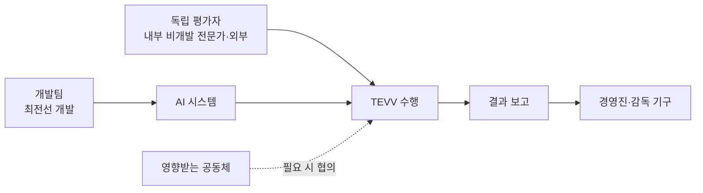

# 독립 평가자

> AI 시스템을 직접 만든 개발팀이 아니라, 그 시스템의 최전선 개발에 참여하지 않은 내부 전문가나 외부 평가자가 시험·평가·검증에 참여하는 구조. 자기 시스템에 후한 점수를 주는 편향을 줄인다.

## 쉽게 말하면
학생이 자기 시험지를 채점하면 점수가 후해지기 쉽다. 그래서 다른 선생님이 채점한다. AI 평가에서도 만든 사람과 점검하는 사람을 분리하는 것이 독립 평가의 핵심이다.

## 자세히
출처: NIST AIRC Playbook의 Measure 페이지, MEASURE 1.3(열어서 읽음).
- **요구(MEASURE 1.3)**: 정기 평가와 갱신에 "최전선 개발자로 일하지 않은 내부 전문가 및/또는 독립 평가자"를 참여시킨다.
- **협의 대상**: 도메인 전문가, 사용자, AI를 개발·배치한 팀 밖의 행위자, 필요하면 조직의 위험 허용도에 따라 영향받는 공동체.
- **제안 행동**: 개별 테스트 팀을 두어 AI 시스템에 대해 독립적인 결정과 방향 수정을 할 수 있게 한다.
- **독립성 자체도 점검**: TEVV와 감독을 맡은 행위자의 "독립성과 지위(stature)"를 평가해 보증과 피드백 일을 할 독립성과 자원이 있는지 확인한다.
- **문서화**: 설계·개발 등 각 단계 담당자의 역할·책임·권한 위임을 기록한다.
- **구분**: MEASURE 2.1은 TEVV를 누가 해야 하는지나 독립성 요건을 따로 정하지 않는다(해당 항목 확인). 독립성 요구는 1.3에 있다.
- Playbook은 자발적 지침이며 어느 정도의 독립성이 충분한지는 조직의 위험 허용도에 따라 달라진다.

## 그림으로 보기

## 예시
- 채용 AI: 개발팀이 아닌 품질·법무·현업 인력으로 평가 팀을 구성하고, 결과를 개발팀 상급자가 아닌 위험 위원회에 보고.
- 점검 질문: "평가 팀이 출시를 막을 권한이 있는가? 평가 팀 평가가 개발팀 성과에 묶여 있지 않은가?"

## 헷갈리는 것과 비교
| 개념 | 차이 |
|---|---|
| [TEVV](#tevv) | 평가 활동 자체, 독립 평가자는 수행 주체 문제 |
| [MEASURE 함수](#measure-function) | 상위 단계 |
| 레드팀 | 공격자 관점 시험, 독립 평가의 한 형태가 될 수 있음 |
| 외부 감사 | 완전한 제3자, 독립 평가자는 내부 비개발자도 포함 |

## 더 읽을거리
- [NIST AIRC Playbook — Measure](https://airc.nist.gov/AI_RMF_Knowledge_Base/Playbook/Measure) — MEASURE 1.3 독립성 요구와 제안 행동(열어서 확인)
