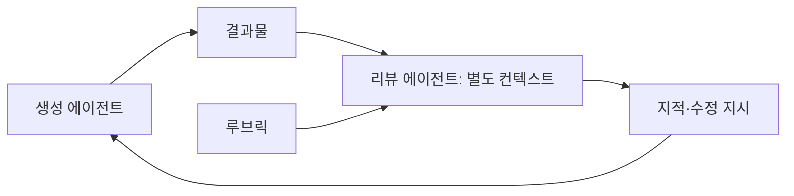
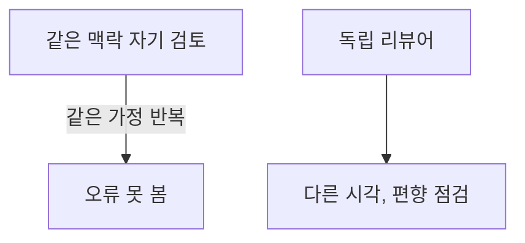

# 독립 리뷰어 에이전트

> **독립 리뷰어 에이전트**는 결과물을 만든 에이전트와 **맥락을 분리한 별도 에이전트**가 검토하게 하는 설계다. 같은 맥락의 자기 검토는 같은 편향·오류를 반복하기 쉽기 때문이다.

## 쉽게 말하면
논문 저자가 자기 원고를 교정하면 오타를 놓치듯, 쓴 사람은 자기 가정에 익숙해져 있다. 처음 보는 동료에게 검토를 맡기면 다른 눈으로 본다. 단, 그 동료도 기준표가 있어야 한다.

## 자세히
- **자기 검토의 한계**: 외부 신호 없는 자기 수정은 추론 과제에서 잘 안 되고 때로 악화된다(Huang 외, arXiv 2310.01798 초록, [자기 수정의 한계](#self-correction-limits)).
- **LLM 심판의 편향**(Zheng 외, arXiv 2306.05685 초록 확인): 위치 편향, 장황함 편향, **자기 선호(self-enhancement) 편향**, 제한된 추론 능력. 그래도 GPT-4급 심판은 사람 선호와 **80% 이상 일치**해 확장 가능한 근사 평가로 쓸 수 있다고 한다. 자기 선호 편향 때문에 **생성한 모델이 자기 결과를 심사**하는 구조는 피하는 편이 낫다(권고).
- **설계 요령**(권고): ① 리뷰어에게 생성 과정의 추론을 숨기고 결과물과 **기준(루브릭)** 만 준다 ② 가능하면 다른 모델이나 다른 프롬프트를 쓴다 ③ 순서를 바꿔 위치 편향 점검 ④ 점수만이 아니라 근거와 수정 지시를 받는다 ⑤ 최종 승인은 테스트·사람이 맡는다.

## 그림으로 보기

## 예시
- 코드 작성 에이전트가 만든 PR을 별도 리뷰 에이전트가 요구사항과 테스트 결과만 보고 검토.
- 번역 품질 평가에 두 가지 순서로 답안을 제시해 위치 편향을 확인.

## 헷갈리는 것과 비교
| 개념 | 차이 |
|---|---|
| 독립 리뷰어 | 맥락 분리된 검토자 |
| 자기 수정 | 같은 맥락에서 스스로 |
| LLM 심판 | 점수를 매기는 평가자 역할 |
| 사람 검수 | 최종 책임·고위험 판단 |

## 더 읽을거리
- [Judging LLM-as-a-Judge with MT-Bench and Chatbot Arena](https://arxiv.org/abs/2306.05685)
- [LLMs Cannot Self-Correct Reasoning Yet](https://arxiv.org/abs/2310.01798)
