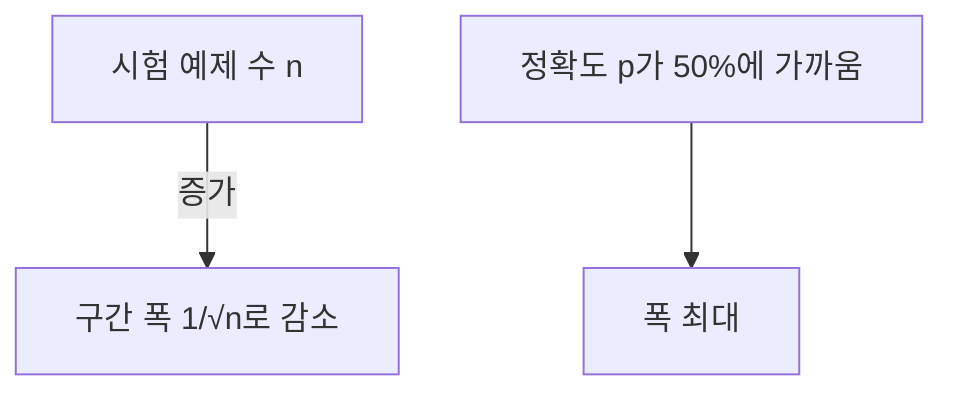

# 독립 시험 세트 신뢰구간

> 학습에 쓰지 않은 **별도 시험 세트**에서 얻은 정확도(맞힌 비율)는 시험 예제가 독립이라는 전제 아래 **이항분포**로 신뢰구간을 계산할 수 있다. 교차 검증과 달리 폴드 상관 문제가 없어 공식이 정직하다.

## 쉽게 말하면
동전을 100번 던져 앞면이 90번 나왔다고 "앞면 확률은 정확히 90%"라고 단정하지 않는다. 시험 문제 100개 중 90개를 맞힌 모델도 "진짜 실력은 대략 83~94%" 정도로 읽는다. 시험 문제 수가 적으면 구간이 넓다.

## 자세히
- **조건**: 시험 세트가 학습과 완전히 분리, 예제끼리 독립(같은 사용자·문서가 섞이면 그룹 단위로 처리), 운영 분포를 대표.
- **방법**(statsmodels `proportion_confint` 문서 확인): `normal`(기본, 근사 정규·Wald), `wilson`, `agresti_coull`, `beta`(Clopper-Pearson, 정확하지만 보수적), `jeffreys`. 문서는 특정 방법을 권하지 않지만 beta가 가장 보수적이라고 밝힌다. 관행적으로 정확도가 0%·100%에 가깝거나 n이 작으면 Wald 대신 Wilson이나 Clopper-Pearson을 쓴다(일반 통계 지식).
- **직접 계산 비교(95%)**
  | 맞힌 수/전체 | Wald | Wilson |
  |---|---|---|
  | 900/1000 | 88.1~91.9% | 88.0~91.7% |
  | 90/100 | 84.1~95.9% | 82.6~94.5% |
  | 9/10 | 71.4~**108.6%** | 59.6~98.2% |
  | 0/50 오류 | 0~0% | 0~7.1% |
  | 3/1500 | −0.03~0.43% | 0.07~0.59% |
  Wald는 소표본·극단 비율에서 100%를 넘기거나 폭이 0이 되어 못 쓴다.
- **필요한 시험 크기 감 잡기**: 정확도 90% 근처에서 ±1%p(95%)를 원하면 약 3,500개, ±3%p면 약 400개(Wald 근사, 계산: n≈1.96²·p(1−p)/e²). 소수 클래스의 재현율은 그 클래스 예제 수가 n이다.
- **오류 0건일 때**: "3의 법칙" — n건에서 오류 0이면 95% 상한이 약 3/n(50건 → 6%).
- **한계**: 시험 세트로 반복해서 모델을 고르면 시험 세트가 사실상 학습에 쓰여 구간이 낙관적이 된다(시험 세트 재사용). 구간은 "그 시험 세트의 표본 변동"만 다루며, 학습 변동·운영 분포 이동은 담지 못한다.

## 그림으로 보기



## 예시
```python
from statsmodels.stats.proportion import proportion_confint
lo, hi = proportion_confint(count=90, nobs=100, alpha=0.05, method="wilson")
print(lo, hi)  # 약 0.826 ~ 0.945
```
- 모델 A 91%, B 89%(각 시험 500개)라면 구간이 크게 겹쳐 차이를 단정할 수 없다. 같은 문제로 비교하면 [맥니마 검정](#mcnemar-test)이 더 적합.

## 헷갈리는 것과 비교
| 상황 | 구간 방법 |
|---|---|
| 독립 시험 세트의 정확도 | 이항(Wilson·Clopper-Pearson) |
| 교차 검증 점수 | [부트스트랩](#bootstrap-ci-for-cv)·보정 검정 |
| F1·AUC 같은 복합 지표 | 부트스트랩 |

## 더 읽을거리
- [statsmodels proportion_confint](https://www.statsmodels.org/stable/generated/statsmodels.stats.proportion.proportion_confint.html) — 방법 목록과 보수성(열어 확인).
- [Wikipedia: Binomial proportion confidence interval](https://en.wikipedia.org/wiki/Binomial_proportion_confidence_interval) — 각 방법의 배경(미열람).
