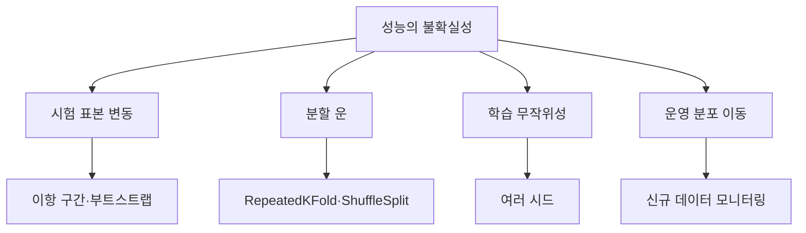
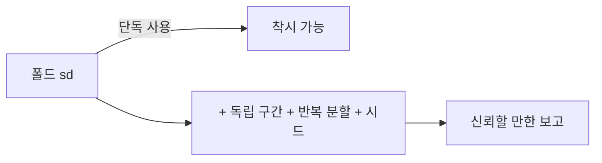

# 독립적 불확실성 추정

> 교차 검증의 **폴드 점수 퍼짐(sd)은 모델 성능의 불확실성을 믿을 만하게 말해 주지 않는다.** 그래서 폴드 밖의 방법(독립 시험 세트 구간, 부트스트랩, 반복 분할의 변동, 시드 변동)으로 불확실성을 따로 추정해 함께 보고한다.

## 쉽게 말하면
같은 시험지로 학생을 5번 나눠 채점해 점수가 비슷하다고 "실력을 정확히 안다"고 하지 않는다. 다른 시험지, 다른 날짜에도 비슷한지 따로 확인해야 한다. 폴드 sd는 "이번 분할 안에서의 흩어짐"이지 "세상에서의 흩어짐"이 아니다.

## 자세히
- **scikit-learn 문서(열어 확인)**: 층화가 교차 검증 반복 간 지표의 퍼짐을 인위적으로 줄일 수 있어, 희귀 클래스에서는 **폴드 간 변동이 더 이상 분류기 성능의 불확실성을 반영하지 않는다**고 명시한다([층화의 착시](#stratification-shrinks-variance)). 문서는 점수를 "평균과 표준편차(예: 정확도 0.98, sd 0.02)"로 보여 주지만 불확실성 해석 주의는 별도로 달지 않는다.
- **독립적 추정 도구들**
  | 도구 | 무엇의 불확실성을 보나 | 참조 |
  |---|---|---|
  | 독립 시험 세트 + 이항 구간 | 시험 표본 변동 | [독립 시험 세트 구간](#independent-test-ci) |
  | out-of-fold 예측 부트스트랩 | 시험 표본 변동(지표 무관) | [부트스트랩 CI](#bootstrap-ci-for-cv) |
  | 군집 부트스트랩 | 군집 내 상관 | [군집 부트스트랩](#cluster-bootstrap) |
  | 반복 KFold·ShuffleSplit | 분할 변동 | 아래 |
  | 여러 시드 학습 | 학습 무작위성 | [시드 변동](#seed-variance-reporting) |
  | 보정 t-검정 | 모델 간 차이 | [보정 t-검정](#nadeau-bengio-corrected-ttest) |
- **RepeatedKFold(문서)**: KFold를 n번 반복하되 반복마다 다른 분할. 층화 버전 RepeatedStratifiedKFold. **ShuffleSplit**은 사용자 지정 횟수와 train/test 비율로 독립 분할을 생성한다(KFold의 대안, 반복 수·비율 세밀 제어). 반복할수록 분할 운은 평균되지만 **데이터 자체가 같아** 여전히 학습 데이터 변동을 다 담지 못한다.
- **k 선택(문서)**: 학습 곡선이 가파르면 5·10겹 CV가 일반화 오차를 과대평가할 수 있고, LOO는 정확도 추정의 분산이 크다(모델들이 거의 동일해 상관). 대부분 5·10겹을 권장.
- **원칙**: 불확실성의 **출처별로** 추정기를 고른다 — 시험 표본, 분할, 학습 시드, 분포 이동. 하나의 오차 막대로 모두 말하지 않는다.

## 그림으로 보기



## 예시
```python
from sklearn.model_selection import RepeatedStratifiedKFold, cross_val_score
cv = RepeatedStratifiedKFold(n_splits=5, n_repeats=10, random_state=0)
s = cross_val_score(pipe, X_dev, y_dev, cv=cv)      # 개발용 데이터에서 분할 변동
# 최종 보고: 보류해 둔 시험 세트에서 한 번만 평가하고 이항/부트스트랩 구간을 붙인다
```

## 헷갈리는 것과 비교
| 항목 | 담는 불확실성 |
|---|---|
| 폴드 sd | 분할 안의 흩어짐(상관·층화로 왜곡) |
| 독립 시험 구간 | 시험 표본 크기 |
| 반복 분할 sd | 분할 운 |
| 시드 sd | 학습 무작위성 |

## 더 읽을거리
- [scikit-learn: Cross-validation](https://scikit-learn.org/stable/modules/cross_validation.html) — Repeated K-Fold·ShuffleSplit·층화 주의 문구(열어 확인).
