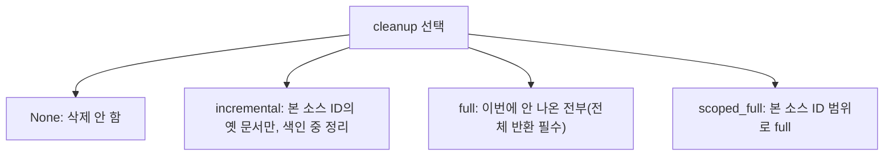

# 색인 정리 모드

> LangChain 인덱싱 API의 `cleanup` 매개변수는 원본에서 사라지거나 바뀐 문서를 벡터 저장소에서 어떻게 지울지 정한다. `None`, `incremental`, `full`, `scoped_full` 4가지가 있다.

## 쉽게 말하면
도서관 목록을 갱신할 때 "새 책만 추가하고 아무것도 안 버린다", "본 출처의 옛 판만 치운다", "이번 조사에서 안 나온 책은 전부 치운다" 중 무엇을 할지 정하는 스위치다.

## 자세히
(LangChain `langchain_core/indexing/api.py` 소스의 docstring과 검증 코드를 직접 읽고 확인. langchain-core 0.3.25에서 `scoped_full` 추가.)
- **`None`**: 아무것도 삭제하지 않는다.
- **`incremental`**: 갱신되지 않았고 이번 색인 중 **본 소스 ID에 연결된** 문서만 정리. 색인 중 **계속** 정리해 사용자가 중복 내용을 볼 확률을 줄인다. 같은 소스 ID의 문서가 여러 배치에 나뉘면 중복 작업이 생기므로 **배치 크기를 크게** 하라고 권한다.
- **`full`**: 이번 실행에서 로더가 반환하지 않은 **모든** 문서를 삭제. 모든 문서를 색인한 뒤에야 정리하므로 색인 중 중복이 보일 수 있다. **로더가 데이터 전체를 반환해야 하며 일부만 반환하면 지우면 안 될 문서까지 지운다**.
- **`scoped_full`**: full과 비슷하나 갱신되지 않았고 이번에 본 소스 ID에 연결된 문서만 삭제. 적절한 배치 크기를 정하기 어렵거나 로더가 전체를 한 번에 못 줄 때 적합. 소스 ID를 메모리에 보관하므로 1천만+ 문서 규모에서는 병렬화가 필요.
- **검증**: cleanup이 `incremental`/`scoped_full`인데 `source_id_key`가 없으면 `ValueError`("Source id key is required ..."). 문서의 소스 ID가 None이어도 오류.
- 기타: `cleanup_batch_size` 기본 1,000, `force_update`(임베딩을 바꿔 다시 색인할 때), 키 해시 `key_encoder` 기본 sha1(충돌 저항성 없음, 새 앱은 sha256 등 권장).

## 그림으로 보기

## 예시
- 위키를 소스별로 나눠 매일 색인할 때 `cleanup="scoped_full"`, `source_id_key="source"`.
- 교육 활용: 모드별 삭제 범위를 그림으로 그려 보는 실습.

## 헷갈리는 것과 비교
| 모드 | 삭제 범위 | 주의 |
|---|---|---|
| incremental | 본 소스 ID의 옛 문서 | 소스 ID 필요 |
| full | 이번에 안 나온 전부 | 로더가 전체를 줘야 함 |
| scoped_full | 본 소스 ID 범위 전체 | 소스 ID를 메모리 보관 |

## 더 읽을거리
- [LangChain indexing api.py (GitHub)](https://github.com/langchain-ai/langchain/blob/master/libs/core/langchain_core/indexing/api.py) — docstring과 검증 코드.
