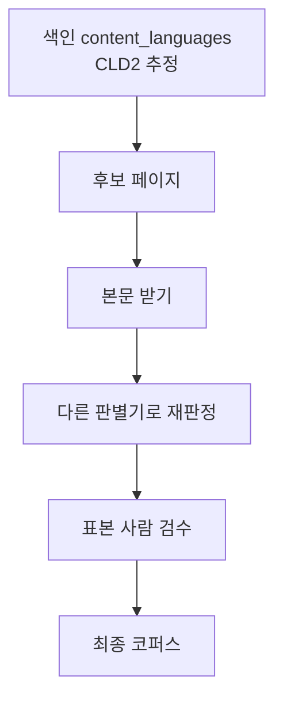
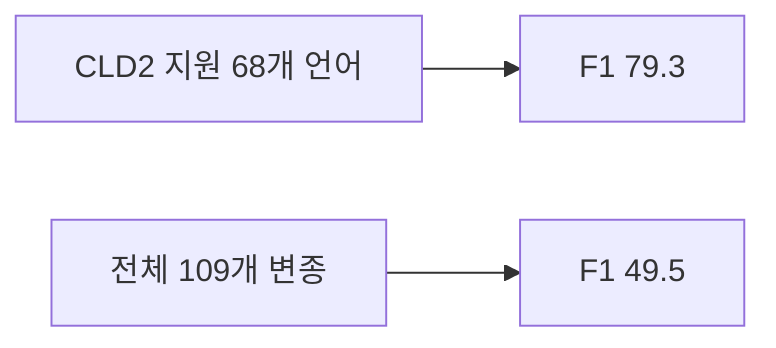

# 색인 언어 판정 정확도

> Common Crawl 색인의 `content_languages`는 **자동 언어 판별기(CLD2)가 붙인 추정값**이다. 짧은 글·혼합 언어·희귀 언어에서는 틀릴 수 있어, 이 열만 믿고 코퍼스를 만들면 다른 언어가 섞인다.

## 쉽게 말하면
공항 자동 입국 심사기가 얼굴을 대충 보고 국적을 추정한다고 하자. 대체로 맞지만 사진이 흐리거나 낯선 얼굴이면 틀린다. 중요한 일이면 직원이 표본을 눈으로 확인해야 한다.

## 자세히
- **어떤 값인가**: Common Crawl 색인의 언어 열은 CLD2로 붙인 값이라는 설명이 있다(검색 요약: 2018년 8월부터, 최대 3개 언어·ISO 639-3 코드; 본문 미확인). CLD2 저장소 README(직접 읽음)는 80+개(완전판 160+개) 언어를 스크립트 또는 4글자 n-gram 나이브 베이즈로 판별하고 CJK는 한 글자 단위로 본다고 설명하며, 입력은 UTF-8이어야 하고 도메인·HTTP 헤더 언어 같은 힌트를 줄 수 있다고 한다. Common Crawl이 실제로 어떤 입력을 어떻게 넣는지는 이 README에 없다.
- **웹 데이터에서의 정확도(CommonLID, arXiv 2601.18026, Common Crawl 등 공저, 직접 읽음)**: 사람이 주석한 웹 LID 벤치마크로 109개 언어 변종, 373,230줄. 8개 모델 비교에서 CLD2의 매크로 F1은 **전체 49.5**(GlotLID 60.4 다음), **CLD2가 지원하는 68개 언어만 보면 79.3으로 최고**였고 가장 빠른 모델이다. 한계는 지원 언어가 적어 저자원 언어를 못 다룬다는 것이다. 논문은 어느 모델도 전체 평가 세트에서 F1 75%를 넘지 못했고, 기존 평가가 웹 데이터 정확도를 과대평가해 왔을 가능성이 높다고 결론짓는다.
- **한국어 주의**: 이 벤치마크에서 한국어는 겨우 8줄이라 한국어 정확도를 이 수치로 말할 수 없다. 한국어 정확도는 직접 표본 검수가 필요하다.
- **CLD2 설계 한계(검색 요약)**: 200자 이상 웹 페이지를 목표로 하고 아주 짧은 글·고유명사 목록·부품 번호에는 약하다.
- **Parquet 열 값 특징**: `ell,eng`처럼 여러 언어가 쉼표로 이어진 값이 흔하므로 `= 'kor'`만 쓰면 혼합 페이지가 빠진다([content_languages 목록 값](#content-languages-list-values)).
- **실무 점검(제안)**: ① 색인으로 후보를 넓게 뽑는다 ② 본문을 받은 뒤 다른 판별기(예: fastText 계열)로 재판정 ③ 무작위 100건을 사람이 확인해 오류율 추정 ④ 길이가 짧은 페이지는 제외.

## 그림으로 보기

## 예시
| 모델 | 전체 F1 | 지원 언어만 F1 |
|---|---|---|
| GlotLID | 60.4 | 68.6 (96개) |
| CLD2 | 49.5 | 79.3 (68개) |
| fastText(NLLB) | 49.3 | 72.6 (74개) |
- 업무 장면: 한국어 코퍼스를 만들 때 색인으로 `kor` 후보를 뽑고, 본문 재판정과 사람 표본 100건 검수로 일본어·중국어 혼입 비율을 잰다.

## 헷갈리는 것과 비교
| 개념 | 차이 |
|---|---|
| 색인 언어 열 | 크롤 때 붙은 추정값 |
| 본문 재판정 | 받은 텍스트로 다시 판별 |
| [Athena 색인 조회](#athena-cc-index-query) | 이 열로 후보를 뽑는 단계 |
| [열 기반 색인](#columnar-index-parquet) | 이 열이 들어 있는 표 |

## 더 읽을거리
- [CommonLID (arXiv 2601.18026)](https://arxiv.org/abs/2601.18026) — 웹 LID 벤치마크와 CLD2 점수(직접 읽음, 앞 100,000자).
- [commoncrawl/language-detection-cld2 (GitHub)](https://github.com/commoncrawl/language-detection-cld2) — CLD2 동작 방식 설명(직접 읽음).
