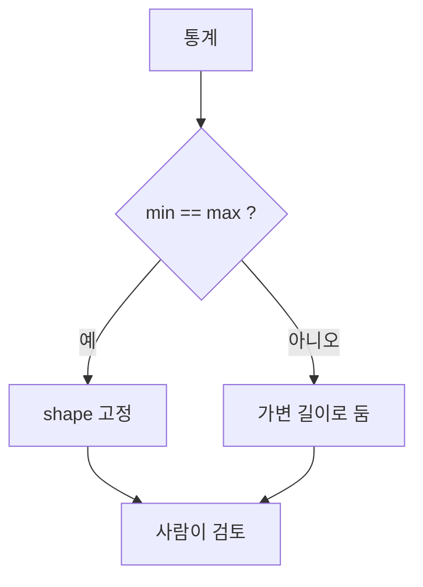

# 피처 shape 추론

> TFDV가 스키마를 처음 만들 때, **모든 예제에서 값 개수가 같은 필수 피처의 shape(모양)를 자동으로 고정**해 주는 옵션(`infer_feature_shape`)이다.

## 쉽게 말하면
설문지에서 "연락처 칸이 항상 딱 1개"라면 양식에 그 칸을 한 줄짜리로 미리 인쇄해 둘 수 있다. 사람마다 칸 수가 다르면 인쇄할 수 없다. shape 추론은 이 "항상 같다"를 데이터에서 찾아 양식에 반영하는 기능이다.

## 자세히
(TensorFlow Data Validation 공식 "Get started" 문서를 직접 읽었다.)
- `tfdv.infer_schema(stats)`는 통계에서 초기 스키마를 만든다. 보수적 휴리스틱으로 안정적 속성만 추론해 특정 데이터셋에 과적합되지 않게 한다.
- **기본 동작(문서)**: 필수 피처의 `value_count.min`과 `value_count.max`가 **같으면** 그 피처의 shape를 추론한다. 같지 않으면(가변 길이) 추론하지 않는다.
- **끄기**: `infer_feature_shape=False`.
- 스키마의 `value_count {min:1 max:1}`는 "예제당 값 1개"를 뜻한다. 값 개수는 스키마가 기술하는 속성 중 하나다(존재 여부·타입·존재 비율·도메인과 함께).
- 문서는 shape 추론을 *가변 길이 피처 처리법*으로 따로 설명하지 않는다. 가변 길이 피처는 min≠max라 자동 추론 대상이 아니라는 것까지가 문서에서 확인되는 사실이고, 그 뒤 처리(예: 패딩·희소 변환)는 이 글에서 다루지 않았다.

## 그림으로 보기


## 예시
```python
schema = tfdv.infer_schema(stats)                              # 기본: shape 추론
schema = tfdv.infer_schema(stats, infer_feature_shape=False)  # 끄기
```
- 모델 입력이 고정 크기를 요구하면 켜 두고, 길이가 가끔 달라질 피처는 끄거나 검토에서 풀어 준다(제안).

## 헷갈리는 것과 비교
| 개념 | 차이 |
|---|---|
| shape 추론 | 예제당 값 개수를 스키마에 반영 |
| [스키마 추론](#schema-inference) | 타입·도메인·존재 비율까지 포함한 전체 |
| [사람 검토](#schema-human-review) | 자동 추론 결과를 고치는 단계 |

## 더 읽을거리
- [TFDV Get started](https://www.tensorflow.org/tfx/data_validation/get_started) — infer_schema와 shape 옵션(직접 읽음).
