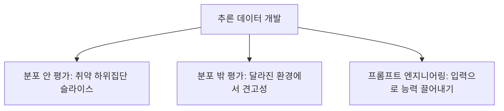

# 추론 데이터 개발

> 학습이 끝난 모델을 더 세밀하게 평가하거나, 입력 데이터를 잘 설계해 원하는 능력을 끌어내는 데이터 작업이다. 데이터 중심 AI 서베이가 세운 세 목표 중 하나로, 분포 안 평가·분포 밖 평가·프롬프트 엔지니어링을 묶는다.

## 쉽게 말하면
운전면허 시험을 평지 코스 한 번으로만 보지 않고, 비 오는 날·급경사·좁은 골목 같은 상황별 코스를 따로 만들어 보는 일이다. 같은 모델이라도 어떤 입력을 주느냐에 따라 능력이 드러나기도, 숨기도 한다.

## 자세히
(Zha 등, *Data-centric Artificial Intelligence: A Survey*, arXiv:2303.10158, 2023-06 v3의 본문을 PDF에서 직접 읽어 정리.)
- **서베이의 정의**: 추론 데이터 개발의 목표는 모델에 대해 더 **세밀한 통찰**을 주거나 설계된 입력으로 **특정 능력을 끌어내는** 새 평가 세트를 만드는 것. 하위 목표 셋:
  1. **분포 안(in-distribution) 평가**: 학습 데이터와 같은 분포를 따르는 샘플. 예로 모델이 성능이 낮은 **하위 집단**을 찾는 데이터 슬라이싱, 결정 경계를 평가하는 알고리즘적 대안 제시(recourse).
  2. **분포 밖(out-of-distribution) 평가**: 학습 분포와 다른 샘플로 견고성·일반화를 본다.
  3. **프롬프트 엔지니어링**: 언어 모델에서 원하는 예측이 나오도록 프롬프트(입력)를 조정. 모델이 커질수록 데이터 입력만 설계해도 원하는 출력을 얻을 수 있다고 서베이가 설명한다.
- **왜 필요한가**: 전통적 방식은 학습에 쓰지 않은 보류 평가 세트에서 정확도 같은 지표를 잰다. 하지만 지표 하나로는 견고성·일반화·판단 근거 같은 중요한 속성을 다 담지 못한다.
- **성격**: 서베이는 이 영역의 과제들이 모델의 여러 능력을 평가하거나 끌어내는 것이라 비교적 **열린 형태**라고 한다.
- **이 지도에서의 연결**: 평가 세트 설계는 [AI 평가·벤치마크](#ai-evaluation), 입력 설계는 llm-basics의 프롬프트 노드와 이어진다.

## 그림으로 보기

## 예시
- 고객 문의 분류기 정확도는 92%인데, 외국어 섞인 문의에서만 60%라면 "외국어 혼용" 슬라이스를 평가 세트로 만든다(분포 안 슬라이스 예).
- 학습 때 못 본 신제품 용어가 들어간 문의로 분포 밖 평가 세트를 따로 만들어 견고성을 본다.

## 헷갈리는 것과 비교
| 개념 | 차이 |
|---|---|
| 추론 데이터 개발 | 평가·입력 쪽 데이터 설계 |
| 학습 데이터 개발 | 학습에 쓰는 데이터를 모으고 고침 |
| [데이터 유지·관리](#data-maintenance) | 데이터를 계속 믿을 수 있게 관리 |
| [학습·검증·시험 분할](#train-validation-test-split) | 기본 보류 평가 세트 설계 |

## 더 읽을거리
- [Data-centric Artificial Intelligence: A Survey](https://arxiv.org/abs/2303.10158) — 세 목표와 하위 목표(초록 확인, 본문은 PDF에서 읽음).
