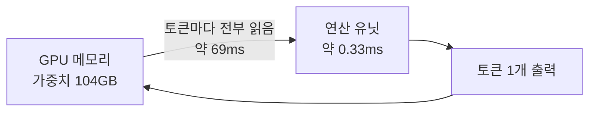
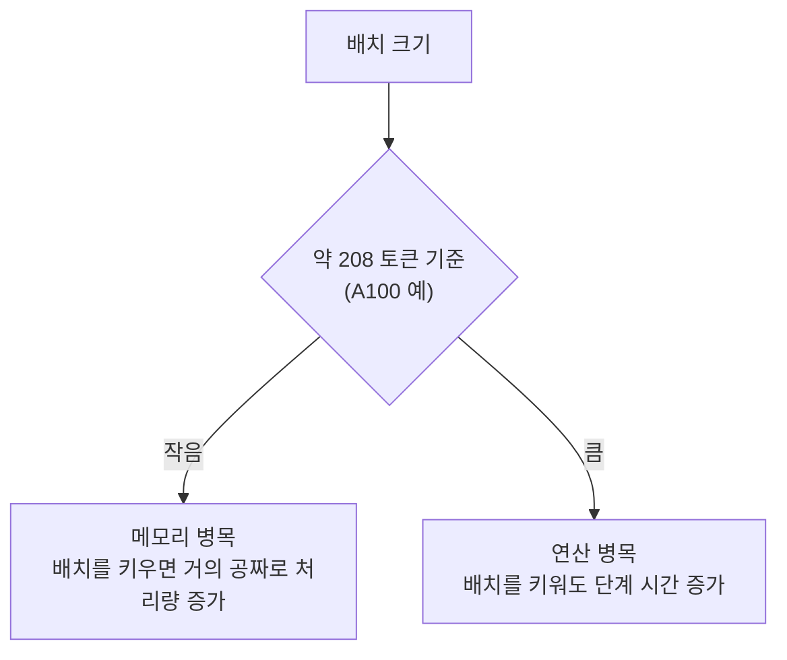

# 추론은 왜 메모리가 병목인가

> LLM이 글을 한 토큰씩 생성할 때는 모델 가중치 전체를 메모리에서 읽어 오는 시간이 곱셈 계산 시간보다 훨씬 길다. 그래서 속도는 GPU 연산 성능보다 **메모리 대역폭**이 좌우한다.

## 쉽게 말하면
식당에서 주방장(계산)은 아주 빠른데 재료 창고(메모리)와 주방 사이 통로가 좁아, 요리 하나 만들 때마다 창고의 모든 재료를 통로로 날라 와야 한다고 하자. 주방장은 대부분 시간을 재료를 기다리며 보낸다. 손님 여러 명 주문을 한꺼번에 받아(배치) 한 번 가져온 재료로 여러 요리를 만들면 효율이 오른다.

## 자세히
**원리(Kipply, "Transformer Inference Arithmetic" 기준)**
- 디코딩(생성)은 토큰을 하나씩 만들고, 매 단계가 모델의 모든 가중치를 거친다. 토큰당 연산은 매개변수당 약 2 FLOP뿐이라 **연산 밀도가 배치 1에서 대략 바이트당 1 FLOP**이다.
- 소배치에서 한 토큰 지연 ≈ 가중치 바이트 수 ÷ 메모리 대역폭.

**52B 모델 예(2바이트 가중치, A100)**을 직접 다시 계산했다.
- 가중치 크기: 52e9 × 2 = 104 GB
- 메모리 읽기 시간(1.5 TB/s): 104e9 ÷ 1.5e12 ≈ **69 ms/토큰**
- 연산 시간(312 TFLOPs): 2 × 52e9 ÷ 312e12 ≈ **0.33 ms/토큰**
- 메모리 시간이 연산 시간의 약 **208배**. GPU 4장으로 나누면 토큰당 약 17 ms.
- **배치 교차점**: 312e12 ÷ 1.5e12 ≈ 208 FLOP/바이트. 배치가 약 208 토큰보다 작으면 메모리 병목, 크면 연산 병목. 그래서 소배치 디코딩은 GPU를 거의 못 쓴다.
- **KV 캐시**: 토큰당 2(K,V) × 2바이트 × 64층 × 8192 ≈ 2.1 MB. 40GB A100 4장(160GB)에서 가중치 104GB를 빼면 56GB가 남아 전체 요청 합쳐 약 2만 3천 토큰만 담긴다. 캐시 읽기도 대역폭을 쓴다(글의 기본 공식은 이를 빼서 추정치는 하한).

**양자화가 빨라지는 이유(내 계산, 대역폭 1TB/s GPU 가정)**: 7B 모델 FP16은 14GB → 토큰당 약 14 ms(약 71 토큰/초), 4비트는 3.5GB → 약 3.5 ms(약 286 토큰/초) 이론 상한. 연산이 아니라 읽을 바이트 수가 줄어서다. 실제 속도는 커널·KV 캐시·오버헤드로 이보다 낮다.

**대응 기법**
- [양자화](#quantization): 가중치 바이트를 줄여 읽기 시간 단축.
- **배치 처리**: 요청 여러 개를 묶어 한 번 읽은 가중치를 재사용([배칭 서빙](#batching-serving)).
- KV 캐시 관리: [PagedAttention](#paged-attention) 등으로 메모리 낭비 감소.
- 추측 디코딩, 작은 모델·증류: 큰 모델 호출 횟수 줄이기.
- 하드웨어: 대역폭이 높은 GPU(HBM)를 고른다.

## 그림으로 보기

## 예시
- 같은 7B 모델을 4비트로 양자화하면 이론 상한 속도가 약 4배(14ms → 3.5ms/토큰, 직접 계산)로 올라간다.
- 동시 사용자가 많은 서비스에서 요청을 묶어 처리하면 GPU당 처리량이 크게 늘어 토큰당 비용이 줄어든다.
- 교육 활용: "왜 같은 GPU인데 동시 사용자가 늘면 오히려 서버가 효율적인가?"를 비유(통로와 주방장)로 설명한다.

## 헷갈리는 것과 비교
| 개념 | 차이 |
|---|---|
| 메모리 병목(디코딩) | 토큰 하나씩 만들 때 가중치 읽기가 지배 |
| 연산 병목(프리필·큰 배치) | 입력을 한꺼번에 처리할 때 곱셈이 지배 |
| [KV 캐시](#kv-cache) | 지난 토큰의 K·V를 저장해 재계산을 피함. 메모리와 대역폭을 차지 |
| [양자화](#quantization) | 읽을 바이트를 줄여 속도·메모리를 개선 |
| 지연 vs 처리량 | 배치는 처리량을 올리지만 개별 요청 지연은 늘 수 있음 |

## 더 읽을거리
- [Transformer Inference Arithmetic (kipply)](https://kipp.ly/transformer-inference-arithmetic/) — 대역폭 vs 연산, 배치 교차점, KV 캐시 계산
