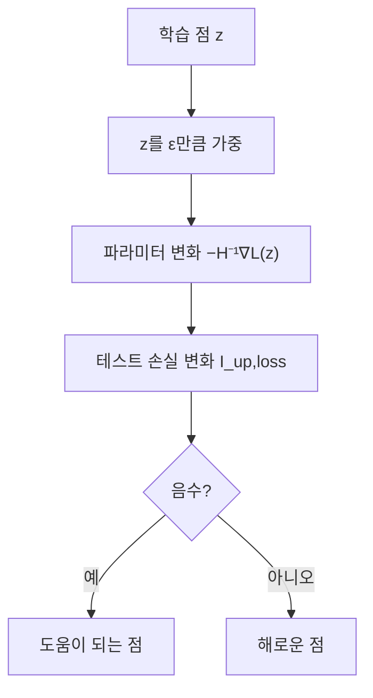
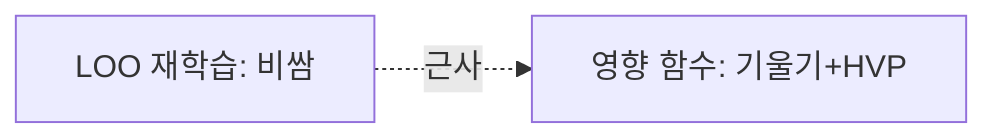

# 영향 함수 기반 가치 평가

> **영향 함수(influence function)** 로 "학습 데이터 한 점을 빼거나 가중치를 바꿨다면 모델이 어떻게 달라졌을까"를 **재학습 없이 기울기와 헤시안으로 근사**한다. LOO 가치를 계산 가능한 비용으로 근사하는 방법이다.

## 쉽게 말하면
직원 한 명을 빼고 회사를 처음부터 다시 운영해 보는 건 너무 비싸다. 대신 "그 직원의 일이 전체 결과에 얼마나 큰 영향을 주는 위치에 있는지"를 수식으로 미리 계산해 두는 것이 영향 함수다.

## 자세히
(Koh & Liang, ICML 2017, arXiv 1703.04730 본문 확인)
- **핵심 아이디어**: 점 z를 아주 조금(ε) **가중치를 올렸을 때** 최적 파라미터가 변하는 정도를 닫힌 형식으로 구한다. I_up,params(z) = −H⁻¹ ∇θ L(z, θ̂)(H는 경험적 위험의 헤시안, 양의 정부호 가정). 이는 위험 함수를 이차로 근사해 **뉴턴 스텝 한 번**을 하는 것에 해당한다. 점을 **제거하는 것은 ε = −1/n로 가중치를 올리는 것**과 같으므로 θ̂₋z − θ̂ ≈ −(1/n)·I_up,params(z)로 **재학습 없이** 제거 효과를 근사한다.
- **테스트 점 손실에 대한 영향**: 체인 룰로 "z를 가중하면 테스트 점 z_test의 손실이 얼마나 변하는가" I_up,loss(z, z_test)도 닫힌 형식. 값이 음수면 z를 더 가중하면 테스트 손실이 줄어 **도움이 되는 점**, 양수면 **해로운 점**.
- **계산**: 헤시안 역행렬을 직접 구하지 않고 **헤시안-벡터 곱(HVP)** 만 사용해 큰 모델에서도 가능하게 구현(기울기와 HVP에 대한 오라클 접근만 필요).
- **이론 가정 vs 실제(논문 4장)**: 이론은 (i) 파라미터가 경험적 위험을 최소화하고 (ii) 위험이 두 번 미분 가능하고 강볼록(strictly convex)임을 가정한다. 실험으로 LOO 재학습과 비교: 볼록 모델에서 높은 일치. 수렴하지 않은 비볼록 CNN(500k 반복, 감쇠 λ=0.01)에서도 예측 변화와 실제 손실 변화의 **피어슨 상관 0.86**. 비미분 가능 손실(힌지)을 부드러운 근사로 계산했을 때 t=0.001에서 **피어슨 R=0.95**, t=0.1에서 0.91로 높게 유지(t가 너무 크면 하락).
- **응용(초록)**: 모델 행동 이해, 디버깅, 데이터셋 오류 탐지, 시각적으로 구별 안 되는 학습 세트 공격 생성. 개 vs 물고기 실험에서 Inception 네트워크는 중요한 영향을 가진 훈련 이미지가 픽셀 거리와 거의 무관했고, 어떤 개 이미지가 모델에게는 물고기와 비슷해 보여 도움이 되었다는 점을 관찰(RBF SVM은 가까운 물고기가 대체로 도움).
- **샤플리와의 차이**: 영향 함수는 **한 모델·한 테스트 점에 대한 국소(한 점 제거) 근사**라서 LOO처럼 [중복 데이터에서 서로 가린다](#duplicate-data-substitution). 샤플리는 모든 부분집합을 평균해 대체 관계를 반영하지만 훨씬 비싸다.
- **한계**: 헤시안 계산·안정화 비용, 큰 비볼록 모델에서의 불안정, 파라미터가 많을수록 근사 품질 변동(위 R=0.86은 한 설정).

## 그림으로 보기



## 예시
```python
# 개념 코드 (HVP로 H^-1 v 를 풂)
g_test = grad(loss(model, z_test))
s_test = hvp_inverse(model, train_data, g_test)       # H^-1 g_test (LiSSA/CG)
influence = {i: -dot(s_test, grad(loss(model, z_i))) for i, z_i in enumerate(train_data)}
# 값이 크게 음수/양수인 점을 검수 후보로
```
- 오분류된 테스트 이미지에서 "가장 해로운 학습 이미지" 상위 10개를 보고 라벨 오류·중복 여부 점검.

## 헷갈리는 것과 비교
| 방법 | 단위 | 비용 | 특징 |
|---|---|---|---|
| 영향 함수 | 한 모델·한 점 근사 | 중간(HVP) | 재학습 없음, 가정 필요 |
| [LOO](#leave-one-out-value) | 한 점 제거 재학습 | 높음 | 정확하나 중복에 약함 |
| 샤플리 | 모든 부분집합 평균 | 매우 높음 | 대체 관계 반영 |

## 더 읽을거리
- [Understanding Black-box Predictions via Influence Functions (arXiv 1703.04730)](https://arxiv.org/abs/1703.04730) — 정의·검증·응용(PDF 본문 확인).
