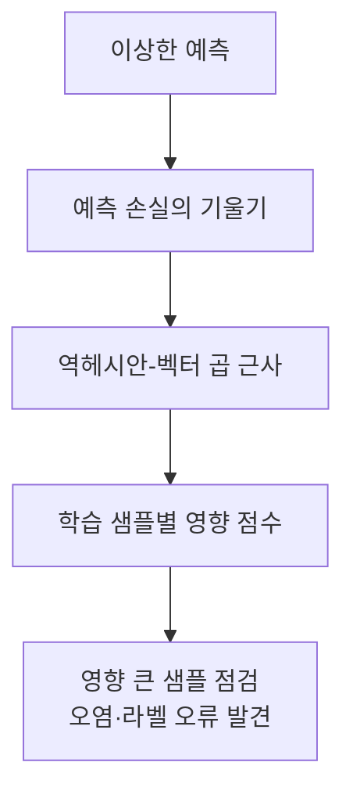
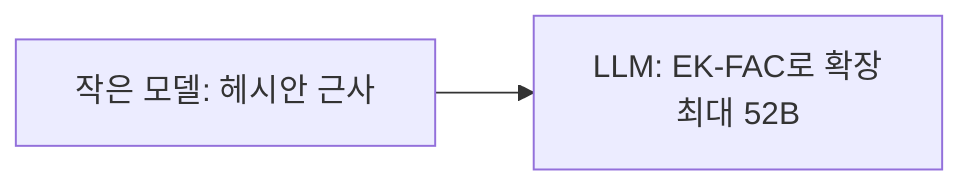

# 영향 함수

> 영향 함수(influence functions)는 모델의 어떤 예측이나 행동을 **책임이 큰 학습 샘플까지 거슬러 추적**하는 도구다. "이 학습 데이터 한 건을 빼거나 더하면 모델이 어떻게 달라질까"를 다시 학습하지 않고 근사한다.

## 쉽게 말하면
시험에서 특정 문제를 틀렸을 때 "공부하면서 본 어떤 문제집 페이지 때문에 이렇게 외웠구나"를 역추적하는 것이다. 문제집 페이지를 하나씩 빼고 다시 공부해 볼 수 없으니, 수학으로 그 영향을 근사한다.

## 자세히
- **원조(Koh & Liang, ICML 2017, arXiv 1703.04730, 초록 직접 확인)**: 로버스트 통계의 고전 도구를 가져와 예측을 학습 알고리즘을 거쳐 가장 책임 큰 학습 점까지 추적한다. 그라디언트와 **헤시안-벡터 곱**만 있으면 되는 효율적 구현을 만들어 현대 모델에 쓴다. 볼록하지 않은·미분 불가능한 모델에서는 이론이 깨지지만 근사로도 유용한 정보를 준다고 저자들이 보고한다. 선형 모델과 CNN에서 ① 모델 행동 이해 ② 디버깅 ③ 데이터 오류 탐지 ④ 눈으로 구분 안 되는 학습셋 공격 생성에 쓸 수 있음을 보였다.
- **LLM으로 확장(Grosse 외, arXiv 2308.03296, 2023-08, 초록 직접 확인)**: 표준 영향 추정은 역헤시안-벡터 곱이 필요해 LLM에서는 어렵다. 저자들은 **EK-FAC**로 최대 520억 파라미터 모델까지 확장했고, 전통적 추정기와 정확도가 비슷하면서 역헤시안 단계가 훨씬 빠르다고 보고한다. TF-IDF 필터링과 질의 배치로 후보 학습 시퀀스의 그라디언트 계산 비용을 줄였다. 발견: 영향 패턴은 희소하고, 규모가 커질수록 추상성이 늘며(수학·프로그래밍·다국어 일반화·롤플레이 분석), 핵심 구문의 **순서를 뒤집으면 영향이 거의 0**이 되는 한계가 있다. (페이지에서 소속은 확인되지 않았다.)
- **데이터 가치 평가와의 관계(해석)**: Shapley 값([Shapley 값](#shapley-value))이 모든 부분집합 평균인 반면 영향 함수는 모델 근방에서의 1차 근사라 훨씬 싸지만 가정(손실 곡면 모양)에 의존한다.
- **한계**: 비볼록 모델에서 근사 오차, 거대 모델에서 계산 비용, 여러 데이터의 조합 효과는 포착하기 어렵다.

## 그림으로 보기

## 예시
- 분류기가 이상한 이미지를 높은 확신으로 오분류할 때 영향이 큰 학습 이미지를 보고 라벨 오류를 찾는다.
- 교육 소재: "AI의 답은 어느 학습 데이터에서 왔나?"를 보여 주는 설명 가능성 사례.

## 헷갈리는 것과 비교
| 개념 | 차이 |
|---|---|
| 영향 함수 | 모델 근방 1차 근사로 샘플 영향 추정 |
| [Shapley 값](#shapley-value) | 모든 부분집합 평균, 비쌈 |
| [Leave-one-out 가치](#leave-one-out-valuation) | 실제로 빼고 재학습 |
| [데이터 보상·거래 논의](#data-compensation-markets) | 가치를 돈으로 연결하는 문제 |

## 더 읽을거리
- [Understanding Black-box Predictions via Influence Functions (arXiv 1703.04730)](https://arxiv.org/abs/1703.04730) — 원조 논문(초록 확인).
- [Studying LLM Generalization with Influence Functions (arXiv 2308.03296)](https://arxiv.org/abs/2308.03296) — EK-FAC·52B(초록 확인).
