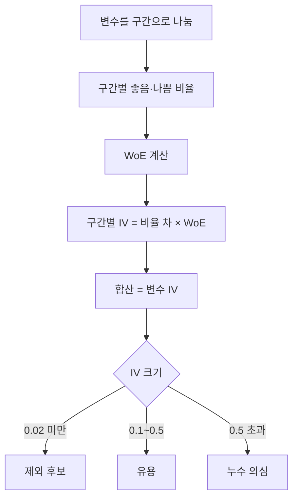

# IV(정보값, Information Value)

> 한 변수(구간화한 특성)가 "좋은 고객 vs 나쁜 고객" 또는 "사건 vs 비사건"을 얼마나 잘 가르는지를 **숫자 하나**로 요약하는 지표. 구간별 `(좋음 비율 − 나쁨 비율) × WoE`를 모두 더한다.

## 쉽게 말하면
두 반 학생을 키로 구분할 수 있는지 보는 상황을 떠올리자. 한 반은 거의 큰 사람, 다른 반은 거의 작은 사람이면 키는 반을 잘 가르는 변수다. IV는 그 "가르는 힘"을 점수로 매긴 것이다. 두 반의 키 분포가 똑같으면 0이다.

## 자세히
출처: OptBinning 튜토리얼(본문 확인: 표의 IV가 구간 합과 일치, "Jeffrey's divergence"로 소개), 검색 요약(공식·임계값은 여러 자료).
- **공식**: `WoE_i = ln(%비사건_i / %사건_i)`, `IV = Σ (%비사건_i − %사건_i) × WoE_i`. 구간별 IV를 더한 것이 전체 IV다. 사건 방향 부호는 도구마다 달라도 IV는 늘 0 이상이다(항이 모두 비음수).
- **관습적 해석(Siddiqi 2017을 따른 자료 기준)**: <0.02 예측력 없음, 0.02~0.1 약함, 0.1~0.3 중간, 0.3~0.5 강함, 0.5 초과는 **의심(누수 가능)**으로 보는 자료가 있다. 이 구간은 통계적 근거가 아닌 관습이라는 비판 논문이 있다.
- **함정 1**: 구간을 너무 잘게 쪼개면 표본이 적은 구간이 생겨 IV가 부풀려진다(노이즈).
- **함정 2**: 정답을 미리 아는 변수(미래 정보)가 들어가면 IV가 비정상적으로 높다.
- **이론(주장)**: 2025 arXiv 프리프린트는 IV를 두 분포의 Jeffreys 발산과 같다고 주장한다. 합의된 정설은 아니다.
- **쓰임**: 변수 선택(IV 낮은 변수 제외), 구간화 비교([WoE 구간화](#woe-binning)), 모형 안정성 점검.

## 그림으로 보기


## 예시
구간 3개, 좋음 800명·나쁨 700명인 변수(직접 계산):

| 구간 | 좋음 비율 | 나쁨 비율 | WoE | 구간 IV |
|---|---|---|---|---|
| A | 0.500 | 0.143 | 1.253 | 0.447 |
| B | 0.375 | 0.286 | 0.272 | 0.024 |
| C | 0.125 | 0.571 | −1.520 | 0.678 |

합계 IV ≈ 1.15 → 매우 높다. 실무에서 이만큼 나오면 누수나 과도한 구간화를 먼저 의심한다.

```python
from optbinning import OptimalBinning
optb = OptimalBinning(name="x", dtype="numerical").fit(x, y)
print(optb.binning_table.build())   # 구간별 WoE, IV와 Totals
```

## 헷갈리는 것과 비교
| 개념 | 차이 |
|---|---|
| IV | 변수 전체의 구분력(구간 WoE의 가중 합) |
| [WoE 구간화](#woe-binning) | 구간별 위험 값 계산 방법 |
| 정보 이득(트리) | 노드 분할 기준, 엔트로피 기반 |
| [OptBinning](#optbinning) | IV·WoE를 자동 계산하는 도구 |

## 더 읽을거리
- [OptBinning 이진 분류 튜토리얼](https://gnpalencia.org/optbinning/tutorials/tutorial_binary.html) — 구간표의 IV가 합산됨을 확인
- [arXiv 2509.09855](https://arxiv.org/abs/2509.09855) — IV를 Jeffreys 발산으로 보는 프리프린트(주장 수준)
