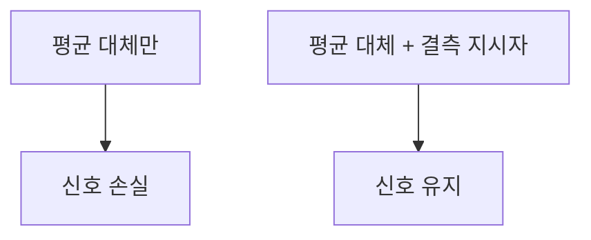

# 정보성 결측

> 값이 비어 있다는 사실 자체가 예측하려는 결과와 관련 있는 경우다. 이때는 어떤 값으로 채우든 정보를 잃고, 결측 지시자를 함께 넣어야 한다.

## 쉽게 말하면
위독한 환자에게는 일부 검사를 하지 않는다. 검사 기록이 "없다"는 것이 곧 "상태가 나쁘다"는 정보다. 빈칸을 평균으로 채우면 이 신호가 사라진다.

## 자세히
(Josse 외 arXiv 1902.06931과 FIMD 1.3.7을 하위 에이전트가 원문으로 읽은 노트 기준. "검사 미시행" 표현은 에이전트의 풀어 쓴 설명이다.)
- **의료 예(Josse 외)**: 위독한 환자에게는 측정이 비현실적이라 결측이 목표(환자 상태)와 관련된다.
- **장난감 예(Example 3)**: Y = X₁(관측 시), 3·X₁(결측 시)일 때 **결측 지시자 없이는 어떤 대체도 실패**한다. 평균 대체는 1/2을 예측하지만 최적은 3/2.
- **지시자 방법(FIMD 1.3.7)**: 모든 데이터를 유지하며 무작위 시험의 기준선 공변량에서는 타당(White & Thompson 2005). 그러나 MCAR 아래에서도 크게 편향될 수 있고(Vach & Blettner 1991; Greenland & Finkle 1995; Knol 2010) 결과 변수 결측이나 관찰 연구에서는 실패한다.
- **실무(제안)**: 예측 목적이면 지시자(`add_indicator=True`) 사용을 검토([MissingIndicator](#missing-indicator-class)), 추론 목적이면 지시자 방법의 편향 위험에 주의.

## 그림으로 보기

## 예시
- 신용 평가에서 "소득 미기입"이 연체 위험과 상관되면 결측 지시자가 유용.
- 교육 활용: 같은 데이터로 지시자 유무에 따른 모델 성능 비교.

## 헷갈리는 것과 비교
| 개념 | 차이 |
|---|---|
| 정보성 결측 | 결측 여부가 결과와 관련 |
| MCAR | 결측이 무작위, 정보 없음 |
| [결측 지시자 특징](#missing-indicator-feature) | 이를 활용하는 방법 |

## 더 읽을거리
- [On the consistency of supervised learning with missing values (arXiv 1902.06931)](https://arxiv.org/abs/1902.06931) — 정보성 결측과 지시자.
- [FIMD 1.3절](https://stefvanbuuren.name/fimd/sec-simplesolutions.html) — 지시자 방법.
