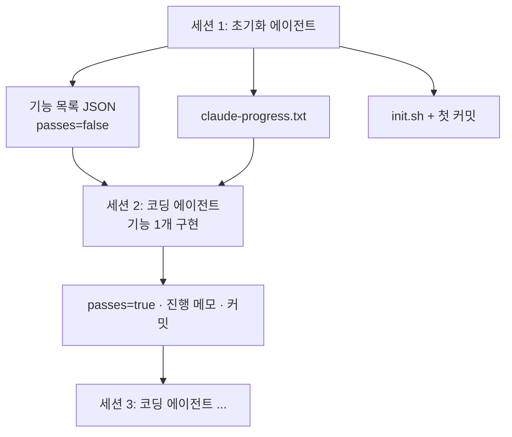
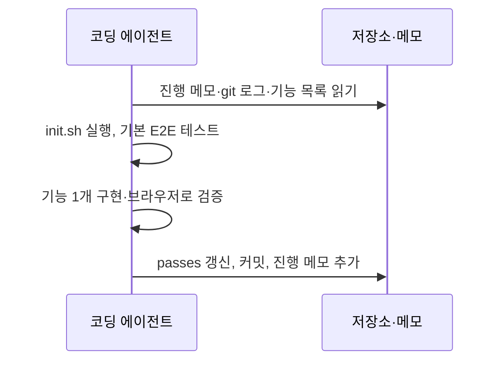

# 초기화·코딩 에이전트 패턴

> 오래 걸리는 작업을 **여러 컨텍스트 창(세션)에 걸쳐** 이어 가기 위한 두 단계 하네스. 첫 세션의 **초기화 에이전트**가 환경과 기능 목록을 세팅하고, 이후 세션마다 **코딩 에이전트**가 기능 하나씩 구현한 뒤 깨끗한 상태와 진행 기록을 남긴다. Anthropic 엔지니어링 글에서 소개됐다.

## 쉽게 말하면
교대 근무 공장이다. 첫 근무조가 작업장 정리, 할 일 목록, 인수인계 노트를 만들어 두고, 다음 근무조는 매번 기억이 없으므로 노트부터 읽고 한 가지 작업만 끝낸 뒤 노트를 갱신하고 퇴근한다.

## 자세히
(Anthropic Engineering, "Effective harnesses for long-running agents" 요약)
- **문제**: 새 세션은 이전 작업을 기억하지 못한다. 컴팩션(요약)만으로는 부족했고, 에이전트가 **한 번에 너무 많이 하려 하거나**, 기능 몇 개만 만들고 **프로젝트가 끝났다고 선언**하는 일이 있었다.
- **초기화 에이전트(첫 세션)**: ① 개발 서버를 띄우는 `init.sh`, ② `claude-progress.txt` 진행 로그, ③ 첫 git 커밋, ④ **200개 이상의 요구사항**을 담은 기능 목록(처음엔 전부 "실패")을 만든다.
- **기능 목록은 JSON**: 항목마다 카테고리·설명·테스트 단계·`passes` 필드가 있고, 코딩 에이전트는 **`passes`만 바꿀 수 있다**. 저자들은 모델이 마크다운보다 JSON을 덜 엉성하게 덮어쓴다고 보아 JSON을 택했다.
- **코딩 에이전트(이후 세션)**: **기능 하나**에 집중하고, 끝나면 코드를 병합 가능한 깨끗한 상태로 두며 설명적인 커밋과 진행 메모를 남긴다. git으로 잘못된 변경을 되돌릴 수 있다.
- **세션 시작 루틴**: 작업 디렉터리 확인 → 진행 메모·git 로그·기능 목록 읽기 → `init.sh` 실행 후 **기본 end-to-end 테스트**로 망가진 상태부터 확인 → 새 작업 시작.
- **검증**: 에이전트가 단위 테스트나 `curl`만 하고 완료 처리하는 일이 많았고, 사람처럼 브라우저를 조작하는 자동화(Puppeteer MCP)를 쓰자 개선됐다(경고창 같은 일부 영역은 여전히 어려움).
- **열린 질문**: 범용 에이전트 하나가 나은지, 테스트·QA·정리 전담 에이전트를 둔 멀티에이전트가 나은지는 미정이라고 저자들이 밝힌다. 이 패턴은 웹앱 개발 맥락의 사례이며 다른 분야 일반화는 아직 검증 단계다.

## 그림으로 보기



## 예시
```json
{
  "category": "functional",
  "description": "새 채팅 버튼을 누르면 빈 대화가 생성된다",
  "steps": ["메인 화면 열기", "새 채팅 클릭", "빈 대화 확인"],
  "passes": false
}
```
- 비개발자 교육: "AI에게 큰 일을 맡길 땐 체크리스트 파일과 인수인계 노트를 만들게 하고, 한 번에 한 항목만 끝내도록 한다."

## 헷갈리는 것과 비교
| 개념 | 차이 |
|---|---|
| 초기화·코딩 에이전트 | 세션 간 인수인계를 위한 역할 분리 |
| [하네스](#harness) | 에이전트를 둘러싼 실행 틀 전반 |
| 컴팩션 | 대화 요약으로 컨텍스트 줄이기(이 패턴은 파일 기록을 병행) |
| [서브에이전트](#subagents) | 한 세션 안에서 작업을 위임 |

## 더 읽을거리
- [Anthropic: Effective harnesses for long-running agents](https://www.anthropic.com/engineering/effective-harnesses-for-long-running-agents) — 원문.
