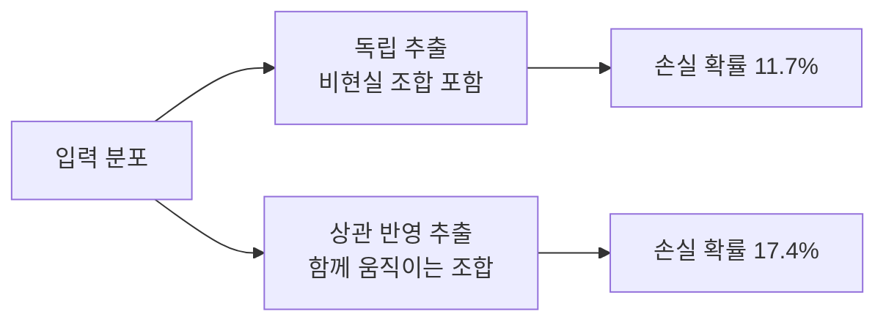
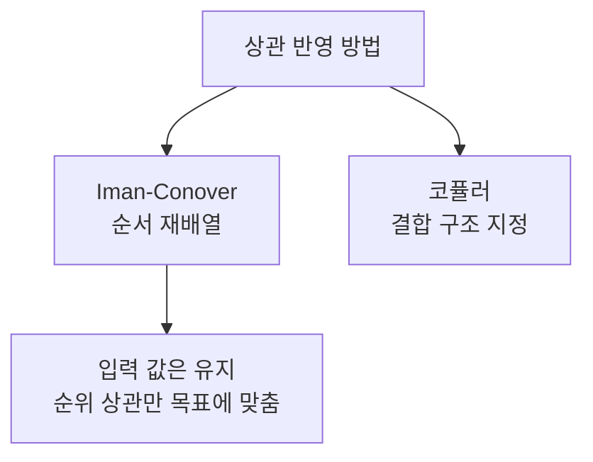

# 입력 간 상관

> 몬테카를로 ROI에서 입력들을 서로 독립으로 추출하면 "사용률이 낮은데 절감 시간만 큰 경우"처럼 현실에서 거의 안 일어나는 조합이 섞인다. 입력 간 상관을 반영하면 결과의 폭과 손실 확률이 달라진다. 방향은 모델 구조에 따라 늘 수도, 줄 수도 있다.

## 쉽게 말하면
키와 몸무게를 따로따로 뽑으면 키 190cm에 몸무게 40kg인 사람이 나올 수 있다. 둘은 함께 움직인다는 사실을 알려 주어야 현실적인 사람들이 뽑힌다. AI 도입에서도 현업이 자주 쓰면 한 번에 절감하는 시간도 늘기 쉽다.

## 자세히
- **분산에 미치는 영향(Wikipedia Variance, 열람)**: 두 변수의 합의 분산은 Var(X)+Var(Y)+2·Cov(X,Y)이다. 공분산 항을 무시하면 양의 상관일 때 합의 분산이 과소, 음의 상관일 때 과대 평가된다. 곱(Var(XY))도 두 변수가 종속이면 공식이 달라진다.
- **방향은 상황에 따라 다르다(Henke, JCAP 2021, 검색 요약만 확인)**: 비용 위험 분석 논문은 입력 상관이 부정확하면 최종 비용의 분산이 부풀거나 줄어든다고 말한다. 따라서 "상관을 무시하면 항상 폭이 줄어든다"는 일반 규칙은 근거가 없다.
- **상관을 만드는 방법(Iman-Conover, aggregate 문서 설명, 검색 결과로만 확인)**: 각 입력의 분포에서 표본을 뽑은 뒤 열별로 순서를 재배열해 목표 순위 상관을 맞춘다. 값 자체는 그대로 두고 순서만 바꾼다. 원 논문의 맥락은 입력 변수를 독립으로 가정하는 기본값의 문제였다(Sandia/NRC 보고서 소개). 연결 구조(코퓰러)까지 넣을 수 있다는 논문도 있다(arXiv 1508.02749, 요약).
- **가상 예시(직접 시뮬레이션)**: 연 순효과(백만 원) = 36 × 사용률 × 월 절감 시간 − 36. 사용률은 삼각분포(0.3·0.6·0.9), 절감 시간은 삼각분포(1·2.5·5시간)로 두고 20만 번 추출(가우시안 코퓰러로 상관 부여).
  - 독립(ρ=0): 평균 25.2, 표준편차 22.1, 손실 확률 11.7%, 90% 구간 −6.3~66.0
  - 상관 0.7: 평균 27.8, 표준편차 28.7, 손실 확률 17.4%, 90% 구간 −12.1~82.2
  - 이 모델은 곱셈 구조라 양의 상관이 평균과 폭, 손실 확률을 모두 키웠다. 두 입력이 함께 나쁠 때 같이 나빠지기 때문이다. 수치는 설명용 가상값이며 입력 분포·상관이 달라지면 결과도 달라진다.
- **상관 값은 어디서(해석)**: 파일럿 데이터가 있으면 두 변수의 실제 상관을, 없으면 0·0.3·0.7처럼 몇 가지를 가정해 민감도로 본다. 상관을 "가정"으로 표시한다.

## 그림으로 보기

## 예시
- 상담 AI ROI: 사용률과 건당 절감 시간을 파일럿 20개 팀의 데이터로 상관을 구해 반영하고, 반영 전후의 손실 확률 차이를 보고서에 함께 적는다.
- 교육 활용: 독립 가정과 상관 0.7 가정 결과를 나란히 보여 주고 "독립 가정은 안전한 기본값이 아니다"를 토론한다.

## 헷갈리는 것과 비교
| 개념 | 차이 |
| --- | --- |
| [몬테카를로 ROI](#monte-carlo-roi) | 상위 방법. 입력 상관은 그 입력 설정의 한 쟁점 |
| [시나리오 분석](#scenario-analysis-roi) | 상관을 이야기로 묶어 비관·낙관 묶음으로 처리 |
| [이원 민감도 분석](#two-way-sensitivity) | 두 변수를 격자로 조합. 상관은 어떤 조합이 현실적인지를 알려 줌 |

## 더 읽을거리
- [Wikipedia: Variance](https://en.wikipedia.org/wiki/Variance) — 합·곱의 분산과 공분산 항
- [aggregate 문서: The Iman-Conover Method](https://aggregate.readthedocs.io/en/latest/5_technical_guides/5_x_iman_conover.html) — 순위 상관 부여 방법
