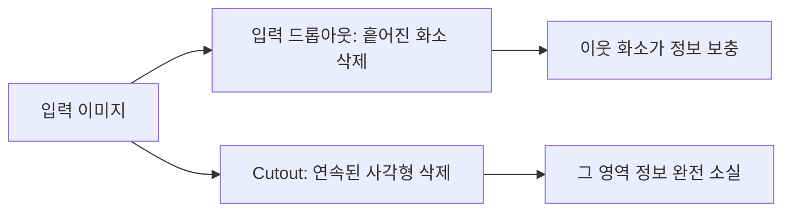
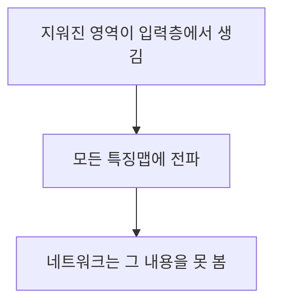

# 입력 드롭아웃과 Cutout

> 둘 다 입력 이미지를 가리는 정칙화지만, **입력 드롭아웃은 화소를 흩어서 무작위로 지우고 Cutout은 연속된 한 덩어리 영역을 지운다.** 이웃 화소가 비슷한 정보를 가진 이미지에서는 덩어리째 가려야 정보가 실제로 사라진다.

## 쉽게 말하면
신문 사진 위에 후추를 뿌리면(입력 드롭아웃) 점들 사이로 여전히 사진이 보인다. 반면 포스트잇으로 한 곳을 덮으면(Cutout) 그 부분 정보는 완전히 없어진다. 이웃 화소들이 서로 비슷해서 점 몇 개가 빠져도 이웃이 대신 알려 주기 때문이다.

## 자세히
- **논문의 설명**(DeVries & Taylor 2017, ar5iv 확인): Cutout은 **입력층에서만** 단위를 지운다. 중간 특징맵에서 지우지 않고, 흩어진 개별 화소가 아니라 **연속된 정사각형**을 지운다. 지워진 영역은 이후 모든 특징맵에 전파되어 네트워크가 그 내용을 전혀 보지 못한다. 합성곱층에서 드롭아웃의 효과가 떨어지는 이유는 이웃 화소가 같은 정보를 담고 있어 하나를 지워도 이웃이 전달하기 때문이며, 영역 전체를 지우면 이 중복을 피한다. 저자들은 Cutout을 "공간 사전지식이 있는 입력 공간의 드롭아웃"이자 드롭아웃보다는 **데이터 증강**(가려진 이미지를 만듦)에 가깝다고 본다. 테스트 때 가중치 재조정이 필요 없다.
- **직접 실행**(digits 8×8 손글씨, 작은 CNN, 학습 718장, 60 에폭, 5 시드 평균±표준편차. 가려지는 면적을 맞춤: Cutout 한 변 4는 평균 19.2%가 가려짐):

| 방식 | 가려지는 정도 | 시험 정확도 |
|---|---|---|
| 없음 | 0% | 0.976 ± 0.003 |
| Cutout 변 4 | 평균 19.2% | 0.976 ± 0.003 |
| 화소 드롭아웃 p=0.15 | 15% | 0.977 ± 0.002 |
| 화소 드롭아웃 p=0.2 | 20% | 0.967 ± 0.008 |
| 화소 드롭아웃 p=0.3 | 30% | 0.969 ± 0.004 |

- 해석: **이 쉬운 8×8 데이터에서는 두 방식의 차이를 구별할 수 없다**(모두 기준선과 표준편차 범위 안이거나 소폭 하락). 화소 드롭아웃은 비율이 올라가자 0.967~0.969로 약간 떨어졌다. 논문의 주장("영역 단위가 더 효과적")을 이 실험이 확인하거나 반박하지 못한다. 8×8 숫자 이미지는 해상도가 낮아 이웃 화소 중복이 적고, 모델·데이터가 너무 쉽기 때문이다(해석). 논문이 다룬 것은 CIFAR·SVHN 같은 더 큰 이미지다.
- **정리**: 이웃 화소 중복이 큰 고해상도 자연 이미지에서 연속 영역 마스킹의 근거가 더 강하고, 저해상도·표 형태 데이터에서는 화소 단위 드롭아웃이 충분할 수 있다(가설).

## 그림으로 보기

## 예시
- 고해상도 제품 사진 분류에서 Cutout을 쓰면 일부 부품이 가려져도 다른 단서로 분류하는 능력을 학습.
- 교육: 같은 사진에 후추 노이즈 vs 포스트잇을 시각적으로 보여 주고 사람이 알아보는 정도를 비교하는 활동.

## 헷갈리는 것과 비교
| 개념 | 차이 |
|---|---|
| 입력 드롭아웃 | 화소 단위 무작위 삭제, 테스트 시 재조정 개념 |
| Cutout | 연속 영역 삭제, 데이터 증강에 가까움 |
| 중간층 드롭아웃 | 특징맵에서 삭제, Cutout과 다른 위치 |
| [Cutout 패치 크기](#cutout-patch-size) | Cutout의 핵심 하이퍼파라미터 |

## 더 읽을거리
- [Cutout 논문 — ar5iv](https://ar5iv.labs.arxiv.org/html/1708.04552) — 드롭아웃과의 차이 서술(열어 확인).
- [scikit-learn digits 데이터셋](https://scikit-learn.org/stable/datasets/toy_dataset.html) — 실험 데이터(열어 확인).
