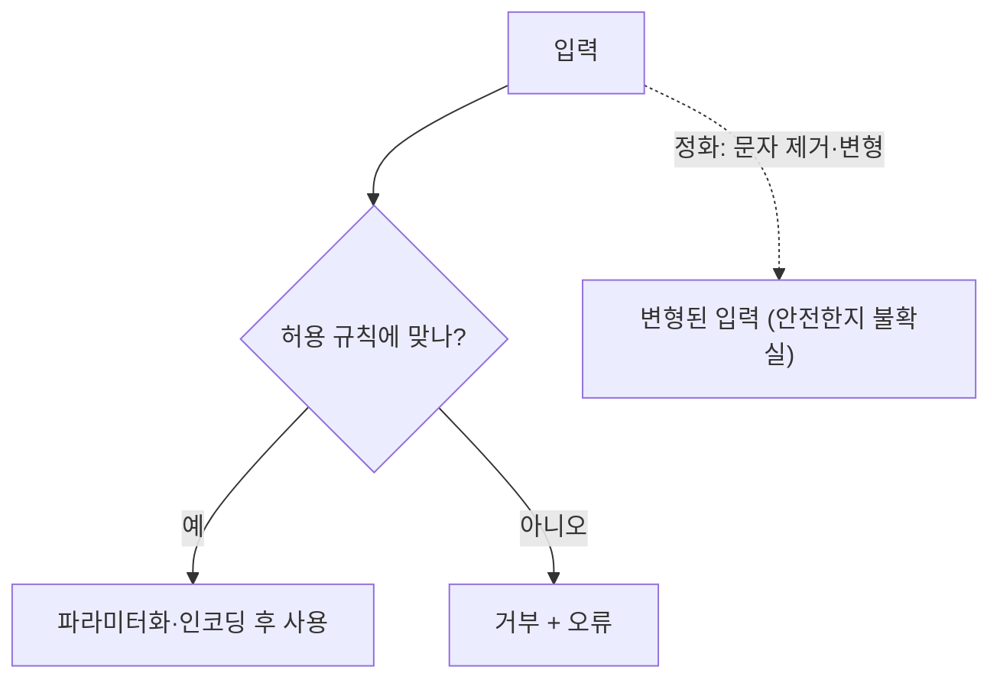

# 검증과 정화의 차이

> 검증(validation)은 입력이 규칙에 맞는지 보고 아니면 **거부**하는 것이고, 정화(sanitization)는 입력을 **고쳐서** 통과시키는 것이다. OWASP는 허용 목록 검증을 권하고, "문자를 지워서 청소하는" 방식을 일반 전략으로 쓰지 말라고 한다.

## 쉽게 말하면
공항 보안검색에서 금지 물품이 나오면 (검증) 통과를 막고 사정을 알린다. (정화) 가방 속에서 의심스러운 부분만 가위로 잘라내고 들여보내면 남은 것이 안전한지, 잘라낸 결과가 새 위험이 되지 않는지 알 수 없다. 그래서 거부가 더 단순하고 안전하다.

## 자세히
OWASP Input Validation Cheat Sheet 기준.
- **허용 목록 vs 차단 목록**: 허용 목록은 받아들일 형식만 정의하고 나머지는 거부한다(권장). 차단 목록은 "모든 악성 문자열을 인식하려 하지 말라"며 비권장이다. 예: 아포스트로피 차단은 정상 이름(O'Brien)을 거부하면서 쿼리를 안전하게 만들지도 못한다.
- **구문 검증 vs 의미 검증**: 구문은 타입·형식·길이·배열 크기. 의미는 연산에 맞는 값인지(예: 예약 종료일이 시작일보다 뒤).
- **검증 vs 정화**: 검증은 규칙에 따라 수락/거부, 틀리면 명확한 오류로 거부해 일부만 검증된 데이터로 진행하지 않는다. 정화는 입력을 바꾸므로 일반 전략으로 쓰지 않는다. 정규화(normalization)는 정화도, 출력 인코딩의 대체도 아니다.
- **예외**: 사용자가 쓴 리치 HTML은 유지·관리되는 HTML 정화 라이브러리를 써야 한다. 정규식으로는 대체할 수 없다.
- **검증은 인젝션 방어의 주축이 아니다**: 문자를 지워도 파라미터화 쿼리나 출력 인코딩을 대신하지 못한다. SQL은 파라미터화, XSS는 상황별 [출력 인코딩](#output-encoding)이 1차 방어이고 검증은 보조다(이 요약은 문서 취지를 풀어 쓴 것).
- LLM 앱에도 같은 교훈이 적용된다: 프롬프트 인젝션을 문구 차단 목록으로 막으려는 시도는 우회되기 쉬우므로 권한 분리·허용 목록 도구 호출이 우선이다([프롬프트 인젝션](#prompt-injection), 주장: 일반적 보안 원칙의 적용).

## 그림으로 보기

## 예시
- 나이 필드: 정수 0~150만 허용, 그 외는 400 응답(검증).
- 정렬 컬럼: 목록에 있는 이름만 허용([ORDER BY 인젝션](#order-by-injection)).
- 게시글 HTML: 자체 정규식 대신 검증된 HTML 정화 라이브러리 사용.

## 헷갈리는 것과 비교
| 개념 | 차이 |
| --- | --- |
| 검증 | 규칙 불일치 시 거부 |
| 정화 | 입력을 수정해 통과 |
| [허용 목록](#allowlist-validation) | 허용 형식만 정의하는 검증 방식 |
| 차단 목록 | 나쁜 패턴만 막음, 우회 쉬움 |
| [출력 인코딩](#output-encoding) | 출력 맥락에 맞게 변환, 검증과 별개 |

## 더 읽을거리
- [Input Validation Cheat Sheet (OWASP)](https://cheatsheetseries.owasp.org/cheatsheets/Input_Validation_Cheat_Sheet.html) — 허용/차단 목록, 구문·의미 검증, 정화 경고
