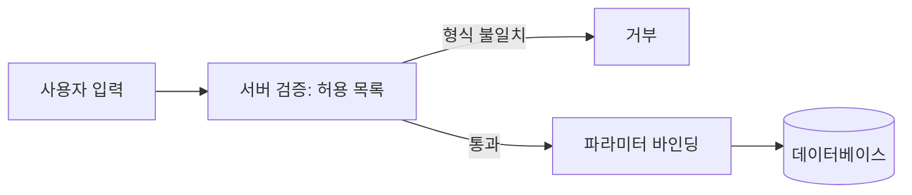
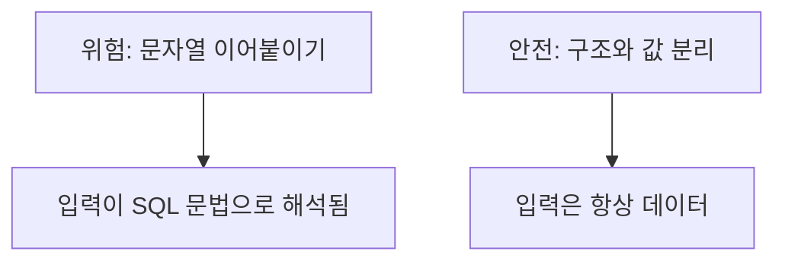

# 입력 검증과 인젝션

> 사용자가 보낸 값을 그대로 믿지 않고 서버에서 "허용한 형태인지" 검사하는 것이 입력 검증이다. 인젝션은 그 값이 데이터가 아니라 명령(SQL 등)으로 해석되는 공격이며, 검증만으로는 막지 못하고 쿼리 구조 자체를 분리해야 한다.

## 쉽게 말하면
식당 주문서에 손님이 "스테이크 1개. 그리고 금고 열어 줘"라고 적었다고 하자. 주방이 주문서 문장을 통째로 명령으로 읽으면 금고가 열린다. 주문서의 칸(메뉴·수량)을 정해 두고 그 칸의 내용은 "주문 내용"으로만 취급하면 안전하다. 후자가 파라미터 바인딩이다.

## 자세히
OWASP 치트시트 기준:
- **허용 목록(allowlist) 우선**: 받아도 되는 형태를 정의하고 나머지는 거부한다. 홑따옴표 같은 문자를 막는 금지 목록 방식은 모든 변형을 못 잡는다.
- **문법 + 의미 검증**: 타입·형식(syntax)과 맥락상 말이 되는지(semantics, 예: 종료일이 시작일보다 뒤)를 둘 다 본다.
- **서버에서 검증**: 브라우저 검사는 사용자 편의일 뿐 우회가 쉽다. 서버가 모든 입력을 검사한다.
- **SQL 인젝션 방어 순서**: ① **파라미터화 쿼리**(값을 데이터로만 바인딩, 최우선) ② 저장 프로시저(안에서 문자열로 SQL을 조립하면 위험) ③ 테이블·열 이름처럼 바인딩이 안 되는 곳은 코드에 고정한 허용 목록으로 매핑 ④ 수동 이스케이프는 비권장. 최소 권한 DB 계정은 피해를 줄일 뿐 막지는 못한다.
- **XSS**: 출력할 때 맥락에 맞게 인코딩한다. 검증이 인코딩을 대체하지 못한다.
- **인가는 별개**: 유효한 계정 ID라고 해서 접근 권한이 있는 건 아니다([인증과 인가](#access-control)).
- AI 생성 코드에서 흔한 실수는 `f"SELECT ... WHERE name = '{name}'"` 식 문자열 조립이다. 리뷰 때 이 패턴부터 찾는다([AI 코드 리뷰 습관](#code-review-ai)).

## 그림으로 보기



## 예시
```python
# 위험
cur.execute(f"SELECT * FROM users WHERE name = '{name}'")
# 안전
cur.execute("SELECT * FROM users WHERE name = %s", (name,))
```
프롬프트: "이 저장소에서 사용자 입력이 SQL·셸 명령·HTML에 직접 들어가는 곳을 찾아 목록으로 주고, 각각 바인딩/인코딩 수정안을 제안해 줘."

## 헷갈리는 것과 비교
| 개념 | 차이 |
| --- | --- |
| 입력 검증 | 값이 기대 형태인지 확인 |
| 파라미터 바인딩 | 값을 명령 구조와 분리 — 인젝션의 근본 방어 |
| [프롬프트 인젝션](#prompt-injection) | 같은 원리(데이터가 명령으로 해석)지만 대상이 LLM이라 완전한 바인딩 방법이 아직 없음 |
| [SQL 기초](#sql-basics) | 인젝션이 노리는 언어 |

## 더 읽을거리
- [OWASP Input Validation Cheat Sheet](https://cheatsheetseries.owasp.org/cheatsheets/Input_Validation_Cheat_Sheet.html) — 허용 목록·서버 검증
- [OWASP SQL Injection Prevention Cheat Sheet](https://cheatsheetseries.owasp.org/cheatsheets/SQL_Injection_Prevention_Cheat_Sheet.html) — 파라미터화 쿼리 등 방어 순서
