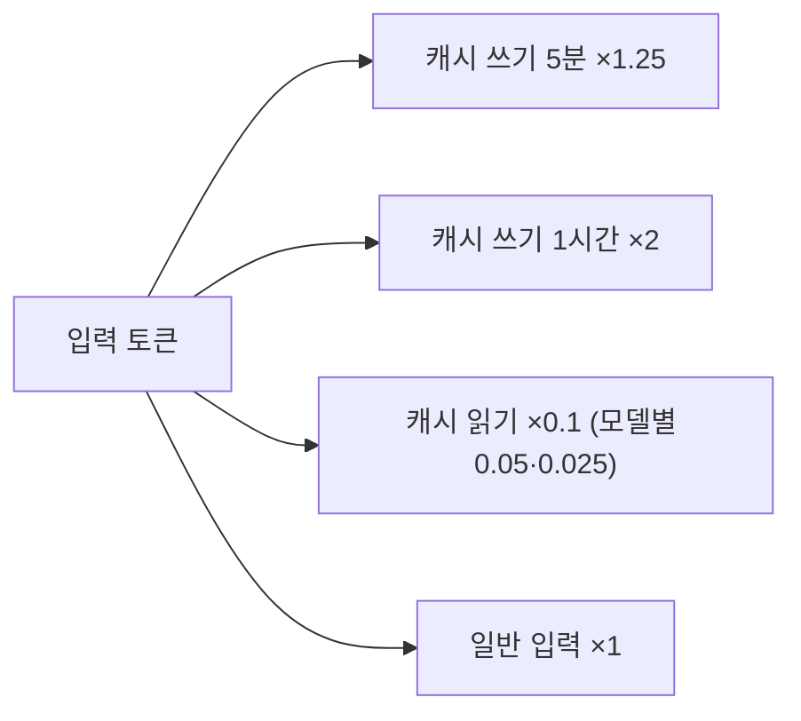

# 입력·출력 토큰 단가와 캐시 배수

> LLM API는 **입력 토큰과 출력 토큰을 다른 단가로** 청구하고, 입력 중에서도 캐시 쓰기·읽기는 기본 입력 단가에 배수를 곱해 청구한다.

## 쉽게 말하면
택시 요금이 기본요금과 거리 요금으로 나뉘듯, API 요금도 "읽은 양"과 "쓴 양"과 "재사용한 양"이 단가가 다르다. 단가표를 모르면 비용 최적화 방향을 잘못 잡는다.

## 자세히
(Anthropic 프롬프트 캐싱 문서의 배수 부분을 직접 읽었다. 기본 단가 자체(달러)는 이 문서 범위에서 확인하지 못했다. 단가·배수는 모델·날짜에 따라 바뀌므로 청구 전 공식 가격표를 재확인한다.)
- **캐시 배수(문서, 기본 입력가 대비)**: 5분 캐시 쓰기 **1.25배**, 1시간 캐시 쓰기 **2배**, 캐시 읽기(히트) **0.1배**. 일부 모델은 다르다 — 예: Opus 5.5·Sonnet 5.5는 읽기 **0.05배**, Fable/Mythos 5.1+는 **0.025배**.
- **출력 토큰 단가**: 이 문서 범위에서 확인하지 못했다. 일반적으로 출력이 입력보다 비싸다(일반 상식, 이 글에서 미확인).
- **손익분기(해석)**: 5분 캐시는 쓰기에서 25% 더 내므로 한 번이라도 읽히면(0.1배 읽기) 보통 이득이다. 읽기가 거의 없다면 손해다. 1시간 캐시는 쓰기가 2배라 더 많이 읽혀야 이득.
- **대상 프롬프트**: 반복되는 긴 시스템 프롬프트·참고 문서·few-shot 예시.

## 그림으로 보기

## 예시
- 기본 입력 1,000 토큰이 1단위라면 5분 캐시 쓰기 1.25, 이후 읽기 0.1 → 두 번째 호출부터 입력 비용이 약 90% 감소(0.1배 모델 기준).

## 헷갈리는 것과 비교
| 항목 | 배수(문서) |
|---|---|
| 일반 입력 | 1배 |
| 5분 쓰기 | 1.25배 |
| 1시간 쓰기 | 2배 |
| 읽기 | 0.1배 등 모델별 |

## 더 읽을거리
- [Anthropic — Prompt caching](https://platform.claude.com/docs/en/build-with-claude/prompt-caching) — 배수(직접 읽음).
- [OpenAI — Prompt caching](https://developers.openai.com/api/docs/guides/prompt-caching) — 다른 사업자 방식(앞선 글에서 열람, 이번엔 다시 읽지 않음).
