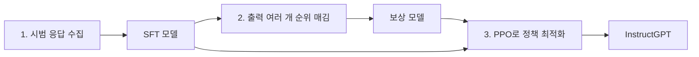
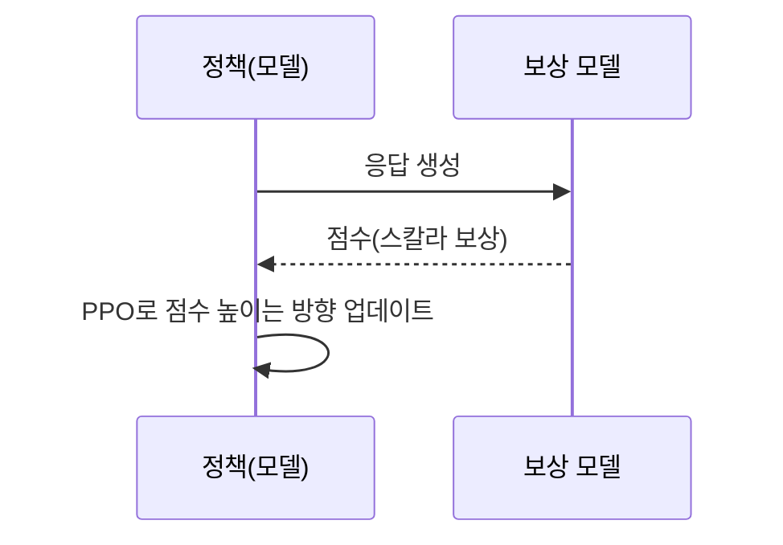

# InstructGPT 3단계

> OpenAI가 GPT-3를 사람 지시를 잘 따르는 모델로 바꾼 3단계 절차(2022): ① 사람 시범으로 지도 미세조정(SFT) ② 출력 비교로 보상 모델(RM) 학습 ③ 보상 모델을 점수로 삼아 PPO로 강화학습.

## 쉽게 말하면
신입 사원 교육과 같다. ①선배가 모범 답안을 보여 주고 따라 하게 한다 ②신입이 쓴 답안 여러 개를 상사가 "이게 더 낫다"고 순위를 매기고, 그 취향을 흉내 내는 채점관을 만든다 ③채점관 점수가 높게 나오도록 신입이 계속 연습한다.

## 자세히
(Ouyang 외, "Training language models to follow instructions with human feedback", arXiv 2203.02155 본문을 직접 읽고 확인.)
- **1단계 SFT**: 라벨러가 프롬프트에 대한 바람직한 응답을 시범으로 쓰고, 그 데이터로 사전학습된 GPT-3를 지도학습으로 미세조정.
- **2단계 RM**: 같은 프롬프트에 대한 여러 출력을 라벨러가 선호 순으로 비교한 데이터로, 사람이 선호할 출력을 예측하는 보상 모델을 학습.
- **3단계 PPO**: RM 출력을 스칼라 보상으로 써서 SFT 정책을 PPO로 최적화. 2~3단계는 반복할 수 있다(비교 데이터 대부분은 SFT 정책에서, 일부는 PPO 정책에서).
- **데이터 규모**: SFT 약 13k 프롬프트, RM 33k, PPO 31k(API 프롬프트만). 약 40명의 계약 라벨러(Upwork·ScaleAI).
- **결과(논문 보고)**: 1.3B InstructGPT 출력이 175B GPT-3보다 선호됨(파라미터 100배 적음). 175B InstructGPT는 175B GPT-3 대비 85±3%, few-shot GPT-3 대비 71±4%로 선호.
- 한계: 라벨러 40명의 선호에 맞춰진다는 점, 주로 영어 프롬프트라는 점을 논문도 언급.

## 그림으로 보기

## 예시
- 사내 챗봇: 모범 답변 300개로 SFT → 같은 질문 답변 쌍에 선호 투표 → 선호 모델로 개선(실무는 DPO 등 간소화도 흔함).
- 교육 활용: "ChatGPT는 왜 대답을 사람 취향에 맞출까"의 기본 설명.

## 헷갈리는 것과 비교
| 개념 | 차이 |
|---|---|
| InstructGPT 3단계 | SFT+RM+PPO(RLHF) 전체 파이프라인 |
| [SFT](#sft-supervised-finetuning) | 그중 1단계만 |
| 사전학습 | 대량 텍스트로 다음 단어 예측 |

## 더 읽을거리
- [InstructGPT 논문 (arXiv 2203.02155)](https://arxiv.org/abs/2203.02155) — 3단계·데이터 규모·선호 결과.
