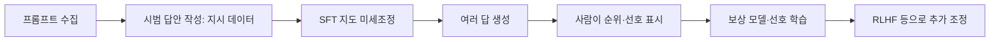
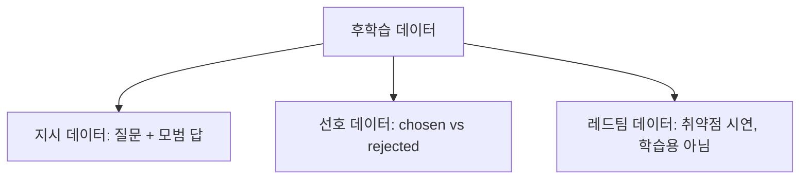

# 지시·선호 데이터

> 사전학습이 끝난 모델을 "사람이 시킨 대로, 사람이 좋아하는 방식으로" 답하게 만드는 후학습(post-training)용 데이터다. 질문과 모범 답안 쌍(지시 데이터)과, 같은 질문에 대한 두 답 중 어느 쪽이 나은지 표시한 비교 데이터(선호 데이터)가 있다.

## 쉽게 말하면
사전학습이 "책을 많이 읽은 학생"을 만든다면, 지시·선호 데이터는 "면접 코칭"이다. 시범 답안(지시 데이터)을 보여 주고, 두 답을 비교해서 "이쪽이 더 낫다"고 알려 주며(선호 데이터) 답하는 태도를 다듬는다.

## 자세히
- **InstructGPT 방식(OpenAI, arXiv:2203.02155, 초록 직접 확인)**: 프롬프트는 고용한 라벨러가 쓴 것과 OpenAI API로 들어온 것에서 모았다. ① 라벨러가 **원하는 행동의 시범 답안**을 써서 GPT-3를 지도학습으로 미세조정 ② 모델 출력 여러 개에 대한 **순위**를 모아 보상 신호를 학습 ③ 이를 이용한 인간 피드백 강화학습(RLHF)으로 추가 조정. 1.3B 파라미터 InstructGPT의 출력이 약 100배 큰 175B GPT-3의 출력보다 평가자에게 선호됐다고 보고한다. 초록은 진실성 향상과 독성 감소를 말하지만 구체 수치는 적지 않았다.
- **선호 데이터의 형태 — Anthropic hh-rlhf 예(HF 데이터셋 카드 직접 확인)**: 각 항목이 선택됨(chosen)/거부됨(rejected) 텍스트 쌍이며 선호·보상 모델 학습용. 유용성 데이터는 기본 모델·거부 샘플링·반복적 온라인 방식의 세 단계에서, 무해성 데이터는 기본 모델에서만 모았다. 기본 서브셋 약 16.9만 행(train 16.1만, test 8,550), MIT 라이선스. 카드는 이 데이터가 대화 에이전트의 **지도학습용이 아니라고** 명시하고, **레드팀 데이터**는 선호 모델링이나 미세조정용이 아니라 레드팀 방식을 보여 주는 용도라고 밝힌다. 차별 표현·학대·폭력·자해 내용이 포함될 수 있다는 경고가 있다.
- **쓰임새 정리(일반적 이해)**: 지시 데이터 → SFT(지도 미세조정) / 선호 데이터 → 보상 모델 학습이나 DPO 같은 직접 선호 최적화. 방법별 세부는 후속 노드에서 다룬다.
- **품질 이슈**: 라벨러 편향, 평가자 간 불일치, 합성 데이터(모델이 만든 선호 데이터) 의존의 한계는 별도 점검이 필요하다([라벨링 규칙서](#label-consistency-guideline), [라벨링 품질 관리](#data-labeling-qa)).
- **한계**: 이번 조사에서 다른 공개 지시 데이터셋(Dolly, OpenAssistant 등)의 구성은 직접 확인하지 못했다.

## 그림으로 보기

## 예시
- 선호 쌍 한 건(개념): `{"prompt": "환불 정책 알려줘", "chosen": "7일 이내 미사용 상품은…", "rejected": "그건 잘 모르겠어요."}`
- 사내 챗봇 튜닝: 상담 리더가 모범 답을 쓰고(지시 데이터), 두 후보 답 중 나은 것을 고르게 해(선호 데이터) 톤·정확성을 맞춘다(제안).

## 헷갈리는 것과 비교
| 개념 | 차이 |
|---|---|
| 사전학습 데이터 | 대량 비라벨 텍스트, 언어 능력 |
| 지시 데이터 | 질문-모범 답, 따르는 능력 |
| 선호 데이터 | 두 답의 우열, 취향·안전 정렬 |
| [학습 데이터 기초](#training-data-basics) | 이 데이터를 포함한 전체 분류 |

## 더 읽을거리
- [Training language models to follow instructions with human feedback (arXiv:2203.02155)](https://arxiv.org/abs/2203.02155) — InstructGPT의 시범·순위 데이터와 RLHF(초록 직접 확인).
- [Anthropic/hh-rlhf 데이터셋](https://huggingface.co/datasets/Anthropic/hh-rlhf) — chosen/rejected 쌍과 레드팀 데이터(카드 직접 확인).
