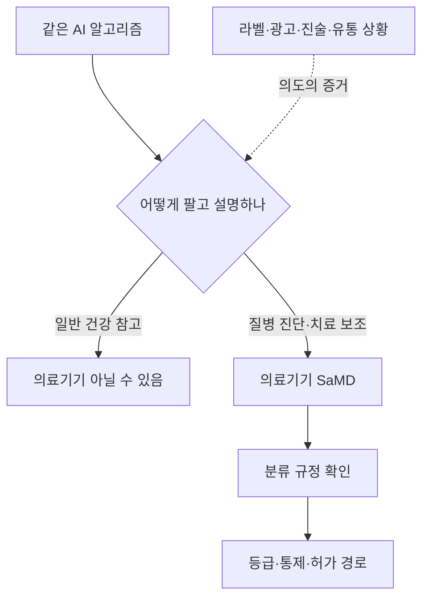

# 용도 기반 분류

> 의료기기 여부와 위험 등급은 기술이 아니라 **의도한 용도**로 정해진다. 같은 알고리즘도 "건강 관리 참고"로 팔면 규제 밖일 수 있고 "질병 진단"으로 팔면 의료기기로 분류된다.

## 쉽게 말하면
같은 칼도 요리용으로 팔면 주방용품이고, 수술용이라고 팔면 의료기기다. 칼의 모양이 아니라 "무엇에 쓰라고 하는가"가 규제를 가른다. 그래서 AI 제품에서는 설명 문구가 곧 규제 문제가 된다.

## 자세히
출처: 21 CFR 801.4(eCFR)와 FDA의 SaMD 예시 페이지(둘 다 열어서 읽음).
- **의도한 용도의 정의(801.4)**: 표시(라벨링)에 법적 책임이 있는 사람들의 **객관적 의도**를 말한다. 의도는 그들의 표현, 제품의 설계·구성, 표시 주장, 광고, 구두·서면 진술, **유통 상황**으로 드러난다. 즉 제조사가 마케팅에서 한 말도 증거다.
- **SaMD(소프트웨어 의료기기)**: FDA 예시 페이지는 의학적 목적이 있으면 범용 플랫폼(예: 스마트폰)에서 돌아가도 SaMD라고 본다. 예: 암 검출 CAD 소프트웨어, 소비자 카메라 가속도계를 쓰는 진단 소프트웨어.
- **SaMD가 아닌 예**: 기기에 내장된 제어 소프트웨어(인퓨전 펌프 모터 제어), 의학적 목적 없는 소프트웨어(데이터 암호화), 일정·환자 등록 같은 업무 흐름 도구, 검색 기능만 있는 데이터베이스(의학적 목적이 없다면).
- **구분의 한계**: 이 페이지에는 "건강 관리 vs 진단" 구분 예시나 SaMD의 공식 정의 인용이 없다. 개별 제품은 FDA에 문의하라고 안내한다.
- **등급과의 관계**: 용도가 정해지면 해당 기기 유형의 분류 규정과 위험 등급이 따라온다([의료기기 등급](#device-risk-classes), [일반 통제 vs 특별 통제](#general-vs-special-controls)).
- **실무 함의(해설)**: 마케팅 문구·고객 안내·영업 설명이 의도한 용도의 증거가 되므로 제품 설명을 규제 전략과 맞춰야 한다. 구체 판단은 전문가 확인이 필요하다.

## 그림으로 보기

## 예시
- 수면 패턴 앱이 "수면 습관 참고"라고만 안내 → 의료기기 아닐 수 있음. 같은 알고리즘이 "수면무호흡 진단"을 주장 → 의료기기로 분류될 가능성이 크다.
- 점검: 웹사이트·영업 자료의 "진단", "치료", "질병 예방" 표현을 규제 전략과 비교.

## 헷갈리는 것과 비교
| 개념 | 차이 |
|---|---|
| [의료기기 등급](#device-risk-classes) | 위험도 분류, 용도가 입력 |
| [일반 통제 vs 특별 통제](#general-vs-special-controls) | 등급별 추가 요건 |
| 내장 소프트웨어 | 기기 일부라 SaMD 별도 취급이 아님 |
| [실질적 동등성](#substantial-equivalence) | 같은 의도 용도가 첫 요건 |

## 더 읽을거리
- [21 CFR 801.4 Meaning of intended uses (eCFR)](https://www.ecfr.gov/current/title-21/chapter-I/subchapter-H/part-801/subpart-A/section-801.4) — 의도한 용도의 객관적 기준(열어서 확인)
- [What are examples of Software as a Medical Device? (FDA)](https://www.fda.gov/medical-devices/software-medical-device-samd/what-are-examples-software-medical-device) — SaMD 여부 예시(열어서 확인)
