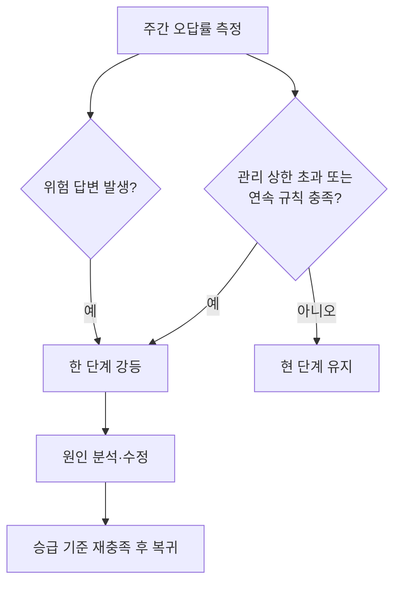

# 강등 트리거 (자율 단계 내리기)

> AI가 맡던 문의 유형을 **오답 증가·사고 같은 신호가 생기면 한 단계 낮은 자율 수준(예: 자동 응답 → 승인 후 발송)으로 되돌리는 조건**. 승급 기준과 짝으로 미리 정해 둔다.

## 쉽게 말하면
수습을 끝내고 혼자 전화를 받던 직원의 실수가 갑자기 늘면, 원인을 찾는 동안 다시 선배가 옆에서 확인해 주는 단계로 돌린다. 징계가 아니라 안전장치다.

## 자세히
출처: NIST 공학 통계 핸드북의 관리도 기초 페이지(본문 확인, 2026-11-18). p 관리도(불량률) 페이지는 해당 링크에 없어 읽지 못했고, 아래 p 관리도 한계식은 일반 통계 상식이며 c 관리도의 k-시그마 틀과 같은 원리다.
- **우연과 진짜 변화 구분**: 오답률은 매주 조금씩 흔들린다. 한 주 튄 것만으로 강등하면 잦은 오경보이고, 안 하면 늦는다. 관리도는 평소 변동 범위(관리 한계) 밖으로 나갔는지 본다.
- **3시그마 한계**: 중심선 ±3σ가 업계 표준이다. 정규분포에서 한계 밖에 나올 확률은 약 0.3%이므로 밖의 점은 공정이 변했음을 시사한다. 3시그마 규칙만 쓸 때 평균 약 371점에 한 번 오경보가 난다.
- **연속 규칙(Western Electric)**: 한 점이 ±3σ 밖, 최근 3점 중 2점이 같은 쪽 2σ 밖, 5점 중 4점이 같은 쪽 1σ 밖, 8점 연속 중심선 한쪽, 6점 연속 증가·감소 추세. 이 규칙을 더하면 오경보 간격이 약 91.75점으로 짧아진다(경보는 더 민감, 오경보도 더 잦음).
- **오답률 적용(제안)**: p 관리도에서 한계 = p̄ ± 3√(p̄(1−p̄)/n). 예(직접 계산): 평소 오답률 2%, 주당 200건 표본이면 상한 약 4.97%. 표본이 50건이면 상한은 약 7.0%로 넓어진다. 즉 표본이 작을수록 경보가 둔하다.
- **강등 트리거 후보(제안)**: ①관리 상한 초과 또는 연속 규칙 충족 ②위험 답변·규정 위반 1건 즉시 ③고객 불만·분쟁 급증 ④출처 문서 개정(지식 변경) 직후 재검증 전까지 ⑤모델·프롬프트 변경 직후 ⑥담당자 판단. 즉시 강등과 관찰 후 강등을 구분한다.
- **강등 후 절차**: 자율 단계를 한 칸 내리고 원인 분석 → 수정 → 승급 기준을 다시 충족해야 복귀([승급 조건](#intent-promotion-criteria)).
- **구분**: 관리 한계는 공정의 일관성 기준이고, 규격(허용 오답률)과 다르다. 두 가지를 다 둔다.

## 그림으로 보기


## 예시
```python
from math import sqrt
def p_chart_limits(p_bar, n, k=3):
    s = k * sqrt(p_bar * (1 - p_bar) / n)
    return max(0, p_bar - s), p_bar + s
p_chart_limits(0.02, 200)   # (0.0, 약 0.0497)
```
교육 활용: 상담 품질 관리자가 주간 오답률 그래프에 관리 한계선을 그려 "튄 한 주"와 "추세"를 구분하는 실습.

## 헷갈리는 것과 비교
| 개념 | 차이 |
|---|---|
| 강등 트리거 | 자율 단계를 내리는 조건 |
| [승급 조건](#intent-promotion-criteria) | 올리는 조건 |
| [롤백 계획](#rollback-plan) | 기능 전체를 되돌림, 강등은 유형별 단계 조정 |
| 관리 한계 | 공정 일관성 기준(규격과 다름) |

## 더 읽을거리
- [NIST: 관리도 기초(3시그마, 연속 규칙)](https://www.itl.nist.gov/div898/handbook/pmc/section3/pmc32.htm) — 한계·Western Electric 규칙·오경보 간격
- [NIST: c 관리도](https://www.itl.nist.gov/div898/handbook/pmc/section3/pmc331.htm) — k-시그마 한계식과 가정
