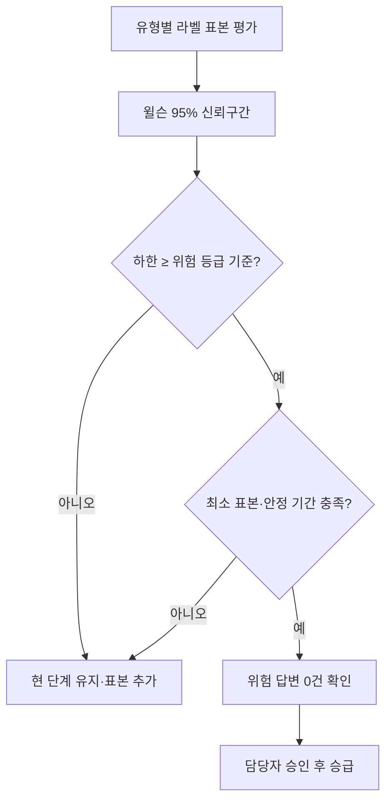

# 승급 조건 (문의 유형 자율 단계 올리기)

> AI가 처리하는 문의 유형을 **초안 보조 → 승인 후 발송 → 자동 응답**처럼 더 자율적인 단계로 올릴 때, 표본 수·정확도·안정 기간을 숫자로 미리 정해 두는 기준. 핵심은 "표본이 충분히 크고, 정확도의 **신뢰구간 하한**이 기준을 넘는가"다.

## 쉽게 말하면
수습 직원에게 혼자 전화를 받게 하려면 "연습 통화 몇 건에서 몇 번 틀렸나"를 본다. 5건 중 0번 틀렸다고 믿고 맡기면 위험하고, 300건 중 0번이라면 훨씬 믿을 만하다. 표본이 작으면 "틀린 적 없음"이 별 의미가 없다.

## 자세히
출처: Wikipedia "Rule of three (statistics)"와 "Binomial proportion confidence interval"(둘 다 본문 확인, 2026-11-18). 승급 기준값 자체(정확도 몇 %)는 조직이 위험에 따라 정하는 값이며 아래 예는 설명용이다.
- **0건 오류 규칙(3의 법칙)**: n건에서 오류가 한 번도 없으면 오류율의 95% 신뢰구간 상한이 약 3/n이다. 표본이 30건 넘을 때 정밀한 검정 결과를 잘 근사한다고 문서는 쓴다. 다른 신뢰수준의 분자는 약 3.51(97%), 4.61(99%), 5.3(99.5%).
- **윌슨 구간**: `[p̂ + z²/2n ± z·√(p̂(1−p̂)/n + z²/4n²)] / (1 + z²/n)`(z≈1.96이 95%). 단순 정규근사(Wald)는 p가 0이나 1에 가까울 때 폭이 0이 되고 경계가 [0,1]을 넘는 등 문제가 있어, 윌슨 구간이 정확하고 견고한 근사로 소개된다. 클로퍼–피어슨(정확) 구간은 보수적이다.
- **직접 계산한 값(윌슨 95%)**:

| 표본 | 오류 | 관측 정확도 | 신뢰구간 하한 |
|---|---|---|---|
| 100 | 0 | 100% | 96.3% (3의 법칙 오류율 상한 3%) |
| 100 | 2 | 98% | 93.0% |
| 300 | 0 | 100% | 98.7% (오류율 상한 1%) |
| 300 | 3 | 99% | 97.1% |
| 1,000 | 10 | 99% | 98.2% |

- **승급 기준 설계(제안)**: ①위험 등급별 **하한 정확도**(예: 읽기 전용 97%, 행동 문의는 99.5% 이상이거나 승급 불가) ②**최소 표본**(기준을 증명하려면 필요한 건수, 예: 오류 0건으로 오류율 1% 이하를 보이려면 약 300건) ③유형별 **안정 기간**(연속 N주 기준 유지) ④위험 답변 0건 ⑤담당자 승인.
- **함정**: 관측 정확도가 99%여도 표본 100건이면 하한이 약 95%대로 떨어질 수 있다. 라벨(정답) 품질, 표본이 실제 문의 분포를 대표하는지, 여러 유형을 동시에 검정할 때의 우연도 따로 본다.
- **강등과 짝**: 승급 기준만 있고 되돌리는 기준이 없으면 한쪽만 있는 문이다([강등 트리거](#intent-demotion-triggers)).

## 그림으로 보기


## 예시
```python
from math import sqrt
def wilson_lower(s, n, z=1.96):
    p, d = s / n, 1 + z*z/n
    c = (p + z*z/(2*n)) / d
    h = z * sqrt(p*(1-p)/n + z*z/(4*n*n)) / d
    return c - h
wilson_lower(297, 300)   # 약 0.971
```
교육 활용: 챗봇 도입 보고서의 "정확도 99%"에 표본 수가 있는지 묻고, 하한을 직접 계산해 보는 실습.

## 헷갈리는 것과 비교
| 개념 | 차이 |
|---|---|
| 승급 조건 | 자율 단계를 올리는 기준 |
| [강등 트리거](#intent-demotion-triggers) | 단계를 내리는 기준 |
| [단계 전환 기준](#rollout-gates) | 출시 범위 확대 기준, 유형 단위 승급과 층이 다름 |
| 신뢰구간 | 관측 정확도의 불확실성 범위 |

## 더 읽을거리
- [Wikipedia: Rule of three](https://en.wikipedia.org/wiki/Rule_of_three_(statistics)) — 0건 사건의 95% 상한 3/n
- [Wikipedia: Binomial proportion confidence interval](https://en.wikipedia.org/wiki/Binomial_proportion_confidence_interval) — 윌슨·클로퍼–피어슨·Wald 비교
