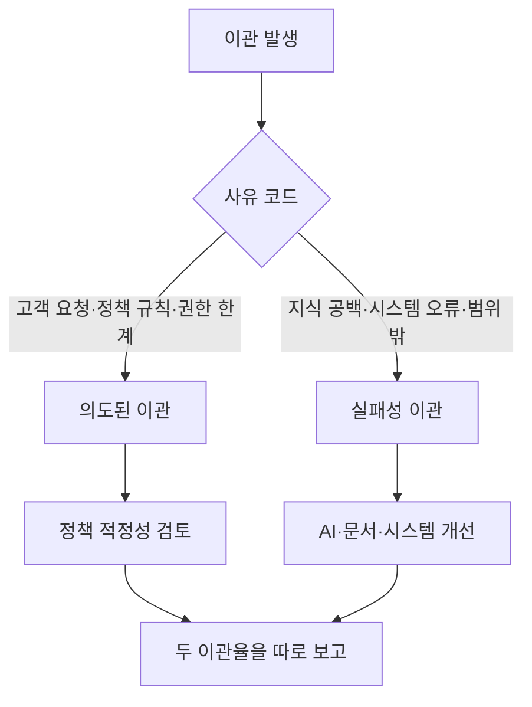

# 의도된 이관 vs 실패성 이관

> 사람에게 넘어간 건을 **처음부터 정책으로 사람이 맡기로 한 것(의도된 이관)**과 **AI나 시스템이 해내지 못해 넘어간 것(실패성 이관)**으로 나눠 따로 보고하는 방식. 둘을 합친 이관율은 줄여야 할 대상과 지켜야 할 대상을 섞어 버린다.

## 쉽게 말하면
병원에서 "수술은 반드시 전문의가 한다"는 규칙으로 넘어가는 환자와, 1차 진료 의사가 진단을 못 해 넘기는 환자는 다르다. 앞의 숫자를 줄이려 하면 안전이 깨지고, 뒤의 숫자는 줄이는 것이 목표다.

## 자세히
출처: Intercom Fin 이관 사유 속성 도움말(15개 값, 본문 확인)과 Robylon 이관 사유 계열 글(본문 확인, 벤더 자체 데이터), 2026-11-18. 아래 "의도/실패" 구분은 두 목록에 대한 **내 분류 제안**이며 출처가 직접 이 구분을 제시한 것은 아니다.
- **의도된 이관(정책·고객 선택)**: 고객이 사람을 요청("User requested", Robylon의 "고객 요청" 5.0%), 빠른 답장 버튼으로 "사람과 대화" 선택, 이관 규칙 적용("Escalation rule applied"), 워크스페이스 지침 적용, 맞춤 답변 이관, 음성 이관, 권한 한계(Robylon 19.1%: 환불 한도 초과 등 사람의 승인이 필요), 신원·확인(11.6%), 감정·위험(10.8%) 중 정책상 반드시 사람 처리해야 하는 부분.
- **실패성 이관(개선 대상)**: 범위 밖("Out of scope"), 맞춤 도구 오류, 코드 조건 오류, 시스템 오류, 사용량 한도 도달, 지식 공백(Robylon 28.4%), 모호성(9.7%), 확신 낮음·원인 불명(7.2%).
- **경계에 있는 것**: 고객이 불만을 표시해 이관("User is frustrated")은 정책이면서 AI의 응대 실패 신호일 수 있고, 지식 공백도 "문서화되지 않은 정책"이면 의도에 가까울 수 있다. 각 조직이 정의를 정해 기록한다.
- **보고 방식(제안)**: 이관율을 ①의도된 이관율 ②실패성 이관율로 나눠 추세를 본다. 실패성 이관율을 낮추는 것이 AI 개선 목표이고, 의도된 이관은 정책이 맞는지(너무 많거나 적은지)를 검토한다.
- **함정**: 의도된 이관을 줄이려고 사람 연결 버튼을 숨기면 안 된다. 이는 이관율을 낮추지만 고객 경험과 규정 준수를 해친다([에스컬레이션율 목표](#escalation-rate-target)의 "너무 낮을 때" 경고).
- **데이터 구조(제안)**: 이관 레코드에 `reason_code`, `triggered_by`(규칙·절차), `intent_class`(intentional/failure), `owner_team`을 두고 정의를 버전 관리한다. Intercom은 사유와 "이관 주체"를 분리 속성으로 둔다([이관 사유 분류](#escalation-reason-taxonomy)).
- **한계**: 분류 기준이 주관적이어서 팀 간 합의가 필요하다. 사유 기록이 부정확하면 구분도 흔들린다.

## 그림으로 보기

## 예시
| 이관 건 | 분류 | 담당 조치 |
|---|---|---|
| 환불 한도 초과로 상급자 승인 필요 | 의도(권한 한계) | 한도 정책 검토 |
| 문서에 없는 해외 결제 질문 | 실패(지식 공백) | 문서 작성 |
| 도구 호출 오류로 조회 실패 | 실패(시스템) | 엔지니어링 수정 |
교육 활용: 자사 이관 사유 코드 목록을 의도/실패로 나눠 보고 이견이 생기는 코드를 토론하는 실습.

## 헷갈리는 것과 비교
| 개념 | 차이 |
|---|---|
| 의도된 이관 | 정책으로 사람이 맡기로 한 건 |
| 실패성 이관 | AI·시스템이 못 해서 넘긴 건 |
| [업무별 이관율](#per-task-escalation-rate) | 업무 유형별로 쪼개 보기 |
| [이관 사유 분류](#escalation-reason-taxonomy) | 이관 이유 코드 체계 |

## 더 읽을거리
- [Intercom: Escalation reporting attributes](https://www.intercom.com/help/en/articles/16202960-escalation-reporting-metrics-attributes) — 이관 사유 15개와 이관 주체 속성
- [Robylon: AI escalation reason codes taxonomy](https://www.robylon.ai/blog/ai-escalation-reason-codes-taxonomy) — 사유 계열별 비중(벤더 자체 데이터)
