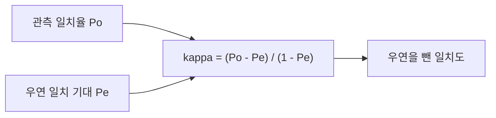
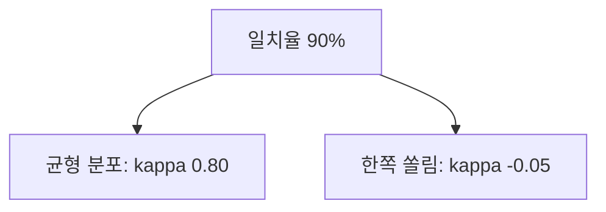

# 평가자 간 일치도

> 평가자 간 일치도(inter-annotator agreement)는 여러 주석자가 같은 샘플에 같은 라벨을 얼마나 일관되게 붙였는지 재는 통계다. 우연히 일치한 몫을 빼고 계산하는 카파(kappa) 계열이 대표적이다.

## 쉽게 말하면
두 사람이 동전 던지기로 "예/아니오"를 답해도 절반은 우연히 일치한다. 그래서 "90% 일치했다"만으로는 잘했다고 말할 수 없고, "우연히 맞을 몫을 뺀 뒤 얼마나 더 일치했나"를 본다.

## 자세히
- **카파(Wikipedia)**: 우연으로 기대되는 일치를 보정해 일치도를 잰다. Cohen's kappa는 평가자 2명, Fleiss' kappa는 정해진 수의 여러 명용이다. 원형은 범주를 순서 없는 값으로 취급해 순서 정보를 충분히 쓰지 못하고, 확장판이 이를 다룬다. 음수는 체계적 불일치를 뜻한다.
- **Krippendorff's alpha(Wikipedia)**: 평가자 수에 제한이 없고 명목·순서·구간·비율 척도에 모두 쓰며, 결측과 작은 표본을 보정한다. 라벨링에서 평가자가 샘플마다 다르게 배정되는 경우에 유리하다.
- **직접 계산한 예(2×2, 100개)**: 둘 다 예 45·둘 다 아니오 45·엇갈림 10일 때 단순 일치율 0.90, 우연 일치 기대 0.50, kappa = (0.90−0.50)/(1−0.50) = 0.80. 반면 둘 다 예 90·둘 다 아니오 0·엇갈림 10이면 일치율은 똑같이 0.90인데 우연 기대 0.905라서 kappa = −0.05가 된다. 한쪽 라벨이 압도적으로 많을 때(유병률이 한쪽에 치우칠 때) kappa가 낮게 나오는 한계를 보여 준다. Wikipedia도 base rate가 50% 근처일 때만 높은 값이 가능하다고 적는다.
- **기준 숫자는 주의(해석)**: 흔히 쓰는 Landis-Koch 구간은 어디까지나 경험칙이며 위 문서는 숫자를 제시하지 않는다. 용도(의료 vs 감성 분류)에 맞춰 합격선을 정한다.
- **쓰임(해석)**: 라벨 가이드를 고치기 전후의 일치도를 비교하고, 일치도가 낮으면 [모호한 샘플](#ambiguous-vs-wrong-label)이 많거나 가이드가 불명확하다고 본다. 개별 주석자는 [주석자 품질 통계](#annotator-quality-stats)로 본다.

## 그림으로 보기

## 예시
- 코드: `from sklearn.metrics import cohen_kappa_score; cohen_kappa_score(a, b)`
- 교육 활용: 표 두 개(균형/쏠림)로 일치율이 같아도 kappa가 달라지는 것을 계산해 보게 한다.

## 헷갈리는 것과 비교
| 개념 | 차이 |
| --- | --- |
| 단순 일치율 | 우연 일치를 포함 |
| Cohen's kappa | 2명, 우연 보정 |
| Fleiss' kappa | 정해진 N명 |
| Krippendorff's alpha | 결측·다양한 척도 가능 |
| [CROWDLAB](#crowdlab) | 일치도가 아니라 합의 라벨 추정 |

## 더 읽을거리
- [Inter-rater reliability (Wikipedia)](https://en.wikipedia.org/wiki/Inter-rater_reliability) — kappa 계열과 Krippendorff's alpha, 한계
- [cleanlab multiannotator 튜토리얼](https://docs.cleanlab.ai/stable/tutorials/multiannotator.html) — 주석자 합의 통계
