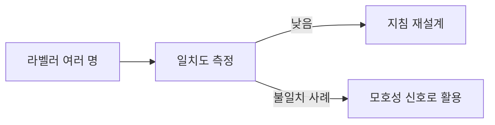

# 라벨러 간 신뢰도

> 여러 사람이 같은 데이터에 붙인 라벨이 **얼마나 일치하는지 통계로 재는** 점검이다. 일치도가 낮으면 지침이 모호하다는 신호일 수 있다.

## 쉽게 말하면
심사위원 다섯 명이 같은 그림에 점수를 매겼는데 제각각이면 "무엇을 좋은 그림으로 볼지" 기준이 불분명하다는 뜻이다.

## 자세히
(Google PAIR "Data Collection + Evaluation" 챕터를 직접 읽었다. 사용할 구체적 통계는 이 글이 확인한 출처에 지정되어 있지 않다.)
- **방법(PAIR)**: 라벨을 모은 뒤 **라벨러 간 일치도를 통계적 검정**으로 측정한다.
- **해석(PAIR)**: 낮은 신뢰도는 **지침이 잘못 설계됐다는 신호**일 수 있다.
- **불일치도 정보(PAIR)**: 의견 불일치를 유용한 신호로 보라. 사람의 해석이 갈리는 지점을 알려 주어 모델이 현실의 모호함에 더 대비하게 한다.
- **참고(일반지식, 이 글에서 미확인)**: Cohen's κ 등이 흔히 쓰인다. 앞서 읽은 튜터 평가 논문은 판정자-사람 일치도에 κ를 썼다([누출 LLM 판정자](#llm-judge-leakage)).

## 그림으로 보기

## 예시
- 고객 문의 분류 라벨링에서 "불만"과 "요청" 구분 일치도가 낮으면 두 범주의 정의와 예시를 다시 쓴다(제안).

## 헷갈리는 것과 비교
| 개념 | 차이 |
|---|---|
| 라벨러 간 신뢰도 | 사람끼리의 일치 |
| 판정자-사람 일치 | LLM 판정자와 사람의 일치 |
| [대표성 점검](#representativeness-check) | 라벨러 풀이 사용자와 닮았는지 |

## 더 읽을거리
- [Google PAIR — Data Collection + Evaluation](https://pair.withgoogle.com/chapter/data-collection/) — 직접 읽음.
