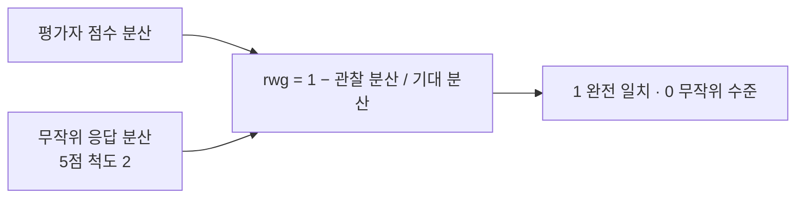
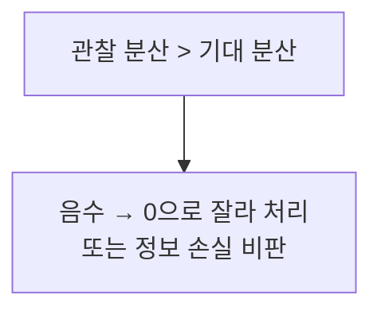

# 평가자 간 일치도 RWG

> 같은 대상을 여러 평가자가 척도(예: 1~5점)로 평가했을 때, 그 평가들이 "무작위로 고른 점수"보다 얼마나 더 모여 있는지를 나타내는 집단 내 일치 지표. rwg = 1 − (관찰된 집단 분산 ÷ 기대되는 무작위 분산)이다.

## 쉽게 말하면
심사위원 4명의 점수가 4, 4, 5, 4처럼 모여 있으면 일치도가 높고, 1, 5, 2, 4처럼 흩어져 있으면 아무 숫자나 찍은 것과 다를 바 없다. rwg는 "찍기 대비 얼마나 모였나"를 0~1로 나타낸다.

## 자세히
출처는 R 패키지 `multilevel`의 `rwg` 문서(rdrr.io, 열람)와 검색 결과 요약이다. 원 논문은 James, Demaree & Wolf(1984, Journal of Applied Psychology 69, 85–98)이며 이번에 직접 열지 않았다.
- **식**: rwg = 1 − (관찰된 집단 분산 / 기대되는 무작위 분산). 단일 문항 척도용.
- **기대 무작위 분산**: 기본값은 2이고, 5점 척도에서 균등(직사각형) 분포의 분산이다. 다른 보기 수 A에는 (A² − 1)/12를 쓴다. 다른 무작위 분포가 더 적합한 연구도 있다고 문서는 적는다.
- **해석**: 1이면 완전한 일치, 0이면 무작위 응답과 같은 정도의 일치(검색 결과 요약 기준). 관찰 분산이 기대 분산을 넘으면 문서의 구현은 이를 잘라(truncate) rwg = 0으로 처리한다. 검색 요약에는 범위를 벗어난 값을 표본 오차로 보고 0으로 재설정하라는 원 논문의 권고와, 이후 이를 정보 손실이라고 비판하는 견해가 함께 있었다.
- **0.70 같은 관습적 기준치**는 이번에 확인한 출처에 없으므로 인용하지 않는다.
- **PDQI-9 맥락**: PDQI-9 원 논문은 평가자 신뢰도로 ICC를 보고했고 rwg는 보고하지 않았다(앞 노드). rwg는 별도의 지표로 이 노드에서 개념만 정리한다([ICC](#icc-reliability)).

## 직접 계산한 가상 예시
한 노트를 평가자 4명이 5점 척도로 평가(표본 분산 사용, 기대 분산 2).

| 사례 | 점수 | 표본 분산 | rwg |
|---|---|---|---|
| 일치 | 4, 4, 5, 4 | 0.25 | 1 − 0.25/2 = 0.875 |
| 불일치 | 1, 5, 2, 4 | 3.333 | 1 − 3.333/2 = −0.667 → 0으로 잘라 처리 |

→ 일치한 사례는 0.875, 흩어진 사례는 문서의 구현 방식으로 0이 된다. 표본 분산이냐 모분산이냐에 따라 값이 달라질 수 있으니 계산 방식을 명시한다. 이 계산은 스크립트로 확인했다.

## 그림으로 보기

## 예시
- 임상 노트 한 건을 의사 4명이 1~5점으로 평가한 뒤 노트별 rwg를 구해 평가자 간 일치가 낮은 노트를 찾는다.
- 교육 실습: 위 두 사례의 분산과 rwg를 손으로 계산해 보고, 점수가 모일수록 rwg가 1에 가까워짐을 확인.

## 헷갈리는 것과 비교
| 개념 | 차이 |
|---|---|
| rwg | 한 집단(대상) 안의 점수 분산 기반 일치 |
| [ICC](#icc-reliability) | 대상 간 분산 대비 신뢰도 |
| [Krippendorff alpha](#krippendorff-alpha) | 결측·여러 척도에 쓰는 범용 일치도 |
| [Fleiss kappa](#fleiss-kappa) | 범주형 라벨 일치 |

## 더 읽을거리
- [R multilevel 패키지: rwg](https://rdrr.io/cran/multilevel/man/rwg.html) — 식과 기본 기대 분산(열람)
