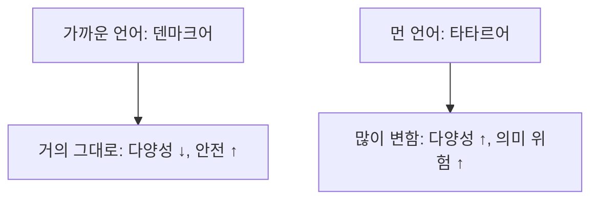

# 중간 언어 선택

> 역번역(영어→**다른 언어**→영어)에서 **가운데 거치는 언어(pivot)를 무엇으로 고르느냐**에 따라 바뀌는 정도가 달라진다. 가까운 언어는 원문과 거의 같게, 먼 언어는 더 많이 바뀌게 만들므로 "얼마나 변형하고 싶은가"가 선택 기준이다.

## 쉽게 말하면
같은 문장을 덴마크어로 갔다 오면 거의 그대로 돌아오고, 번역이 어려운 먼 언어로 갔다 오면 말이 많이 달라진다. 변형이 크면 다양한 문장을 얻지만 뜻이 비틀어질 위험도 커진다.

## 자세히
(Ciolino 외, "Back Translation Survey for Improving Text Augmentation", arXiv 2102.09708 PDF 본문을 직접 읽음. 모든 수치는 이 실험 설정의 값)
- 실험: Sentiment-140의 영어 트윗 **1,000개**를 Google Translate API로 **108개 언어**로 번역했다가 영어로 되돌리고, 원문과의 차이를 BLEU, BERT·BART·GPT·XLNet·GloVe·Doc2Vec 임베딩 거리, 감성 점수, 가독성 등 14개 지표로 비교했다.
- BERT 임베딩 거리(원문과 되돌린 문장 사이, 평균 ± 표준편차): 가장 가까운 언어는 **덴마크어 2.08 ± 1.67, 프리지아어 2.11, 이디시어 2.17**, 가장 먼 언어는 **타타르어 5.30 ± 1.86, 라틴어 4.91, 신드어 4.82**.
- 저자의 논의: 임베딩이 가장 멀리 움직이는 언어는 **번역 품질(BLEU)이 가장 나쁜 언어들과 겹친다.** 번역이 서툴수록 문장이 더 많이 바뀌어 "더 일반화 가능한 변형"을 만든다는 해석이다. 반면 덴마크어 왕복은 표현이 덜 달라져 일반화 효과가 작을 것이라 한다. 다만 이 논문은 임베딩 이동만 측정했고 **분류기 학습 성능은 확인하지 않았다**(저자가 다음 단계로 남김).
- 감성 점수는 대체로 같고 일부 이상치만 달랐다고 한다. 단어 사전 방식은 문맥 의미를 못 잡아 임베딩이 움직여도 점수가 안 변할 수 있다.
- 실무 선택 기준(제안): ① 먼 언어일수록 다양하지만 의미 보존 위험이 크다 ② 라벨 민감 과제(감성 반전 위험)는 가까운 언어나 여러 중간 언어를 섞어 쓴다 ③ 표본을 뽑아 라벨 보존을 점검한다([텍스트 증강 라벨 점검](#text-augmentation-label-check)) ④ UDA는 영어↔프랑스어(WMT'14)를 사용했다([UDA](#uda-consistency-training)). 최적 언어는 과제·데이터마다 달라 직접 시험해야 한다.

## 그림으로 보기

## 예시
- 감성 분류 데이터 증강: 프랑스어·독일어·스페인어 세 중간 언어로 역번역해 각 변형을 라벨 그대로 추가하고 표본 점검.
- 교육: "번역기가 못하는 언어일수록 다양한 변형이 나오지만 의미는 덜 믿을 수 있다."

## 헷갈리는 것과 비교
| 개념 | 차이 |
|---|---|
| 가까운 중간 언어 | 변형 작음 |
| 먼 중간 언어 | 변형 큼, 의미 보존 점검 필요 |
| [역번역](#back-translation) | 방법 전체 |
| [LLM 패러프레이즈](#llm-paraphrase-augmentation) | 번역 대신 모델에게 다시 쓰게 함 |

## 더 읽을거리
- [Back Translation Survey for Improving Text Augmentation (arXiv 2102.09708)](https://arxiv.org/abs/2102.09708) — 108개 언어 왕복 실험(PDF 본문 읽음).
