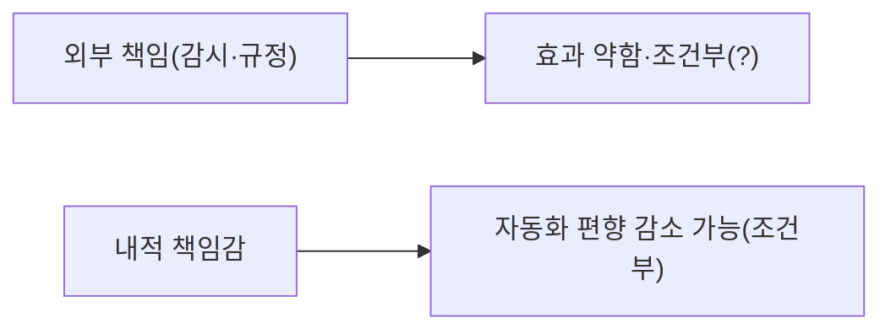
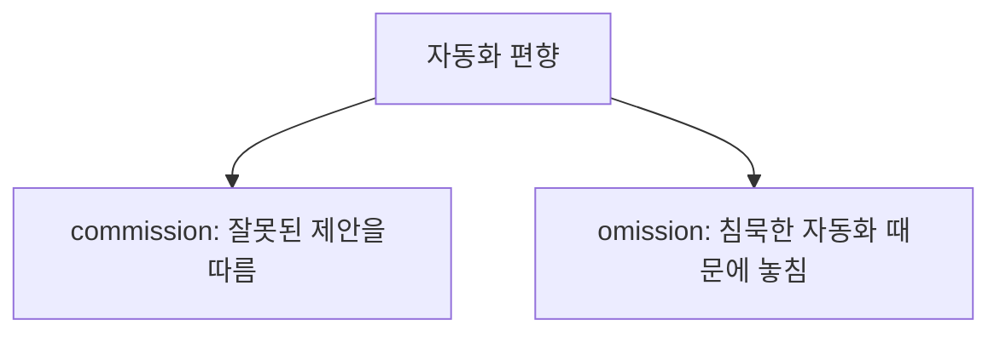

# 내적 책임감

> 자동화 편향(자동화 제안을 점검 없이 따르는 오류)을 줄이는 데 외부에서 책임을 지우는 것보다 사용자가 스스로 느끼는 책임감이 더 중요할 수 있다는 가설이다. 근거는 조건부이며 확인된 부분이 제한적이다.

## 쉽게 말하면
상사가 감시한다는 이유로 확인하는 사람보다 "내 판단이니 내가 책임진다"고 느끼는 사람이 AI 제안을 더 잘 검증할 수 있다는 이야기다.

## 자세히
(하위 에이전트가 초록·검색 스니펫·2차 리뷰로 확인한 노트 기준. 전문을 읽지 못해 아래는 모두 **미확인 또는 조건부**.)
- **인용 주의**: "Does automation bias decision-making?"(Skitka·Mosier·Burdick 1999, IJHCS 51(5):991–1006)은 자동화 편향 본 연구(비행 시뮬레이터 과제, 오류의 종류: 잘못된 자동 알림을 따르는 commission, 자동화가 침묵할 때 놓치는 omission). **책임감 실험은 동반 논문** "Accountability and automation bias"(2000, IJHCS 52:701–717)다.
- **보고 내용(2차 요약)**: PMC 리뷰는 책임감 연구를 학생 181명, omission·commission 오류 모두 P<.001로 인용하고, 책임감 조작이 **초보자에게는 약한 효과, 전문가에게는 효과 없음**이라고 적는다. 스니펫들은 충돌한다: 책임감 조작이 전반적으로 유의하지 않았고 **내면화된 책임감**을 가진 사람에게서 사후 분석상 효과가 나타났다는 요약, 전체 수행·결정 정확도에 책임을 지우면 자동화 편향이 낮았다는 요약.
- **교육 관련 단서(스니펫)**: 자동화 편향 훈련이 commission 오류는 줄였지만 omission 오류는 줄이지 못했다는 보고(미확인).
- **정리(제안)**: "책임을 지우면 편향이 줄어든다"는 중간 강도의 조건부 주장으로 읽고, 사내 도입에서는 검수자에게 최종 책임·이유 기록을 요구하는 설계를 시험해 효과를 직접 측정한다.

## 그림으로 보기

## 예시
- 검수 화면에서 승인 사유를 한 줄 쓰게 하고 승인율·오류 포착률 변화를 측정.
- 교육 활용: 책임감 설계가 AI 협업 품질에 미치는 영향을 토론(근거가 제한적임을 함께 알림).

## 헷갈리는 것과 비교
| 개념 | 차이 |
|---|---|
| 내적 책임감 | 스스로 느끼는 책임 |
| 외적 책임 | 감시·평가로 부과 |
| [AI 과신](#overreliance-on-ai) | 틀린 제안을 수용하는 결과 |

## 더 읽을거리
- [Does automation bias decision-making? (DOI)](https://doi.org/10.1006/ijhc.1999.0252) — 자동화 편향 본 연구(전문 미확인).
- [Accountability and automation bias (DOI)](https://doi.org/10.1006/ijhc.1999.0349) — 책임감 연구(전문 미확인).
