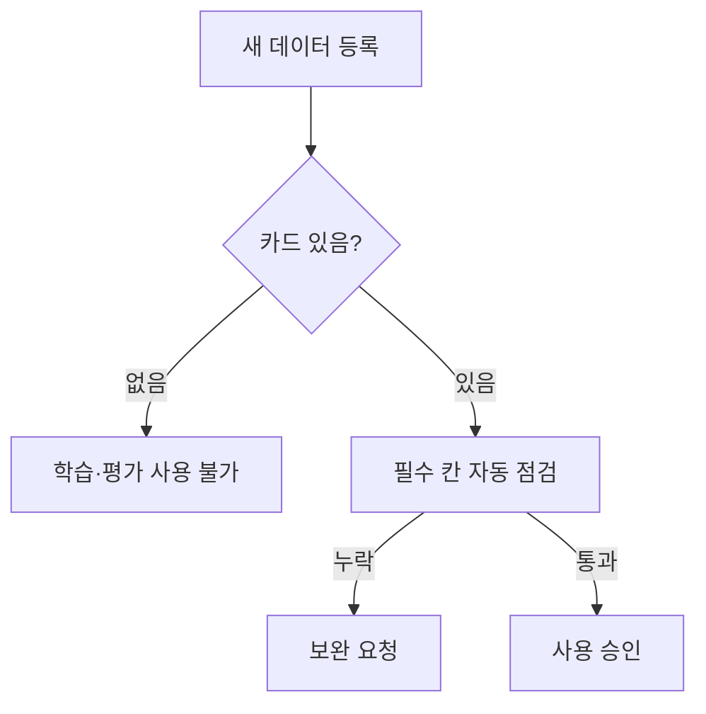
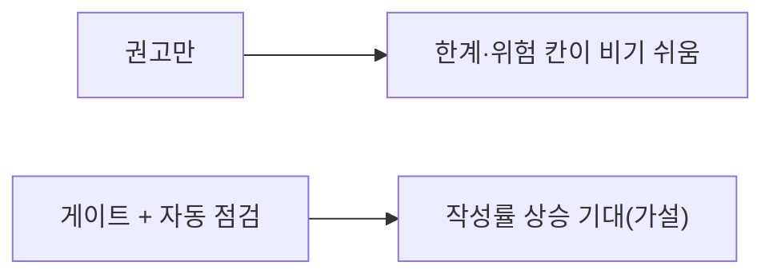

# 데이터 카드 도입 규칙

> 데이터 카드를 사내에서 실제로 쓰이게 만드는 **운영 규칙**이다. 카드를 만들자는 권고만으로는 비는 칸이 많아지므로, "카드 없는 데이터는 학습에 쓰지 않는다" 같은 게이트와 담당·갱신 규칙을 함께 정한다.

## 쉽게 말하면
식품 성분표를 "붙이면 좋다"고만 하면 빈 포장이 나온다. "성분표가 없으면 진열 불가"라고 정하고 누가 검사하는지 정해야 모두 붙인다. 데이터 카드도 같다.

## 자세히
- **공개 허브의 실태(Yang·Liang·Zou, arXiv 2401.13822, ICLR 2024, 초록 직접 확인 + 검색 요약)**: Hugging Face의 데이터셋 카드 7,433건을 분석했고, 작성률이 인기와 상관이 있으며 가장 많이 채워진 칸은 Dataset Description과 Dataset Structure, **가장 적게 채워진 칸은 Considerations for Using the Data**(데이터 사용 시 고려사항)였다고 초록이 말한다. 검색 요약에 인용된 수치(24,065개 저장소 중 비어 있지 않은 카드 7,433건 30.9%, 비어 있지 않은 카드가 전체 다운로드의 95.0%, 인기 상위 100개 중 86.0%가 권장 항목을 모두 작성 등)는 논문 본문이 아닌 요약에서 본 것이라 확인이 필요하다.
- **교훈(해석)**: ① 카드를 권고만 하면 사용 한계·위험 칸처럼 **가장 필요한 칸이 비기 쉽다** ② 인기 있는(많이 쓰이는) 데이터일수록 카드를 채우는 경향이 있으나 인과는 알 수 없다.
- **사내 도입 규칙 예(제안)**
  1. **게이트**: 카드가 없는 데이터는 학습·평가에 쓰지 않는다(사용 신청 때 확인).
  2. **필수 칸**: 출처, 허용·금지 용도([데이터 허용 용도 정책](#allowed-use-policy-data)), 한계·위험, 보관·삭제 기한, 담당자.
  3. **담당과 갱신**: 오너/스튜어드가 카드를 갱신하고 데이터 변경 시 버전을 올린다([데이터 오너와 스튜어드](#data-owner-steward)).
  4. **검수**: 빈 칸 자동 점검(예: 필수 칸 누락 시 CI 실패)과 분기별 샘플 감사.
  5. **템플릿 통일**: Hugging Face 템플릿의 Uses/Out-of-Scope/Bias·Risks·Limitations/Recommendations 구조를 사내용으로 줄여 사용([HF 템플릿](https://raw.githubusercontent.com/huggingface/huggingface_hub/main/src/huggingface_hub/templates/datasetcard_template.md), 직접 확인).
- **한계**: 규칙이 무거우면 우회·형식적 작성이 늘 수 있으므로 필수 칸을 최소로 시작하고 효과를 보며 늘린다(해석).

## 그림으로 보기

## 예시
- 사내 데이터 카탈로그에 카드 링크가 없으면 "학습 데이터로 신청" 버튼이 비활성화되도록 설정.
- 교육 소재: 공개 데이터셋 카드 3개를 열어 비어 있는 칸을 찾고, 왜 비어 있는지 토론하는 활동.

## 헷갈리는 것과 비교
| 개념 | 차이 |
|---|---|
| [사내 데이터 카드](#internal-data-card) | 카드 내용 |
| 도입 규칙 | 카드를 쓰게 만드는 운영 장치 |
| [허용 용도 정책](#allowed-use-policy-data) | 카드 속 용도 규칙 |
| [시스템 카드](#system-cards) | 시스템 수준 문서 |

## 더 읽을거리
- [Navigating Dataset Documentations in AI (arXiv 2401.13822)](https://arxiv.org/abs/2401.13822) — Hugging Face 카드 실태(초록 직접 확인).
- [HF Dataset Cards 문서](https://huggingface.co/docs/hub/datasets-cards) — 카드 개요(직접 확인).
