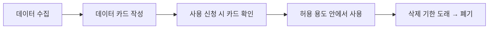
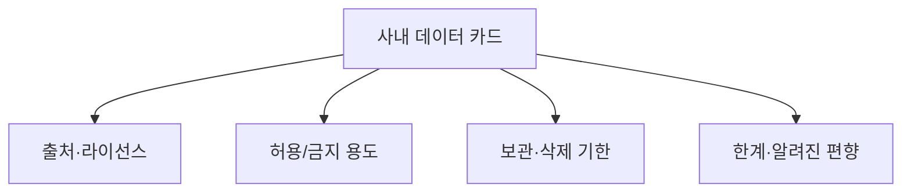

# 사내 데이터 카드

> 사내에서 AI에 쓰는 데이터 세트마다 출처·허용 용도·금지 용도·보관·삭제 기한·담당자를 한 장에 적어 붙여 두는 문서다. 외부 연구의 "Datasheets for Datasets" 아이디어를 사내 운영용으로 줄인 형태다(제안).

## 쉽게 말하면
식품 포장 뒷면의 성분표·유통기한·알레르기 표시와 같다. 데이터를 쓰는 사람이 "이게 어디서 왔고, 어디에 써도 되고, 언제까지 쓸 수 있는지"를 열어 보지 않고도 알게 한다.

## 자세히
- **원형**: Gebru 등 7인의 「Datasheets for Datasets」(arXiv 2018.3 첫 게재, CACM 2021.12 출판). 전자 부품 데이터시트처럼 데이터 세트마다 동봉하자는 제안이며, 동기·구성·수집 과정·권장 용도 등을 문서화한다(논문 초록 확인). 2차 자료에 따르면 템플릿은 동기, 구성, 수집 과정, 전처리·정제·라벨링, 용도, 배포, 유지 관리의 7개 절이다.
- **사내용으로 줄이면(제안)** 한 장에 들어갈 항목:
  1. 이름·버전·담당자(오너)
  2. 출처와 수집 방법, 수집 날짜 ([데이터 출처 추적](#data-licensing-provenance) 연결)
  3. 포함된 개인정보·민감정보 여부
  4. **허용 용도**와 **금지 용도**(예: 내부 검색 개선 O, 외부 모델 학습 X)
  5. 라이선스·계약 조건
  6. 보관 위치, 삭제 기한, 갱신 주기
  7. 알려진 한계(편향, 빠진 집단, 라벨 오류율)
- 카드는 데이터와 같은 폴더·카탈로그에 두고, 데이터가 바뀌면 같이 갱신한다. 카드 없는 데이터는 학습에 못 쓴다는 규칙이 가장 효과적이다(제안).

## 그림으로 보기

## 예시
- 고객센터 통화 녹취 데이터 카드: 출처=콜센터 2025년 녹취, 개인정보 있음(마스킹 완료), 허용=상담 품질 분석, 금지=외부 업체 학습, 삭제=수집 후 3년.
- 교육 활용: 수강생에게 자사 데이터 하나를 골라 카드를 쓰게 하면 "데이터에 맥락이 있다"는 점을 체감시키기 좋다.

## 헷갈리는 것과 비교
| 개념 | 차이 |
|---|---|
| 데이터 카드 | 데이터 세트 1개의 문서 |
| 모델 카드 | 모델의 성능·한계 문서 |
| [데이터 출처·라이선스](#data-licensing-provenance) | 출처 확인 활동. 카드가 그 결과를 담는 그릇 |

## 더 읽을거리
- [Datasheets for Datasets (arXiv 1803.09010)](https://arxiv.org/abs/1803.09010) — 원 논문 초록(열어 확인).
- [Hugging Face 논문 페이지](https://huggingface.co/papers/1803.09010.md) — 검색 결과로 확인, 직접 열지는 않음.
